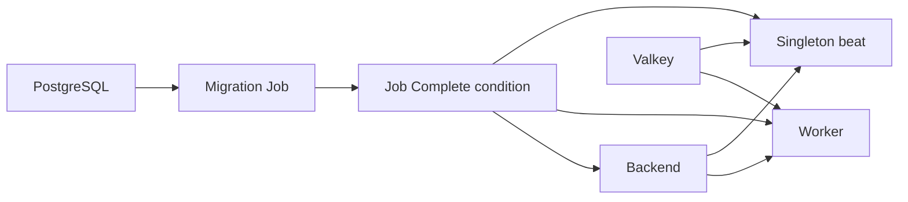

# camply-web Helm chart

This chart deploys the distributed application using one `camply-web` image for
Nginx, Gunicorn, Celery worker, beat, and migrations. It includes optional single
instance PostgreSQL 17, Valkey, and Prometheus services. Kubernetes 1.26+ and Helm
3 or 4 are supported. Gateway API resources additionally require the v1 CRDs and
a compatible controller; Ingress needs an installed ingress controller.

## Install

Create the namespace and provision a Secret named `camply-db` with a
`POSTGRES_PASSWORD` key using your secret manager. No credentials are generated
or stored in chart defaults. To use another Secret, set `database.existingSecret`
and optionally `database.passwordKey`.

Copy one of the examples into your own values file, replacing the example
domain, secret references, and storage class. Stable releases publish the chart
to `oci://ghcr.io/juftin/charts/camply-web`; chart version `1.2.3` selects the
matching `ghcr.io/juftin/camply-web:v1.2.3` image by default. After publication,
install a specific release with:

```sh
helm upgrade --install camply oci://ghcr.io/juftin/charts/camply-web \
  --version 1.2.3 --namespace camply --create-namespace \
  -f my-values.yaml --wait --wait-for-jobs --timeout 15m
```

For a source checkout, choose a published image tag or digest explicitly:

```sh
helm upgrade --install camply ./deploy/helm \
  --namespace camply --create-namespace \
  --set image.tag=v1.2.3 \
  -f my-values.yaml --wait --wait-for-jobs --timeout 15m
```

Without a route, use `kubectl -n camply port-forward svc/camply-camply-frontend
8080:8080` and browse `http://localhost:8080`. Set `fullnameOverride: camply` to
use names such as `camply-frontend` instead of `camply-camply-frontend`.
The chart is named `camply-web`; `nameOverride: camply` preserves the original
resource names and selectors. `image.tag` overrides the packaged appVersion,
and `image.digest` takes precedence over either tag.

Authentication defaults to the application's `none` mode (shared admin).
For password sessions, use the secret references in
[examples/home-ops.yaml](examples/home-ops.yaml). For Auth0, set
`CAMPLY_AUTH_MODE`, `CAMPLY_AUTH0_DOMAIN`, `CAMPLY_AUTH0_AUDIENCE`, and
`CAMPLY_AUTH0_CLIENT_ID` through `env` or `backend.env`. Set `CAMPLY_APP_URL` to
the public origin for notification links, and `CAMPLY_CORS_ORIGINS` to a JSON
array of trusted origins for login and CSRF. HTTPS cookies are enabled by
default; local HTTP password sessions require `CAMPLY_SESSION_COOKIE_SECURE=false`.

## Migration ordering and upgrades

A regular Job runs `python -m camply.db.migration` after waiting for PostgreSQL.
Every new backend, worker, and beat pod has an init container that reads that
specific Job and waits for its `Complete=True` condition. A failed Job or timed
out wait stops startup. Worker and beat additionally wait for the broker's TCP
listener and the API's post-migration health endpoint. The API launcher's own
migrations are disabled to prevent concurrent migration runs across replicas.



The Job is part of the normal release, so a new bundled database can start on
first install. There are no pre-install hooks or Argo CD sync waves. Do not
place the workloads in an earlier sync wave than the Job or database. The Job
name hashes values, chart version, and Helm release revision; the pod template
references that name so upgrades rerun the gate. Argo CD's deterministic
rendering reruns migrations when the image/configuration/chart version changes.
When reusing a mutable image tag, explicitly bump `migrations.revision` on every
new build. Pin versions/digests for reproducible upgrades and rollbacks.

The Job is retained for the lifetime of this release revision, allowing scaled
or restarted pods to pass the same barrier. Do not configure a Job TTL or delete
the completed Job. On a failed migration, inspect `kubectl logs job/JOB_NAME`,
correct the problem, and bump `migrations.revision` to create a new Job. The Job
has a 600-second deadline and three retries by default; waiting init containers
allow 900 seconds. Helm should have a longer timeout.

A dedicated namespaced Role permits only `get` on the current migration Job.
Only waiting init containers mount a projected service-account token and CA;
application containers, migration processes, and infrastructure have automatic
token mounting disabled. Any network policies must permit those init containers
to reach the Kubernetes API as well as application dependencies.

Existing running API/worker processes may continue during a rolling upgrade.
Use backwards compatible migrations; the chart does not stop the previous
release, downgrade the database on rollback, or coordinate multiple releases
sharing a database. Beat uses one replica and `Recreate` to avoid overlapping
schedulers. Its default `--sync-providers` argument queues an initial catalog
sync; replace `beat.args` with `[camply, serve, beat]` to omit it.

## Ingress and gateways

| Configuration                           | Controller support                                                       | Example                                   |
| --------------------------------------- | ------------------------------------------------------------------------ | ----------------------------------------- |
| `ingress.enabled`                       | Any `networking.k8s.io/v1` controller, selected with `ingress.className` | [Ingress with TLS](examples/ingress.yaml) |
| `route.enabled` with `route.parentRefs` | Existing Gateway API Gateways, including Envoy, Cilium, and Traefik      | [Home-ops Envoy](examples/home-ops.yaml)  |
| `gateway.enabled` and `route.enabled`   | Create a Gateway using `gateway.className` and `gateway.listeners`       | [Gateway with TLS](examples/gateway.yaml) |

Ingress sends `/` to the frontend, whose bundled Nginx proxies `/api` to the
release's backend. This also supports controllers such as Tailscale that only
accept a root path: set `ingress.className: tailscale`, appropriate controller
annotations, and the hostname/TLS settings required by that controller.
HTTPRoute sends `/api` directly to the backend and `/` to the frontend. Neither
routing method publishes `/metrics` from the backend or exposes backing services.

Use `ingress.annotations`, `route.annotations`, and `gateway.annotations` for
external-dns, cert-manager, and controller options. `ingress.tls` references
existing TLS Secrets. Gateway listeners accept native Gateway API TLS and
`allowedRoutes` configuration. Cross-namespace parent Gateways must allow routes
from the Camply namespace. Supply `route.filters` for standard HTTPRoute filters;
controller-specific auth policies can be supplied via `extraObjects` or managed
separately. This chart does not install ingress controllers, certificate issuers,
Gateways selected through parentRefs, or their CRDs.

## Persistent storage and external services

PostgreSQL (10Gi), Valkey (2Gi), and Prometheus (5Gi) each have independent
`COMPONENT.persistence` settings:

| Setting                              | Behavior                                                                      |
| ------------------------------------ | ----------------------------------------------------------------------------- |
| `enabled: true`                      | Create a PVC, or mount `existingClaim`                                        |
| `existingClaim: claim-name`          | Mount a same-namespace PVC without creating or managing it                    |
| `storageClass: null`                 | Omit the class and use the cluster default                                    |
| `storageClass: fast`                 | Select a named storage class (including local-path, NFS, or CSI provisioners) |
| `storageClass: "-"`                  | Explicit empty class for statically provisioned storage                       |
| `accessModes`, `size`, `annotations` | Configure access modes, requested capacity, and PVC metadata                  |
| `retain: true`                       | Add Helm's keep annotation to chart-created PVCs on uninstall                 |
| `enabled: false`                     | Use disposable `emptyDir` storage                                             |

Infrastructure uses one replica and `Recreate` so ReadWriteOnce volumes do not
require simultaneous attachment during an upgrade. Provisioners supporting
`WaitForFirstConsumer` can bind after pods are scheduled. `nodeSelector`,
`affinity`, and `tolerations` apply to all workloads, including migrations.
Filesystem permissions must permit the configured pod user/group to write;
`fsGroup` defaults are provided per component. PVC size expansion depends on the
storage class, and storage classes/access modes generally cannot be changed in
place. Retention is a Helm policy; configure GitOps pruning and storage-provider
reclaim policies separately. Existing retained PVCs may require adoption or
`existingClaim` when reinstalling. Back up PostgreSQL independently of PVC
retention; the chart supplies neither replication nor database backups.

Disable bundled services and set their connection settings using
[examples/external-services.yaml](examples/external-services.yaml).
`database.host`, `port`, `username`, `name`, and the password Secret apply to the
migration Job and all database consumers. External Valkey accepts `valkey.url`
or a Secret reference containing the complete `redis://` or `rediss://` URL.
`prometheus.externalUrl` provides the API's trend query endpoint when bundled
Prometheus is disabled. An empty external URL leaves trends unavailable.

## Runtime configuration and monitoring

Global `env` values are merged with each role's `env`; entries can be scalar
values or native Kubernetes `valueFrom` objects. `envFrom` lists are concatenated
with per-role lists. The migration Job uses the backend's environment and secret
sources, so database TLS settings and credentials match the API. Chart-owned
variables for database/broker connections, metrics paths/ports, runtime mode,
backend proxy target, and `SKIP_MIGRATIONS` take precedence over `env`/`envFrom`.
Configure these through the corresponding chart settings.

Set worker notification credentials (`PUSHOVER_APP_TOKEN`), provider credentials,
Sentry configuration, or polling intervals using these environment settings.
Use `annotations` (global or per component) for optional reloader integration,
and `podAnnotations` for pod metadata. `extraObjects` accepts native Kubernetes
objects such as ExternalSecrets and Envoy SecurityPolicies and emits them
literally, preserving external-secrets template syntax. Secret managers and
reloader must already be installed; the chart never reads secret contents.

Each role has startup, readiness, and liveness probes using the application's
health endpoints/CLI. Frontend shutdown sends Nginx `SIGQUIT`; all roles receive
a 60-second termination grace period. API/worker Prometheus multiprocess data
lives in per-pod `/tmp` emptyDir storage. Optional Prometheus retains 30 days of
metrics and discovers individual API/worker replicas through headless Services;
no Kubernetes discovery RBAC is needed. An external Prometheus can scrape the
same `FULLNAME-backend-metrics` and `FULLNAME-worker-metrics` Services. Backend
and worker replicas, resources, container security context, and per-component
pod security contexts are configurable. Beat and backing services remain single
instances.

## Moving from home-ops

[examples/home-ops.yaml](examples/home-ops.yaml) preserves session auth secret
references, node-local PVC sizing, reloader annotations, Envoy parentRefs,
Prometheus, initial provider sync, and the seven application components from
[the custom deployment](https://github.com/juftin/home-ops/blob/main/kubernetes/apps/default/camply/app/values.yaml).
Continue managing the `camply-home-ops` ExternalSecret in home-ops or supply it
via `extraObjects`; this chart consumes the resulting Secret.

Before moving an existing installation, stop its old controllers so two
PostgreSQL/beat processes cannot use the same data/schedule. Confirm actual PVC
names with Kubernetes and set `postgresql.persistence.existingClaim`,
`valkey.persistence.existingClaim`, and `prometheus.persistence.existingClaim` to
those names. The chart's database service is `FULLNAME-postgresql`, and all
internal connections are generated accordingly. Merely setting
`fullnameOverride: camply` does not adopt app-template's existing PVCs or rename
its database controller. Keep the PostgreSQL major version compatible with the
existing data. The new migration gate replaces reliance on Argo CD sync waves.

## Verify and package

```sh
task helm:test       # strict lint, rendered-manifest matrix, and gate behavior
task helm:smoke      # disposable kind cluster: install, upgrade, and migration failure
task helm:package    # dist/camply-web-0.1.0.tgz
```

The smoke test requires Docker, kind, and kubectl. It builds the application from
this checkout, loads that image into a test-owned cluster, disables registry pulls
for the application, and uses synthetic credentials with initial provider sync
disabled. It verifies migration ordering, `helm test`, a successful upgrade with
preserved PostgreSQL data, and failed-migration startup blocking. Set
`CAMPLY_HELM_TEST_IMAGE=repository:tag` to reuse an already built local image.
The test deletes its own cluster and any application image it built; diagnostic
resources/logs remain under `tmp/camply-helm-*`. It never prunes other Docker data.

Plan for at least 10 GB of free space in both Docker's filesystem and the host
before running the smoke test. `docker system df` shows image, volume, and build-cache
usage. A full Docker filesystem can fail the frontend install during the image
build (including exit code 135), or prevent kind from pulling its node image with
`no space left on device`. Free space using your Docker runtime's storage tools,
then rerun the task. Unused build cache can be recreated; review any cleanup
before removing images or volumes containing other projects' data.

CI runs the lifecycle smoke after loading the existing Docker build, using the
PR's image rather than a published image. Standard chart checks run against Helm
3 and 4 and need no cluster or credentials.

Stable release publication runs `task helm:publish RELEASE_VERSION=1.2.3` in the
existing publisher after the exact release tag's container image is available.
The task packages chart version `1.2.3` with appVersion `v1.2.3` and pushes it to
GHCR without modifying source metadata. It requires `CI=true`, a stable semantic
version, and an authenticated Helm registry session. Main builds that only update
the image's `latest` tag do not publish charts. Helm OCI charts use semantic
version tags rather than moving `latest` or major aliases. See
[release operations](../../docs/operations/RELEASES.md#helm-chart) for permissions
and recovery. Publication tests package the real chart and record the push without
contacting a registry.

## Configuration validation and probes

`values.schema.json` checks values during Helm lint, rendering, install, and
upgrade. Unknown chart settings, invalid replica counts/ports/access modes, and
incomplete external-service or routing choices fail before installation. Native
Kubernetes extension objects, environment variable names, and metadata keys remain
open. The schema ships inside the OCI chart; it has no remote schema references.

Each application role supports `probes.startup`, `probes.liveness`, and
`probes.readiness`. Supply native Kubernetes Probe fields to override the defaults,
or `false` to disable that probe. A supplied `exec`, `httpGet`, `tcpSocket`, or
`grpc` handler replaces the default handler while retaining other default timings.

```yaml
backend:
  probes:
    startup:
      failureThreshold: 90
    readiness:
      timeoutSeconds: 4
worker:
  probes:
    liveness:
      periodSeconds: 60
```

API liveness uses `/api/ping`, which is independent of dependencies. API readiness
and startup use `/api/health`, which runs a database query with a two-second budget
and returns HTTP 503 when unavailable. Standalone also checks its supervised local
loops. Keeping these checks separate avoids restarting the API during a temporary
database outage. Worker and beat retain their role-specific CLI health probes.

## Existing Prometheus Operator installations

Enable `serviceMonitor.enabled` to create one ServiceMonitor for the headless API
and worker metrics Services. The existing Operator must already supply the
`monitoring.coreos.com/v1` ServiceMonitor CRD and select the monitor's labels and
namespace. The chart does not install CRDs or a monitoring controller.

```yaml
prometheus:
  enabled: false
  externalUrl: http://prometheus.monitoring.svc:9090
serviceMonitor:
  enabled: true
  labels:
    release: monitoring
  interval: 30s
  scrapeTimeout: 10s
```

Match `labels.release` to your Prometheus installation's selectors; that label is
an example rather than a universal convention. Set `prometheus.externalUrl` so
Camply can query its existing historical trends. The monitor scrapes individual
pod endpoints using the Services' `metrics` port and omits workers when disabled.

## Installation checks and troubleshooting

Helm prints access, authentication, and migration troubleshooting instructions
from `NOTES.txt`. They contain Secret references and settings guidance, never
secret contents. After installation or upgrade, run:

```sh
helm test camply -n camply --logs
```

The test Pod checks backend readiness and, when enabled, the frontend's `/api`
proxy. It uses the same application image without a service-account token or
application credentials, performs no writes, and is removed after success.
Failed test Pods remain available for logs. Set `tests.enabled=false` to omit
this hook when managing connection checks separately. API readiness verifies the
database connection; the test does not claim to verify provider access or successful
background task processing.
