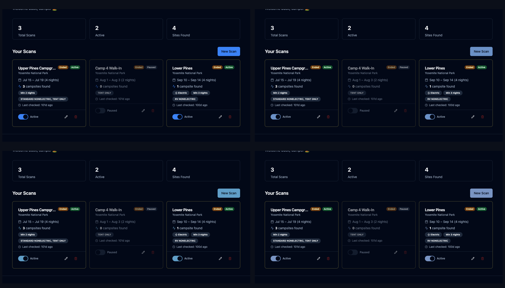
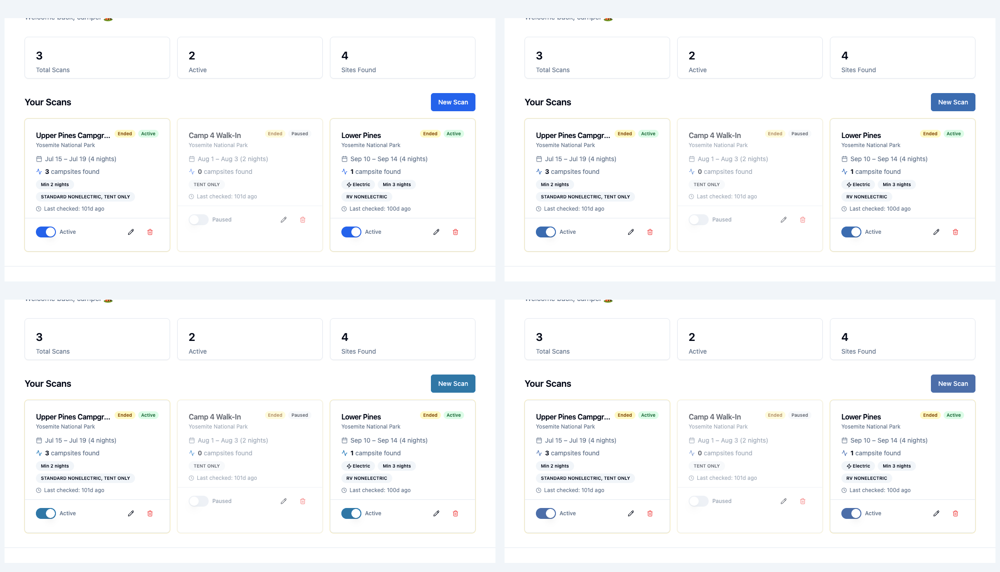

# 🎨 Camply Theme & Palette Dashboard

Visual inspection guide, color science rationale, and before-and-after comparison dashboard for the website theme.

---

## 🕹️ Interactive Color Palette Studio (Live in Browser)

An interactive palette tool has been added to the application so reviewers can experiment live in the browser:
* **Dedicated Palette Studio**: Visit [`/palette`](https://adoring-bedbug.camply-81r.pages.dev/palette) or `/dev/palette`
* **Design System Catalog**: Visit [`/dev/preview`](https://adoring-bedbug.camply-81r.pages.dev/dev/preview) (embedded directly at the top of the catalog)
* **Floating Tool Option**: Toggle *"Show floating tool across all pages"* inside the studio to bring a floating palette trigger across the entire app (`/`, `/dashboard`, `/search`, etc.)

### Studio Capabilities:
1. **One-Click Presets**: Steel/Slate Blue, Alpine Lake Blue, Nordic Dusk, Deep Denim, Evergreen Pine, Campfire Amber, and Legacy Neon.
2. **Interactive Controls**:
   * Visual point-and-click color picker (`<input type="color">`).
   * Rainbow Hue Slider (0° – 360°).
   * Saturation Slider (0% – 100%) with dark-mode optical glare warnings.
   * Lightness Slider (15% – 85%).
   * Auto-tune dark mode glare toggle.
3. **Live WCAG Contrast Analysis**: Real-time evaluation of button text readability against WCAG AA standards.
4. **Instant CSS Export**: "Copy CSS" button copies the ready-to-use `:root` and `.dark` snippet to clipboard.
5. **Session Persistence**: Color choices immediately update all UI elements in real time and persist across pages via `localStorage`, with a "Reset" button to revert anytime.

---

## ⚡️ The Issue: Why the Previous Blue Looked "Glow-in-the-Dark"

The original Shadcn default palette used pure Tailwind Blue:
- **Light mode**: `hsl(221.2 83.2% 53.3%)` (`#2563eb`, Tailwind `blue-600`)
- **Dark mode**: `hsl(217.2 91.2% 59.8%)` (`#3b82f6`, Tailwind `blue-500`)
- **Dark mode ring**: `hsl(224.3 76.3% 94.1%)` (94% brightness focus flash)

### Root Causes
1. **Saturation Overdrive (83% – 91%)**: At 91.2% saturation against an almost black background (`#020817`), blue wavelengths induce *chromostereopsis*. The human eye focuses blue wavelengths differently from dark backgrounds, creating an optical halo or vibrating "glow-in-the-dark" sensation.
2. **Foreground Inversion in Dark Mode**: Dark mode used `--primary-foreground: 222.2 84% 4.9%` (dark text on a bright 60% lightness cyan-blue button). The button visually behaved like an illuminated fluorescent sign.

---

## 📊 Component & Interactive Elements Matrix

Below is a side-by-side comparison of buttons, active badges, and switches across all candidate palettes:


---

## 🌓 Dark Mode Side-by-Side Comparison

Section crop of the top interactive dashboard area (Stats, **+ New Scan** primary button, and Scan Cards):



*Top-Left: Current Neon Blue (High Glare) | Top-Right: Option 1: Steel Slate Blue (Applied)*  
*Bottom-Left: Option 2: Alpine Lake Blue | Bottom-Right: Option 3: Nordic Dusk Blue*

---

## ☀️ Light Mode Side-by-Side Comparison

Section crop of the dashboard in light mode:



---

## 📐 Candidate Palette Specifications

All candidate options satisfy **WCAG AA contrast (≥ 4.5:1)** for text legibility:

| Option | Character & Style | Light Mode HSL / Hex | Dark Mode HSL / Hex | Saturation | Contrast (Light / Dark) |
| :--- | :--- | :--- | :--- | :---: | :---: |
| **Current (Previous)** | Neon Blue (High Glare) | `221.2 83.2% 53.3%`<br>`#2563eb` | `217.2 91.2% 59.8%`<br>`#3b82f6` | 83% / 91% | 5.17:1 / 5.44:1 |
| **Option 1: Steel / Slate** *(Applied)* | Modern, calm, balanced (Linear/GitHub style) | `215 50% 46%`<br>`#3b6cb0` | `215 45% 60%`<br>`#6b91c7` | 50% / 45% | 5.31:1 / 6.19:1 |
| **Option 2: Alpine Lake** | Glacial mountain lake (Campsite-inspired) | `204 55% 42%`<br>`#3077a6` | `204 48% 58%`<br>`#609ec7` | 55% / 48% | 4.87:1 / 6.87:1 |
| **Option 3: Nordic Dusk** | Ultra-low glare twilight blue | `218 38% 48%`<br>`#4c6ea9` | `218 38% 62%`<br>`#7994c3` | 38% / 38% | 5.11:1 / 6.51:1 |
| **Option 4: Deep Denim Navy** | Classic structured nautical navy | `224 46% 45%`<br>`#3e5aa8` | `222 42% 62%`<br>`#758ec7` | 46% / 42% | 6.50:1 / 6.14:1 |

---

## 🛠️ Applied Configuration

Updated in [`frontend/src/index.css`](../frontend/src/index.css):

```css
@layer base {
  :root {
    --primary: 215 50% 46%;
    --primary-foreground: 210 40% 98%;
    --ring: 215 50% 46%;
  }

  .dark {
    --primary: 215 45% 60%;
    --primary-foreground: 222.2 84% 4.9%;
    --ring: 215 45% 60%;
  }
}

.camply-map-camp {
  background: hsl(var(--primary));
}
```
