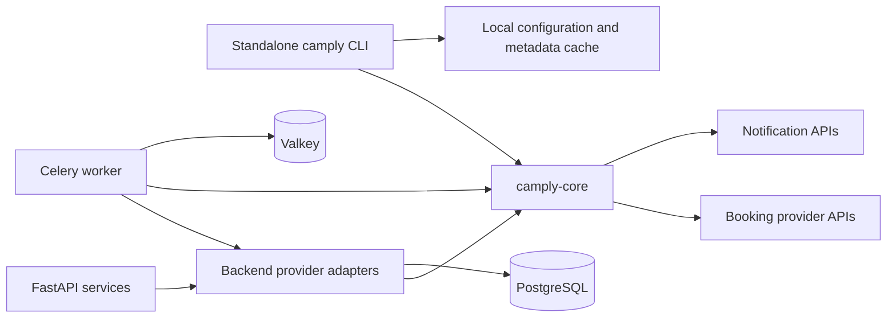
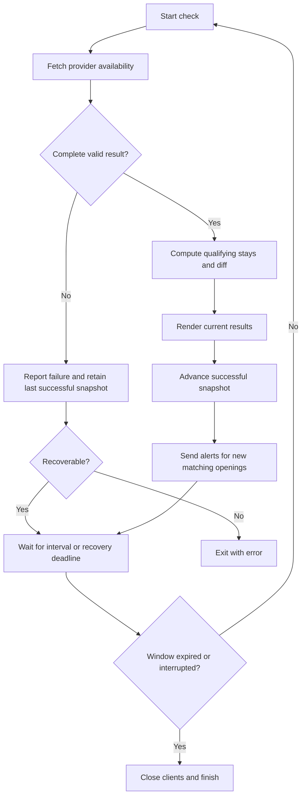

# DESIGN_CLI: Independent CLI Built on the Modern Engine

**Date**: 2026-10-12
**Status**: Proposed design; implementation has not started
**Feature**: [Specification](../../specs/004-independent-cli/spec.md) · [Implementation plan](../../specs/004-independent-cli/plan.md) · [Tasks](../../specs/004-independent-cli/tasks.md)

## Contents

1. [Product direction](#1-product-direction)
2. [Goals and scope](#2-goals-and-scope)
3. [Current implementation findings](#3-current-implementation-findings)
4. [Architecture and dependency boundaries](#4-architecture-and-dependency-boundaries)
5. [Domain and service contracts](#5-domain-and-service-contracts)
6. [Command contract](#6-command-contract)
7. [Local configuration and catalogue](#7-local-configuration-and-catalogue)
8. [Monitoring and notification semantics](#8-monitoring-and-notification-semantics)
9. [Independent packaging and dependency management](#9-independent-packaging-and-dependency-management)
10. [Task workflows, CI, and publishing](#10-task-workflows-ci-and-publishing)
11. [Migration and retirement](#11-migration-and-retirement)
12. [Verification and acceptance criteria](#12-verification-and-acceptance-criteria)
13. [Alternatives and tradeoffs](#13-alternatives-and-tradeoffs)
14. [Risks and decisions before implementation/release](#14-risks-and-decisions-before-implementationrelease)
15. [Constitution alignment and documentation changes](#15-constitution-alignment-and-documentation-changes)

## 1. Product direction

Replace the legacy CLI with a standalone application that uses the campsite engine already developed for the backend. Users install `camply`, query booking providers directly, and monitor availability without running the web application, PostgreSQL, Celery, or Valkey.

The CLI is a member of the same root uv workspace as the backend packages, with one root `uv.lock` and a shared development environment. It retains its own package metadata, tests, documentation, version, and release workflow. Provider fixes and improvements to common campsite logic benefit both the CLI and the web application through a shared library.

The user has established three requirements: standalone provider searches, retirement of the old implementation in favor of modern backend code, and CLI membership in the larger uv workspace. Independent publication and standalone runtime behavior coexist with shared repository dependency resolution. The remaining package layout, command contract, defaults, and rollout below are proposed implementation decisions.

The first stable replacement does not require complete legacy feature parity. Its supported capabilities follow the modern engine. Missing legacy features are documented rather than implemented through an automatic fallback to old code.

## 2. Goals and scope

### First stable release

- Independently installable `camply` executable and `python -m camply` entry point.
- Recreation.gov campsite searches for one campground and one arrival/checkout window per invocation.
- Minimum consecutive stay, campsite type, and electric hookup filters using common engine functions.
- One-shot searches and continuous local monitoring.
- Terminal results with campsite identity, qualifying stays, and booking links.
- Pushover alerts using shared notification delivery; terminal-only operation requires no notification credentials.
- Campground and recreation-area discovery from locally cached provider metadata.
- Modern Python, Pydantic v2, async HTTP, retry/backoff, and circuit breaker behavior.
- Task-based development and independent wheel/source-distribution publication.

### Later work

Additional providers become available after implementation in the shared engine. RV length, accessibility requirements, weekend/day filters, individual campsite selectors, multiple targets, legacy YAML import, additional notification channels, a TUI, a CLI container image, durable monitoring state, and server account management are separate features.

Accessibility and permitted equipment may already appear in provider metadata; that does not mean their filtering contracts are implemented. The CLI must not advertise a filter solely because a DTO contains a related field.

### Server-dependent capabilities

User accounts, invitation enforcement, scan ownership and suspension, persistent scan history, cross-user target deduplication, distributed locks, queued delivery, Prometheus dashboards, and admin operations stay in backend packages. Sharing the engine does not make these features available in a standalone process.

## 3. Current implementation findings

These findings describe the checked-in source at design time, not a deployed service or the latest published PyPI release.

| Location                                                                                              | Current behavior                                                                                                 | Design consequence                                                                   |
| ----------------------------------------------------------------------------------------------------- | ---------------------------------------------------------------------------------------------------------------- | ------------------------------------------------------------------------------------ |
| [`cli/pyproject.toml`](../../cli/pyproject.toml)                                                      | Publishes `camply`, uses Hatch environments, Pydantic v1, requests, and pandas; declares Python 3.8+             | Preserve distribution identity, replace runtime and development configuration        |
| [`cli/camply/cli.py`](../../cli/camply/cli.py)                                                        | Combines commands, legacy search objects, YAML translation, and notification selection                           | Use it as migration reference, not a dependency of the replacement                   |
| [`providers/pyproject.toml`](../../backend/packages/providers/pyproject.toml)                         | Distribution named `providers` depends on `db`                                                                   | Do not publish this backend package unchanged as the CLI engine                      |
| [`providers/base.py`](../../backend/packages/providers/providers/base.py)                             | HTTP retry and breaker code share a module with SQL statements, ORM imports, and database population contracts   | Split provider access from persistence                                               |
| [`recreation_gov/provider.py`](../../backend/packages/providers/providers/recreation_gov/provider.py) | Async metadata and monthly availability requests, DTO translation, cached RIDB download, and database population | Extract the working client and parsers; retain backend population adapters           |
| [`providers/__init__.py`](../../backend/packages/providers/providers/__init__.py)                     | Provider registry imports ORM seed objects and registers only Recreation.gov                                     | Introduce pure provider descriptors; keep numeric database ID mapping in the backend |
| [`worker/tasks/scanner.py`](../../backend/packages/worker/worker/tasks/scanner.py)                    | Minimum stay/type/electric matching and availability comparison are embedded in task orchestration               | Extract pure functions, preserve task ownership of transactions and fan-out          |
| [`worker/notifications/`](../../backend/packages/worker/worker/notifications/base.py)                 | Async Pushover delivery and a notification DTO exist; settings are read through class-level configuration        | Share delivery, inject credentials/configuration explicitly                          |
| [`backend/routers/search.py`](../../backend/packages/backend/backend/routers/search.py)               | Discovery queries the PostgreSQL search index                                                                    | Standalone discovery needs a local catalogue adapter                                 |
| [`Taskfile.yaml`](../../Taskfile.yaml), [root CI](../../.github/workflows/ci.yaml)                    | Backend/frontend checks; no CLI integration                                                                      | Add independent CLI workflows and aggregate checks                                   |
| [Root pre-commit configuration](../../.pre-commit-config.yaml)                                        | Explicitly excludes `cli/.*`                                                                                     | Include replacement source with appropriate package-specific hooks                   |
| [`cli/.github/workflows/publish.yaml`](../../cli/.github/workflows/publish.yaml)                      | Legacy publishing workflow is nested under the CLI directory                                                     | Add an active workflow under root `.github/workflows/`                               |
| [Root publishing workflow](../../.github/workflows/publish.yaml)                                      | Publishes the backend Docker image on main updates                                                               | Keep CLI package releases independent of this trigger                                |
| [Root license](../../LICENSE), [CLI license](../../cli/LICENSE)                                       | Root is PolyForm Noncommercial; legacy CLI carries MIT metadata/notices                                          | Resolve artifact metadata and preserve applicable source notices before publication  |

### Correctness contracts to establish during extraction

The provider currently selects dates with `start_date <= date <= end_date`, although API fields describe checkout semantics. It also infers availability by excluding known unavailable statuses, allowing unrecognized statuses to look available. The consecutive-night helper sorts dates without deduplicating them, which can split a run containing duplicates.

These are directly relevant to sharing trustworthy results. Characterize current behavior, add failing regression cases, and make the corrections explicit in implementation PRs. Do not bundle unrelated worker or API cleanup into the extraction.

## 4. Architecture and dependency boundaries



### Published library: `camply-core`

Proposed location: `backend/packages/core/`. Proposed import namespace: `camply_core`. Confirm distribution-name availability before selecting the final public name.

Own the following reusable behavior:

- Provider descriptors and the supported-provider registry.
- HTTP clients, retry transport, error types, and circuit breaker state.
- Provider-specific request/response models and translations.
- Campsite DTOs, search windows, filters, and qualifying stay calculations.
- Availability snapshot comparison.
- Booking URL construction and metadata normalization.
- RIDB download/validation/parsing, returning typed records without storing ORM objects.
- Notification DTOs and Pushover transport.

Do not include command parsing, terminal rendering, database models, user identities, Celery registration, broker access, worker metrics, or application settings initialized at import time. A core import must not make network requests, create an HTTP client, inspect credential files, or initialize telemetry.

Use the existing backend dependencies where appropriate: Pydantic v2, HTTPX, and structlog. Keep Click/Rich in the CLI or existing backend population command, rather than making terminal UI a core requirement. Move platformdirs-based path selection into runtime adapters; the shared downloader accepts a destination path. Preserve existing user-agent behavior initially unless lifecycle tests require a targeted change.

### Existing backend packages

The `providers` package becomes the integration layer for metadata persistence and provider lookup by existing database ID. It imports the shared client instead of maintaining a second implementation. Existing backend module paths can temporarily re-export core types to limit disruption to internal callers and test patches.

The worker retains eligibility checks, target locking, transaction boundaries, previous-result storage, fan-out, task signatures, and metrics. It constructs pure filter inputs from `UserScan`, calls shared functions, and persists the resulting domain data through existing models.

The API continues using its existing request/response schemas. Do not replace public schemas with core models merely to reuse a class: wire contracts and domain contracts evolve separately. Adapters translate between them. No database migration is expected for package extraction.

### Standalone CLI

The CLI owns argument parsing, validated local settings, human-readable output, cache paths, and a local monitoring loop. It invokes core functions directly, with no HTTP call to a camply server and no import from `backend`, `db`, `providers`, or `worker`.

### Proposed source structure

```text
backend/
├── pyproject.toml                 # uv workspace root (members = ["packages/*"])
├── uv.lock                        # Single lockfile for all Python packages
├── Taskfile.yaml                  # Backend, CLI, and core tasks
├── .venv/                         # Shared development virtual environment
└── packages/
    ├── core/                      # Shared domain engine (camply-core distribution)
    │   ├── pyproject.toml
    │   ├── src/camply_core/
    │   │   ├── __init__.py
    │   │   ├── py.typed
    │   │   ├── models.py
    │   │   ├── matching.py
    │   │   ├── availability.py
    │   │   ├── providers/
    │   │   └── notifications/
    │   └── tests/
    ├── cli/                       # Standalone CLI (camply distribution) nested alongside packages
    │   ├── pyproject.toml
    │   ├── README.md
    │   ├── src/camply/
    │   │   ├── __init__.py
    │   │   ├── __main__.py
    │   │   ├── app.py
    │   │   ├── config.py
    │   │   ├── output.py
    │   │   ├── monitor.py
    │   │   ├── catalog.py
    │   │   └── commands/
    │   └── tests/
    ├── providers/                 # Database/metadata integration adapters
    ├── worker/                    # Distributed orchestration
    ├── backend/                   # HTTP API and application services
    └── db/                        # Persistence
cli/                               # Legacy CLI (deprecated; retired after replacement verification)
.github/workflows/
├── ci.yaml
├── core-release.yaml
└── cli-release.yaml
```

This is an ownership map, not a requirement to create empty modules. Split files only when the implementation needs them. All modern Python packages reside together under `backend/packages/` (`core`, `cli`, `db`, `providers`, `worker`, `backend`), sharing the `backend/` uv workspace and lockfile. The legacy root `cli/` directory is maintained for reference during development and deleted upon completion. The frontend retains its pnpm environment and lockfile.

## 5. Domain and service contracts

| Contract              | Inputs and outputs                                                                             | Invariant                                                                               |
| --------------------- | ---------------------------------------------------------------------------------------------- | --------------------------------------------------------------------------------------- |
| `ProviderDescriptor`  | Stable slug, display name, booking URL behavior                                                | Contains no ORM objects or environment-specific state                                   |
| `SearchWindow`        | Arrival and checkout dates                                                                     | Arrival precedes checkout; searched nights form `[arrival, checkout)`                   |
| `SearchTarget`        | Provider slug, campground ID as a string, window                                               | Identifiers are provider-scoped; numeric conversion is provider-specific                |
| `SearchFilters`       | Minimum stay, preferred `CampsiteType` values, electric requirement                            | Minimum stay is positive and does not exceed the window; empty types means unrestricted |
| `CampsiteDTO`         | Existing site identity/type/capacity/dates/electric/accessibility/metadata fields              | Dates are unique, sorted, and inside the requested night window                         |
| `StayWindow`          | Arrival and checkout of a maximal consecutive available run                                    | A qualifying stay meets the minimum-night requirement                                   |
| Metadata records      | Provider-scoped campground/recreation-area IDs, names, location, reservability, enabled status | Transport/parsing does not depend on a database session                                 |
| Availability snapshot | Site IDs mapped to available night sets for one target                                         | Failure is not an empty successful snapshot                                             |
| `NotificationDTO`     | Existing title/message/link/site/park/date/metadata payload                                    | Existing Celery JSON field names remain compatible during extraction                    |
| Pushover credentials  | Explicit application token and user key                                                        | No credential loading in core imports or provider class attributes                      |

### Provider client boundary

The core provider client supports async availability checks, campsite metadata retrieval, typed catalogue retrieval/parsing, and explicit async cleanup. It has no `populate_database`, ORM-valued `provider`, SQL statement properties, or database-owning `sync_metadata` method.

Preserve the backend adapter's existing `find_availabilities(park_id, start_date, end_date)` entry point during migration. It translates to the new target/window contract. The backend keeps `RecreationDotGov.id == 1`; the core uses a stable slug such as `recreation_dot_gov`. Renaming a provider class must not change persistence keys or circuit breaker identity.

Reuse HTTP connections for the lifetime of an invocation. Inject a client/transport in tests, use bounded HTTP timeouts, and close responses and transports after retries. Backend task cancellation and CLI interruption must clean up without orphaned background breaker-update tasks.

Circuit breaker counters/timestamps may outlive a client, but event-loop-bound locks/tasks must not survive into a later `asyncio.run` loop. The CLI supplies invocation-owned state. The backend preserves its per-process/per-provider state using loop-independent state access; no distributed breaker service is introduced. Verify sequential task loops and concurrent requests explicitly.

### Matching and date semantics

Normalize dates with `sorted(set(dates))` before finding consecutive runs. Apply type and electric requirements before presenting qualifying stays. A request for three nights in `[2027-06-10, 2027-06-15)` may return a stay arriving June 11 and checking out June 14; June 15 is never counted as an occupied night.

Only provider statuses explicitly mapped to available produce available nights. An unrecognized status inside the requested window produces a typed response-contract error, so the target's previous successful snapshot remains intact. Do not silently present incomplete results as a complete successful check.

Keep backend API date field names and stored target identity/hash unchanged. The provider adapter applies the shared checkout-exclusive interpretation. Document this intentional correction and test existing scans; do not rewrite historical database snapshots during deployment. The next successful check replaces them normally.

The backend's existing predicate becomes a shared pure function without changing its type/electric/minimum-stay policy. CLI output also uses a qualifying-stay helper so isolated nights are not presented as satisfying a multi-night request. The API can adopt richer stay output later without coupling this rebuild to a frontend change.

## 6. Command contract

Retain `camply` as the executable and use existing command names where their meaning remains useful. Implement only the following surface initially.

| Command                                                              | Behavior                                                                                  |
| -------------------------------------------------------------------- | ----------------------------------------------------------------------------------------- |
| `camply --help`, `camply --version`                                  | Work without network access, cache access, or notification credentials                    |
| `camply providers`                                                   | List providers actually registered in the shared engine; initially Recreation.gov         |
| `camply campgrounds --search TEXT [--state CODE]`                    | Search a local catalogue of enabled, reservable campgrounds; show IDs and provider        |
| `camply recreation-areas --search TEXT`                              | Search local recreation-area metadata; does not implicitly create a multi-campground scan |
| `camply campsites --campground ID --start-date DATE --end-date DATE` | Run one availability check and render qualifying stays                                    |
| `camply campsites ... --watch [--interval SECONDS]`                  | Check immediately, then continue until interrupted or the search window expires           |
| `camply campsites ... --notifications pushover`                      | Deliver alerts on matching results; requires explicit valid Pushover credentials          |
| `camply test-notifications --notifications pushover`                 | Send a synthetic configuration test through the same delivery implementation              |

The campsite command accepts `--provider`, `--nights`, repeatable `--type`, and `--electric`. Provider selection defaults to Recreation.gov. Minimum stay defaults to one night; type and electric restrictions default to unrestricted. Selecting unsupported providers/options is a usage error rather than a legacy fallback.

One invocation monitors one campground. This bounds failure handling, state, and concurrency while proving the shared engine. CLI discovery may search many catalogue records, but it does not implicitly fan out availability calls.

```console
uv tool install camply

camply campgrounds --search "Example Campground" --state CA

camply campsites \
  --campground 123456 \
  --start-date 2027-06-10 \
  --end-date 2027-06-15 \
  --nights 3 \
  --type tent \
  --electric

camply campsites \
  --campground 123456 \
  --start-date 2027-06-10 \
  --end-date 2027-06-15 \
  --watch \
  --notifications pushover
```

The ID and catalogue name above are illustrative. Notification credentials are supplied at runtime, not embedded in examples or arguments.

### Output and exit status

Rich renders results to stdout; diagnostics and progress use stderr. Disable styling/progress animation when output is redirected. Core logs use structlog; CLI log configuration must not alter the provider's domain results. Do not add a new JSON output contract in this rebuild.

| Exit code | Meaning                                                                                             |
| --------- | --------------------------------------------------------------------------------------------------- |
| `0`       | Successful command, including a completed search with zero matches                                  |
| `1`       | One-shot operational failure, invalid provider response, or requested notification delivery failure |
| `2`       | Invalid arguments/configuration, unsupported capability, or missing required notification settings  |
| `130`     | User interruption after cleanup                                                                     |

Watch mode reports transient failures and continues under backoff. Invalid configuration and nonrecoverable response-contract errors terminate with a nonzero status. Expiry of the search window is a normal completed run. Empty results and failures are visibly different.

## 7. Local configuration and catalogue

### Configuration

Use CLI-specific settings with precedence: command flags, `CAMPLY_CLI_*` environment variables, an explicitly selected TOML configuration file, then defaults. `--config PATH` is optional; do not automatically load a repository `.env` or backend settings. Reject unknown configuration keys and validate everything before opening a provider client.

Keep the first configuration schema small: `provider`, `interval_seconds`, and `notifications`, with environment names `CAMPLY_CLI_PROVIDER`, `CAMPLY_CLI_INTERVAL_SECONDS`, and `CAMPLY_CLI_NOTIFICATIONS`. Target and date arguments remain explicit command inputs in the first release. Credentials remain environment inputs. Use the backend's current `PUSHOVER_APP_TOKEN` name and introduce `PUSHOVER_USER_KEY` for the standalone user key; backend user keys continue coming from its database.

Default CLI polling interval: 300 seconds. Minimum: 60 seconds for the initial Recreation.gov capability. These are proposed standalone defaults, not a verified provider quota or a copy of the backend's heartbeat/cooldown settings. Put the provider minimum/default in a pure capability policy so future providers can set their own values. Reject intervals below the minimum. Reject the legacy `--polling-interval` flag and explain that its minutes must be converted to the new `--interval` seconds; the distinct flag prevents silent unit reinterpretation.

As a window enters the past, clip each check to remaining nights using the invocation's local calendar date. Exit normally when fewer than the requested minimum nights remain. State clearly that provider-local timezone policy is deferred; add clock-controlled tests and avoid UTC timestamp conversion of provider night keys.

### Local catalogue

Reuse the RIDB export downloader, raw models, address mapping, name normalization, and campground classification. Split parsing from `to_database` methods: core parsers return typed records, backend adapters write rows, and the CLI adapter stores a compact local catalogue. CLI string matching need not reproduce PostgreSQL ranking or full-text behavior.

Use `platformdirs` to select a CLI-owned cache directory. Store the downloaded archive and a normalized JSON catalogue with a schema version and fetched-at timestamp. Preserve the existing 12-hour metadata freshness default. Do not cache availability as if it were current inventory and do not write notification credentials or monitoring state into the catalogue.

Use same-directory temporary files, validate downloads and parsed records, then replace cache files atomically. A failed refresh retains the last usable catalogue. Discovery may use stale metadata with an explicit warning; a direct campground-ID availability check does not depend on catalogue freshness or availability. First-run discovery with no usable cache and a failed download exits with an error.

Reuse a valid archive when the normalized cache schema changes; rebuild the projection locally rather than redownloading unnecessarily. Run blocking archive parsing and filesystem operations outside the async event-loop thread. Initial projection loads are acceptable only after measuring full-export memory/latency; stream record parsing if this exceeds an implementation-recorded budget. Do not add SQLite, an index service, or another cache abstraction without evidence that the simple catalogue is inadequate.

Concurrent cache writers use distinct temporary files and atomic replacement; readers observe an old or new complete cache. Cross-process download deduplication is deferred. Emit a clear progress indication on large first downloads, including when Content-Length is absent.

## 8. Monitoring and notification semantics

### Local monitoring loop

The CLI owns one async event loop and one provider client per invocation. Provider requests within a check are bounded; no check overlaps the next check for that target. Concurrency limits live with provider request policy, not with terminal rendering.

Perform the first check immediately. Schedule later checks with monotonic time, respecting the configured interval between check starts; a check that overruns its interval schedules from completion and does not trigger catch-up bursts. Request-level retries and monitor-level delays must compose without bypassing rate limits or circuit breaker recovery times.

For each successful check, compute qualifying stays and a snapshot containing only nights participating in those stays. Compare it with the previous successful matching snapshot. The first successful check considers all matching nights new; requested notifications therefore alert on existing matches immediately. Subsequent checks alert once per campsite per check when qualifying nights are added. Identical results do not send repeat notifications. A successfully observed disappearance followed by reappearance is a new opening.

The shared comparison helper accepts snapshots and returns newly added site/night pairs. The backend adapter continues comparing raw per-target snapshots before user fan-out; the CLI compares filtered snapshots for its single fixed criteria. Both reuse the same comparison implementation while owning their respective subscription semantics.



A failed or partial check never advances the successful snapshot. A complete successful check with no matches does advance it to empty. Retry waits are interruptible. Validate requested notifications before the first provider request, and do not let a notification failure masquerade as a scan failure.

### Delivery behavior

The shared Pushover transport takes explicit typed credentials and an existing-compatible `NotificationDTO`. Missing credentials are errors when delivery is requested; there is no successful no-op send. The backend adapter may retain its explicit skipped outcome for users who have not configured notifications.

Construct CLI messages from actual qualifying stays, not the whole search window. Include campground/site identity, arrival/checkout, and booking URL. If catalogue names are unavailable, use provider and campground IDs and a valid booking link rather than blocking the check on metadata discovery.

Use a bounded immediate delivery retry budget for transient errors, respecting notification API backoff. After exhaustion, report the delivery failure and continue watching. Advance the availability snapshot independently: do not repeatedly send an unchanged opening on every scan. One-shot operation exits `1` if requested delivery fails, even though results are still rendered.

The initial design has no pending delivery queue or durable delivery ledger. A failed alert may require the user to inspect terminal output or restart monitoring. This is an explicit reliability tradeoff that avoids introducing a second task system. In-process retries after an ambiguous timeout can duplicate an alert; no exactly-once delivery guarantee is made. Cancellation does not wait indefinitely for a notification send.

Restarting watch mode starts a new baseline and may notify again about existing matches. Different CLI processes are independent and may check/notify the same target. If durable deduplication and queued delivery are needed, the backend remains the deployment option until a separate standalone-state feature is designed.

## 9. Independent packaging and dependency management

### Shared Python workspace and package membership

The modern CLI is nested directly inside `backend/packages/cli` alongside `core`, `db`, `providers`, `worker`, and `backend`. All Python packages are unified under the `backend/pyproject.toml` workspace, which defines:

```toml
[tool.uv.workspace]
members = ["packages/*"]

[tool.uv.sources]
camply-core = { workspace = true }
camply = { workspace = true }
backend = { workspace = true }
db = { workspace = true }
providers = { workspace = true }
worker = { workspace = true }
```

This unifies dependency resolution into a single lockfile (`backend/uv.lock`) and development virtual environment (`backend/.venv`), matching existing backend workflows without requiring disruptive repository-root changes. Each package under `backend/packages/*` remains independently defined by its own `pyproject.toml`.

`camply-backend` at `backend/` remains the aggregate backend member depending on API, DB, providers, worker, and core. The standalone CLI (`camply`) at `backend/packages/cli` depends only on `camply-core` and lightweight CLI runtime packages (`click`, `rich`, `platformdirs`, `pydantic-settings`). The CLI does not depend on `camply-backend`, `backend`, `db`, or `worker`.

Resolve all members together using `uv lock` in `backend/`. CLI-scoped synchronization and checks use that shared resolution. Align the replacement CLI with Pydantic v2 before adding it to the workspace; do not try to resolve the legacy Pydantic v1 CLI alongside the modern packages or declare artificial package conflicts to retain it.

Target Python 3.12+ for core and CLI, aligning with the developer guide and CI baseline. Test the oldest supported version and every additional version explicitly advertised in release metadata.

Use `uv add`/`uv remove` with explicit package selection (`--package camply`) to change dependencies and regenerate the lockfile through Task workflows. Keep Hatchling for builds. Store each release version in its member's package metadata and resolve runtime `--version` through installed distribution metadata rather than another handwritten version constant.

### Local and published dependencies

Backend consumers and the CLI declare normal bounded dependencies on `camply-core`, resolved locally through `workspace = true`. Central root source declarations apply to members; do not use a sibling path override or a separate CLI lock. Published metadata contains the ordinary core requirement, and external installations resolve the released distribution. [uv dependency source documentation](https://docs.astral.sh/uv/concepts/projects/dependencies/#dependency-sources)

Do not publish wheels with relative runtime dependencies, depend on the generic `providers` or `db` distributions, vendor copies of core into the CLI, or require cloning this repository. The source distribution for each public package must contain everything needed to build that package; CLI runtime dependency resolution obtains core separately.

Before core is published, candidate-artifact tests install candidate core and CLI wheels from an explicit temporary wheel directory. For normal releases, install the CLI against released core packages as well. Editable development success alone is insufficient.

Core and CLI versions are independent. Select a core compatibility range only after its first public version/API is chosen; tighten the minimum whenever the CLI uses newly introduced core behavior. Stable core APIs use a next-major upper bound; a pre-1.0 series needs an explicit next-incompatible-minor bound rather than assuming all 0.x versions are compatible. The root workspace lock records tested versions/sources. A component version change may update that lock without requiring another component's release. Compatibility shims under old backend module paths are internal migration aids, not a promise to preserve legacy `camply` Python APIs.

Document the supported core imports for domain models, provider client/descriptor lookup, matching/comparison functions, and notification transport. Export only the symbols both consumers need. Provider raw response models and HTTP internals are implementation details unless deliberately included in the public API; moving a file does not automatically make every symbol a compatibility promise.

The new stable CLI is a breaking release relative to the old command/configuration and Python API contracts. Choose its version after checking current published releases and existing repository tags; the checked-in legacy `_version.py` is not authoritative for the next release number.

## 10. Task workflows, CI, and publishing

### Task integration

| Workflow                                            | Purpose                                                                          |
| --------------------------------------------------- | -------------------------------------------------------------------------------- |
| `task python:install`                               | Synchronize Python workspace members/dev tools once from the root lock           |
| `task cli:install`                                  | Delegate to shared Python workspace setup                                        |
| `task cli:run -- <command>`                         | Select the `camply` member in the shared development environment                 |
| `task cli:fix`, `cli:lint`, `cli:check`, `cli:test` | Formatting/linting, typing, and CLI behavior checks                              |
| `task lock`                                         | Regenerate the single root lock after member dependency changes                  |
| `task cli:build`                                    | Build CLI wheel/source distribution into a package-specific output directory     |
| `task cli:package-check`                            | Test candidate artifacts in an environment outside the checkout                  |
| `task core:build`, `core:package-check`             | Build and independently test the shared public library                           |
| Root `install`, `fix`, `lint`, `check`, `test`      | Include the new CLI; backend checks cover core as a workspace member             |
| Root `build`                                        | Include public Python package artifacts alongside existing application artifacts |

Implement Task commands using existing project conventions and `{{.CLI_ARGS}}` forwarding. Development setup runs `uv sync --locked --all-packages` in `backend/` (via `task install` or `task backend:install`), with the necessary development groups explicitly included. After setup, member commands use `uv run --no-sync --package camply ...` or `--package camply-backend` against the shared environment. Core builds select `uv build --package camply-core`; CLI builds select `uv build --package camply`, with separate output directories. These are underlying commands for Task wrappers. [uv command reference](https://docs.astral.sh/uv/reference/cli/)

Do not let concurrently running member checks exact-sync different package subsets into the same `.venv`: one command could remove another's dependencies. Aggregate tasks perform one shared setup before checks and avoid further environment mutation during parallel checks. CLI quality tasks require workspace Python setup but no running backend services, frontend setup, Docker, or migrations. Avoid running core unit tests twice in aggregate checks.

The root `Taskfile.yaml` forwards to `backend/Taskfile.yaml`, which manages all Python packages. Working directories and Compose paths are preserved. Backend version commands select `camply-backend`; CLI and core version commands select their own members.

Scope pre-commit hooks so core uses backend quality settings and CLI uses its own settings. Removing the global exclusion is not sufficient if a backend formatter invocation would then apply the wrong package configuration. Add NumPy docstrings and type annotations to implementation and new tests, matching repository standards.

### CI

Add CLI lint, type, test, and package jobs under root `.github/workflows/`. Changes to core trigger backend and CLI checks; CLI source-only changes trigger CLI checks. Changes to workspace metadata, `backend/uv.lock`, shared tools, or workflows trigger checks for all affected Python consumers. Do not skip cross-consumer verification through overly narrow path filters.

CI jobs use `uv sync --locked --package camply` or `--package camply-backend` in their job-local workspace environment, selecting required development groups explicitly. Cache keys use `backend/uv.lock` and include Python/platform/member selection. Clean installation tests below remain necessary because a full developer workspace can mask undeclared imports.

Test supported Python versions, plus Windows/macOS/Linux coverage for CLI entry points, output, cache paths, and interruption behavior. Provider integration uses reviewed VCR cassettes or mock HTTP transport and frozen clocks, without live credentials. Notification tests send only to mock endpoints. Optional live smoke checks are separate from required deterministic CI.

Build the core and CLI wheels/source distributions, then install candidate artifacts outside the repository with source overrides disabled and no checkout on the import path. Test `--help`, `--version`, import location, a complete mocked search, filters, and a mock notification. Rebuild a wheel from each unpacked source distribution in isolation and run the same smoke checks against it. Inspect runtime metadata for unwanted backend dependencies and relative paths.

`uv build --no-sources` verifies build behavior without development overrides; it does not by itself prove that installed runtime dependencies resolve independently. Both build and installation checks are required. [uv publishing documentation](https://docs.astral.sh/uv/guides/package/)

### Backend container isolation

The backend Dockerfile continues to build from `backend/` using the workspace manifests in `backend/packages/`. Because `camply-backend` depends only on `backend`, `db`, `providers`, `worker`, and `core`, uv installs only the backend service dependency closure. The CLI package (`backend/packages/cli`) is never installed into backend runtime containers, preserving small image sizes and isolation without requiring changes to Docker contexts.

### Release workflows

Use component-qualified tags such as `core/vX.Y.Z` and `cli/vX.Y.Z`. Each workflow validates its tag against package metadata, checks out the tagged commit, runs relevant quality/artifact gates, and publishes only its component. Backend/frontend changes alone do not release CLI packages. Start with explicit version/tag releases rather than reviving monorepo-wide legacy semantic-release automation.

Build once, verify those exact wheel/source-distribution files, retain them as workflow artifacts, and publish the verified files. Core must be published and resolvable before a CLI release that requires that version. A core patch does not require a CLI version bump unless compatibility requirements or CLI behavior change. Root backend Docker publishing remains separate.

Use PyPI Trusted Publishing with root workflow identity and `id-token: write`; configure publishers for both public distributions and separately for TestPyPI if used. [PyPI Trusted Publishing documentation](https://docs.pypi.org/trusted-publishers/using-a-publisher/)

If TestPyPI is used, resolve candidate first-party packages from the intended test source and ordinary dependencies from explicitly configured production sources. Do not broadly mix indexes and assume the intended core version won resolution. Record installed versions and artifact origins.

Test prereleases before the stable cutover. Preserve old PyPI artifacts and tags so users can pin a compatible legacy release. Correct a bad release by issuing a new version; consider yanking an unusable version through normal maintainer policy. Never rebuild different contents under an already published version.

## 11. Migration and retirement

1. **Establish contracts and baseline.** Record current backend checks and characterize provider/filter/diff behavior. Keep legacy code unchanged as reference. Confirm package identity, licensing metadata, supported Python versions, and release ownership.
2. **Extract providers and metadata parsers.** Introduce core in `backend/packages/core/`; move transport/models/client logic and adapt database population. Preserve backend import paths where needed. Prove an installed core wheel can check availability without service configuration.
3. **Extract matching and delivery.** Move common filters, date runs, comparison, DTOs, and Pushover sending into core. Retain worker transactions, eligibility checks, task arguments, retry orchestration, and metrics. Verify shared results and existing worker integration tests.
4. **Build the replacement CLI in `backend/packages/cli`.** Implement modern CLI metadata in `backend/packages/cli/pyproject.toml`, add it to `backend/pyproject.toml` workspace members, and implement one-shot searches, local discovery, monitoring, and alerts. During coexistence, legacy root `cli/` remains as a reference. Replacement tests live in `backend/packages/cli/tests/`.
5. **Enable independent checks and prereleases.** Add Task integration, root workflows, candidate artifact checks, and documentation. Publish core before dependent CLI candidates through the normal release process. Validate installation without repository paths.
6. **Retire legacy source.** After the replacement CLI in `backend/packages/cli` meets its acceptance criteria, remove legacy root `cli/`, legacy-only tests, Hatch environment configuration, requirements exports, nested workflow/release automation, and unsupported extras. Review old docs and fixtures individually; migrate relevant examples/tests and preserve required notices. Keep the new source/tests and root release workflows.

The temporary coexistence period ends at cutover; do not retain a permanent `legacy` mode or a duplicated provider engine. Ensure the new wheel includes only replacement source. Document removed command flags and unavailable providers clearly, including the changed polling-interval unit. Users with legacy-only requirements can pin old releases while provider migrations continue.

### Legacy support and migration matrix

| Legacy capability                                          | Replacement contract                                                       |
| ---------------------------------------------------------- | -------------------------------------------------------------------------- |
| Recreation.gov campground availability                     | Supported through the modern shared provider                               |
| Yellowstone, UseDirect variants, GoingToCamp               | Unavailable until migrated to core; no fallback                            |
| Recreation.gov tickets/tours/timed entry                   | Outside the initial campsite scope                                         |
| Campground/recreation-area name lookup                     | Local metadata discovery; no PostgreSQL search-ranking guarantee           |
| Recreation-area-wide or multiple-target availability scans | Use one campground ID per invocation initially                             |
| `--continuous`, `--search-forever`, `--search-once`        | Default one-shot or explicit `--watch`; watch continues after matches      |
| `--polling-interval` in minutes                            | Rejected; convert to new `--interval` in seconds                           |
| Other notification channels and optional extras            | Pushover or terminal-only operation initially; remove unsupported extras   |
| YAML search files and embedded target settings             | Explicit target/date flags and optional TOML settings; no automatic import |
| Legacy Python imports such as `camply.AvailableCampsite`   | Breaking API change; use the documented `camply_core` API                  |
| Legacy TUI/container workflows                             | Deferred; ordinary package installation is the initial distribution path   |

### Deployment compatibility

Provider imports may be retained as internal re-exports until API/worker packages switch together. Preserve notification DTO JSON shape and existing Celery task names/arguments so messages already in queues remain consumable. The extraction should not require new database columns or destructive cleanup. Verify old serialized payload fixtures against the new delivery adapter.

Backend regression gates are required before shared engine deployment. If an extraction fails, revert backend adapter/core code together to the previously working application commit; do not downgrade database state as part of recovery. An independently released CLI continues using its declared compatible core range.

## 12. Verification and acceptance criteria

| Area                    | Required verification                                                                                                                                                                   |
| ----------------------- | --------------------------------------------------------------------------------------------------------------------------------------------------------------------------------------- |
| Workspace migration     | One root lock; all members resolve together; full and member-selected sync work; explicit Task member/version selection; no concurrent subset-sync races; updated CI and backend images |
| Package isolation       | Import core/CLI with backend service packages absent; no credential/network work during help or imports; wheels resolve without checkout paths                                          |
| Provider contract       | Existing Recreation.gov cassette expectations, pagination, multiple months, missing metadata, known/unrecognized statuses, empty results, parse errors                                  |
| Dates and filters       | Checkout exclusion, leap day/year/month boundaries, duplicate/unsorted dates, short/gapped stays, electric/type criteria, impossible minimum stays                                      |
| Transport and lifecycle | Retry exhaustion, Retry-After, connection errors, circuit open/recovery, response/client closure, cancellation, reuse across backend event loops                                        |
| Backend integration     | Registry numeric IDs, metadata population, worker eligibility/suspension, locking, transactions, fan-out, metrics, queued notification payload compatibility                            |
| CLI contract            | Arguments/settings precedence, unknown keys/providers/options, stdout/stderr, noninteractive output, empty success versus failure, exit statuses                                        |
| Discovery/cache         | First download, absent Content-Length, cache reuse/expiry, corrupt files, failed refresh retaining usable data, atomic writes, schema projection rebuild                                |
| Watch behavior          | Immediate first check, interval enforcement, no overlap/catch-up bursts, failed check preserving snapshot, new matches, no repeated identical alerts, expiry/interruption               |
| Notifications           | Explicit credentials, real send versus skipped outcome, actual qualifying stay message, bounded retry, scan success separated from send failure                                         |
| Artifacts/releases      | Candidate wheel pair, wheel built from each source distribution, installed search outside checkout, version/tag match, core-first resolution, independent component trigger             |

Use existing provider and worker tests as the baseline, moving tests only when ownership moves. Add regression tests for contracts a future change could break. Do not copy all legacy tests or record new live cassettes merely to increase coverage. Fixtures use synthetic identities and runtime credentials supplied only to optional live verification; never inspect secret files during development.

Final implementation gates: `task fix`, `task lint`, `task check`, `task test`, configured pre-commit hooks, core/CLI artifact checks, and `task api:check` when backend contract changes affect generated frontend types. Record actual check results in the feature's validation notes. This document itself does not claim those implementation checks have run.

Stable cutover requires all first-release commands, independent installation, shared backend execution, monitoring/notification semantics, migration documentation, and artifact gates to be complete. Full legacy provider parity is not a cutover gate.

## 13. Alternatives and tradeoffs

| Alternative                                           | Benefit                                                 | Reason to choose the proposed boundary                                                                                          |
| ----------------------------------------------------- | ------------------------------------------------------- | ------------------------------------------------------------------------------------------------------------------------------- |
| Modernize the old CLI in place                        | Retains a large feature surface                         | Keeps a parallel engine and defeats the requested reuse of modern backend code                                                  |
| CLI depends on existing `providers`/`worker` packages | Smaller initial move                                    | Pulls in ORM/broker/application concerns and imports; does not establish a reusable standalone engine                           |
| CLI wraps the HTTP API                                | Reuses persistent scans and discovery directly          | Requires a running server, contrary to the chosen standalone product                                                            |
| Embed core source into the CLI wheel                  | Publishes one artifact                                  | Creates separate copies or unusual build ownership and obscures backend/core compatibility                                      |
| Separate CLI project/lock                             | Dependency resolution isolated from backend development | Rejected by the required shared uv workspace; use member selection locally and clean artifact checks for distribution isolation |
| Multiple public provider/notification packages        | Fine-grained releases                                   | Adds release coordination before there is evidence that a single shared package is inadequate                                   |
| Local SQLite plus persistent alert queue              | Durable standalone history and retry                    | Adds a second persistence/orchestration system beyond the first release's requirements                                          |

Publishing core creates a public compatibility surface and requires two release workflows. The benefit is one maintained implementation with ordinary dependency resolution and explicit compatibility ranges. The CLI may depend on a core release without forcing a backend deployment or frontend release.

The shared workspace intentionally couples Python dependency resolution and local development tooling. A lock update is reviewed across consumers; it does not imply releasing or deploying them together. Application package boundaries and external runtime dependencies remain explicit despite a shared development environment.

## 14. Risks and decisions before implementation/release

| Item                                   | Proposed resolution or next check                                                                                                             |
| -------------------------------------- | --------------------------------------------------------------------------------------------------------------------------------------------- |
| Public core package name and ownership | Confirm `camply-core` availability and configure its publisher before first publication                                                       |
| CLI release number                     | Check PyPI and tags; use a breaking release with prereleases, without assuming the legacy source version is current                           |
| Licensing/provenance                   | Follow repository licensing direction for new artifacts, preserve applicable existing notices, and confirm package metadata before release    |
| Python support declarations            | Use 3.12+ for new packages; audit affected backend consumers and locks so declared ranges remain truthful                                     |
| Python workspace membership            | Add modern CLI metadata in backend/packages/cli; verify lockfile and member-scoped builds                                                     |
| Shared environment mutation            | Synchronize once before parallel checks; select packages without resyncing incompatible subsets into the same environment                     |
| Provider polling defaults              | Start with the explicit conservative defaults above; review against provider guidance before publishing; do not claim a quota guarantee       |
| Date/status corrections                | Add regression tests and disclose backend behavior changes; preserve API field names and database target identity                             |
| Local catalogue size                   | Measure full-export download/parse time and peak memory during implementation; keep a simple projection unless measurements require streaming |
| Monitoring alert loss                  | Document bounded immediate retries and session-only state; durable retry is a separate feature                                                |
| Legacy-only users                      | Publish the support/removal matrix and pinning guidance before stable cutover; reject old interval flags rather than silently changing units  |
| Task/transport lifecycle               | Test loops, cancellation, and cleanup before moving shared classes into a public library                                                      |

## 15. Constitution alignment and documentation changes

- **Reliability and precision:** live provider checks, explicit status mappings, checkout-exclusive dates, and failed checks distinct from empty availability. Notification retry limits and standalone limitations are documented.
- **Type safety:** Pydantic v2 domain inputs and typed adapters; strict mypy/ruff checks for both new packages.
- **Modern automation:** unified uv workspace/lockfile in `backend/` and shared development environment, with member-scoped checks/builds and all workflows exposed through Task.
- **Separation of concerns:** Modern CLI is nested alongside core, db, and workers in `backend/packages/cli`; reusable logic lives in `backend/packages/core`; database/broker integrations remain backend-owned.
- **Automated verification:** shared provider integration tests, backend regression gates, CLI behavior tests, and installed-artifact verification.

On implementation, update `DESIGN_PROVIDERS.md`, `DESIGN_NOTIFICATIONS.md`, `ARCHITECTURE_DEEP_DIVE.md`, `CONFIGURATION.md`, `DEVELOPER_GUIDE.md`, root/CLI READMEs, and the repository agent pointers that currently describe a backend-only workspace and permanently deprecated CLI. Document root lock ownership and member selection. Update `DESIGN_API.md` and frontend generated types only when their actual wire contracts change. The global checklist tracks design separately from unfinished implementation.
