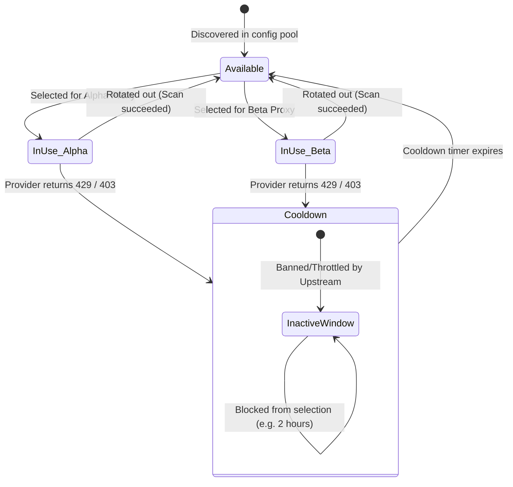
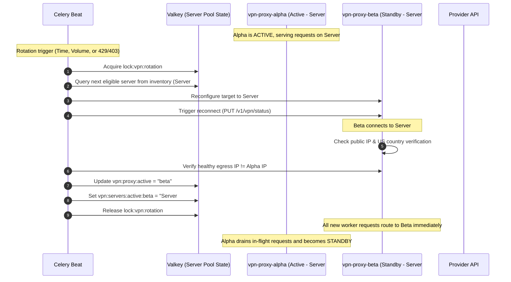

# DESIGN_VPN_ROTATION: Worker VPN & Proxy Rotation Architecture

This document defines the architectural blueprint for routing external campsite provider API requests through a periodically rotating VPN/proxy layer. Its primary objective is to eliminate IP bans, avoid WAF blocks (Cloudflare, AWS WAF, Akamai), and bypass rate-limiting thresholds (HTTP 429) across providers (e.g., Recreation.gov, ReserveCalifornia, UseDirect).

---

## 🎯 Architecture Principles & Defaults

1. **Default Off (Zero Overhead)**: By default, `camply` operates with **no VPN or proxy layer enabled** (`CAMPLY_PROXY_ENABLED=false`). In this default state, provider API requests connect directly to upstream services exactly as they do today, incurring zero latency or infrastructure overhead.
2. **Opt-In Infrastructure via Docker Compose Profiles**: VPN sidecars are configured under Docker Compose `profiles: ["vpn"]`. Standard development commands (`task dev`, `docker compose up`) will not start VPN containers unless explicitly commanded.
3. **OpenVPN Service Credentials & Multi-Config Flexibility**: Supports standard OpenVPN service credentials (`OPENVPN_USER` / `OPENVPN_PASSWORD`) for built-in providers (NordVPN, Surfshark, PIA, etc.) as well as custom multi-config directories containing 1–100 distinct `.ovpn` files.
4. **Multi-Server Inventory (1–100 Configurations)**: The system manages an inventory of 1 to 100 distinct VPN servers or config profiles. It cycles through them using configurable rotation strategies (Round-Robin, LRU, or Random) while enforcing cooldowns on rate-limited or banned servers.
5. **Zero-Downtime Dual-Proxy Topology**: When enabled, two proxy sidecars (`vpn-proxy-alpha` and `vpn-proxy-beta`) run in parallel. Rotations happen in the background on the standby proxy before swapping active traffic, eliminating request blackout windows.
6. **Strict Kill-Switch by Default (`CAMPLY_VPN_STRICT=true`)**: When proxy routing is active, requests must never silently fall back to the host's cleartext IP address if the VPN drops. Failed proxy connections defer Celery tasks with a retryable exception.

---

## 🏗️ Architectural Topology: The Proxy Sidecar Pattern

### Evaluation of Approaches

| Approach | Reliability | Celery/DB Safety | Zero-Downtime Rotation | Multi-Server Scale (1–100) |
| :--- | :--- | :--- | :--- | :--- |
| **A. Network Namespace Sharing** (`network_mode: service:vpn`) | ❌ Low | ❌ Broken (drops Valkey/DB connections) | ❌ No (causes in-flight request resets) | ❌ Impractical |
| **B. In-Worker VPN Process** (OpenVPN inside Celery container) | ❌ Fragile | ❌ Risky (messes with container routing table) | ❌ No | ❌ Maintenance nightmare |
| **C. Dedicated Dual-Proxy Sidecar Pool (CHOSEN)** | ✅ High | ✅ Completely Isolated (internal traffic untouched) | ✅ Yes (Active/Draining pool) | ✅ Scales cleanly via control API |

### Chosen Pattern: Decoupled Multi-Proxy Sidecar Pool

Celery workers must **never** route their entire container network stack through a VPN tunnel. Workers must maintain uninterrupted, ultra-reliable connections to:
- **PostgreSQL (`db:5432`)** for transactional state
- **Valkey (`valkey:6379`)** for task queues, locks, and heartbeats
- **Prometheus (`prometheus:9090`)** for scraping metrics
- **Pushover API** for critical user notifications

Instead, we introduce **Gluetun** proxy sidecars. Gluetun acts as an encrypted OpenVPN client that terminates the VPN tunnel and exposes a local, non-leaking **HTTP proxy** (port `8888`) within the Docker internal network.

```mermaid
graph TD
    subgraph Camply Docker Network ["camply-network (Internal Docker Bridge)"]
        subgraph CeleryWorkerPod ["Celery Worker Container"]
            WorkerProcess["Celery Worker Process (concurrency=4)"]
            ProxySelector{"Proxy Enabled?"}
            DirectClient["Direct httpx.AsyncClient (Default)"]
            ProxiedClient["Proxied httpx.AsyncClient"]
        end

        DB[(PostgreSQL)]
        Valkey[(Valkey Cache, Broker & Server Pool State)]
        Beat[Celery Beat Scheduler]

        subgraph VPNProxyCluster ["Optional VPN Cluster (Compose Profile: vpn)"]
            ProxyA["gluetun-alpha<br/>(Active Proxy - Server #1)<br/>HTTP :8888 | Control :8000"]
            ProxyB["gluetun-beta<br/>(Standby / Rotating - Server #2)<br/>HTTP :8888 | Control :8000"]
        end
    end

    subgraph ServerPool ["Server Configuration Pool (1 - 100 Servers)"]
        S1["Server 1 (e.g. us8421)"]
        S2["Server 2 (e.g. us8422)"]
        S3["Server 3 (e.g. us8423)"]
        SN["Server N (up to 100 servers)"]
    end

    subgraph ExternalInternet ["Public Internet"]
        DirectEgress["Host Public IP (Direct Outbound)"]
        RecDotGov["Recreation.gov API"]
        ReserveCal["ReserveCalifornia / Tyler API"]
        OtherParks["State Park APIs (FL, VA, etc.)"]
    end

    %% Internal Communication (Always Direct)
    WorkerProcess -->|Direct SQL: port 5432| DB
    WorkerProcess -->|Direct Valkey: port 6379| Valkey
    Beat -->|Enqueue Tasks| Valkey

    %% Default Flow (No VPN)
    WorkerProcess --> ProxySelector
    ProxySelector -->|CAMPLY_PROXY_ENABLED=false (Default)| DirectClient
    DirectClient --> DirectEgress
    DirectEgress --> RecDotGov

    %% Opt-in Flow (VPN Enabled)
    ProxySelector -->|CAMPLY_PROXY_ENABLED=true| ProxiedClient
    ProxiedClient -->|Active: Port 8888| ProxyA
    ProxiedClient -.->|Failover / Rotated: Port 8888| ProxyB

    %% Dynamic VPN Tunnels
    ProxyA == Connected ==x S1
    ProxyB == Standby Reconnect ==x S2

    S1 --> RecDotGov
    S1 --> ReserveCal
    S2 -.-> OtherParks
```

---

## 🌐 Multi-Server Configuration Management (1–100 Configurations)

To support cycling between **1 to 100 different VPN configurations**, the system accommodates two distinct configuration patterns:

### Pattern A: Provider Server Identifier Pool (e.g., NordVPN, Surfshark, PIA)
When using a commercial provider supported natively by Gluetun, the operator specifies a pool of 1–100 server names or hostnames.
- **Environment Definition**:
  ```bash
  # Comma-delimited list of 1 to 100 server identifiers
  CAMPLY_VPN_SERVER_POOL=us8420,us8421,us8422,us8423,us8424,us8425,us9100,us9101
  # Or path to a file containing one server per line
  CAMPLY_VPN_SERVER_POOL_FILE=/etc/camply/vpn-servers.txt
  ```
- **Dynamic Reconfiguration via Gluetun REST API**:
  When rotating, the `ProxyManager` instructs the standby Gluetun container (`http://vpn-proxy-beta:8000/v1/openvpn/settings`) to switch its server target dynamically:
  ```json
  {
    "provider": {
      "server_selection": {
        "names": ["us8423"]
      }
    }
  }
  ```

### Pattern B: Custom Multi-Config Directory (1–100 `.ovpn` Files)
When using arbitrary or custom OpenVPN providers, the operator supplies a directory of up to 100 individual `.ovpn` files.
- **Directory Layout**:
  ```text
  ./vpn-configs/
  ├── server-01-atlanta.ovpn
  ├── server-02-chicago.ovpn
  ├── server-03-dallas.ovpn
  └── ... (up to 100 .ovpn files)
  ```
- **Shared Docker Volume & Reconfiguration**:
  The `./vpn-configs` directory is mounted into both proxy containers. A shared runtime volume (`vpn_configs_active`) stores symlinks or copies for the active configuration of each container (`alpha.ovpn` and `beta.ovpn`). When rotating, `ProxyManager` updates `beta.ovpn` to point to the next config file in the pool and issues a reload command (`PUT /v1/vpn/status {"status": "stopped"}` followed by `{"status": "running"}`).

---

## 🧠 Server Selection Algorithm & Cooldown Lifecycle

The pool of 1–100 configurations is governed by a state machine persisted in Valkey:



### Valkey State Keys
| Key | Type | Description |
| :--- | :--- | :--- |
| `vpn:servers:inventory` | Set | All configured server IDs (e.g. `["us8420", "us8421", ...]`) |
| `vpn:servers:active:alpha` | String | Server ID currently connected on `vpn-proxy-alpha` |
| `vpn:servers:active:beta` | String | Server ID currently connected on `vpn-proxy-beta` |
| `vpn:servers:cooldown` | Sorted Set | Server IDs scored by expiration timestamp (Unix epoch) |
| `vpn:servers:history` | List | Circular buffer of recently used servers for LRU selection |
| `vpn:servers:stats:{id}` | Hash | Requests served, error counts, latency, and last connected time |

### Selection Algorithm
When selecting the next configuration for the standby proxy:
1. **Deduplication**: Never select the server that is currently active on the other proxy (Alpha and Beta must never use the same egress IP).
2. **Cooldown Exclusion**: Filter out any server currently in `vpn:servers:cooldown` whose cooldown window has not expired.
3. **Selection Strategy**:
   - `round_robin` (Default): Sequentially iterates through the available inventory.
   - `lru`: Picks the server with the oldest `last_connected_at` timestamp.
   - `random`: Randomly selects among all eligible, non-cooled-down servers.
4. **Fallback Handling**: If all servers are currently in cooldown, select the server with the earliest expiring cooldown score and log a warning to the Admin UI.

---

## 🛡️ Gluetun Compose Definition (`docker-compose.yaml`)

Both proxy services use `profiles: ["vpn"]`, ensuring they only start when requested via `--profile vpn` or `COMPOSE_PROFILES=vpn`:

```yaml
services:
  vpn-proxy-alpha:
    image: qmcgaw/gluetun:v3
    container_name: camply-vpn-alpha
    profiles: ["vpn"]
    cap_add:
      - NET_ADMIN
    devices:
      - /dev/net/tun:/dev/net/tun
    volumes:
      - ./vpn-configs:/gluetun/configs:ro
      - vpn_active_configs:/gluetun/active
    environment:
      - VPN_SERVICE_PROVIDER=${CAMPLY_VPN_PROVIDER:-nordvpn}
      - VPN_TYPE=openvpn
      - OPENVPN_USER=${NORDVPN_OPENVPN_USER}
      - OPENVPN_PASSWORD=${NORDVPN_OPENVPN_PASSWORD}
      - SERVER_COUNTRIES=United States
      - SERVER_REGIONS=US East,US Central
      - HTTPPROXY=on
      - HTTPPROXY_LOG=off
      - FIREWALL_OUTBOUND_SUBNETS=172.16.0.0/12,192.168.0.0/16,10.0.0.0/8
    healthcheck:
      test: ["CMD", "/gluetun-entrypoint", "healthcheck"]
      interval: 15s
      timeout: 5s
      retries: 3
    restart: unless-stopped

  vpn-proxy-beta:
    image: qmcgaw/gluetun:v3
    container_name: camply-vpn-beta
    profiles: ["vpn"]
    cap_add:
      - NET_ADMIN
    devices:
      - /dev/net/tun:/dev/net/tun
    volumes:
      - ./vpn-configs:/gluetun/configs:ro
      - vpn_active_configs:/gluetun/active
    environment:
      - VPN_SERVICE_PROVIDER=${CAMPLY_VPN_PROVIDER:-nordvpn}
      - VPN_TYPE=openvpn
      - OPENVPN_USER=${NORDVPN_OPENVPN_USER}
      - OPENVPN_PASSWORD=${NORDVPN_OPENVPN_PASSWORD}
      - SERVER_COUNTRIES=United States
      - SERVER_REGIONS=US West,US Central
      - HTTPPROXY=on
      - HTTPPROXY_LOG=off
      - FIREWALL_OUTBOUND_SUBNETS=172.16.0.0/12,192.168.0.0/16,10.0.0.0/8
    healthcheck:
      test: ["CMD", "/gluetun-entrypoint", "healthcheck"]
      interval: 15s
      timeout: 5s
      retries: 3
    restart: unless-stopped

volumes:
  vpn_active_configs:
```

---

## 🔄 Dual-Proxy Zero-Downtime Rotation Sequence



---

## 💻 Application Integration Plan

### 1. Configuration Settings (`backend/config.py` & `worker/config.py`)

```python
class WorkerSettings(BaseSettings):
    # Existing settings...
    valkey_url: str = "redis://localhost:6379/0"

    # Outbound Proxy & Multi-Server VPN Settings (Default: OFF)
    camply_proxy_enabled: bool = False
    camply_proxy_urls: list[str] = [
        "http://vpn-proxy-alpha:8888",
        "http://vpn-proxy-beta:8888",
    ]
    camply_proxy_control_urls: list[str] = [
        "http://vpn-proxy-alpha:8000",
        "http://vpn-proxy-beta:8000",
    ]

    # Server Pool (1 to 100 servers)
    camply_vpn_server_pool: list[str] = []
    camply_vpn_server_pool_file: str | None = None
    camply_vpn_config_dir: str | None = None
    camply_vpn_selection_strategy: str = "round_robin"  # round_robin | lru | random
    camply_vpn_cooldown_hours: float = 2.0

    # Rotation Policies
    camply_vpn_rotation_interval_minutes: int = 30
    camply_vpn_max_requests_per_ip: int = 1000
    camply_vpn_strict: bool = True  # Strict kill-switch: fail if proxy down, never leak cleartext IP
```

### 2. BaseProvider & RetryTransport Dynamic Routing

In `backend/packages/providers/providers/base.py`:
- When `camply_proxy_enabled=false` (the default), `BaseProvider` initializes `httpx.AsyncClient` directly. Zero proxy overhead or Valkey operations occur.
- When `camply_proxy_enabled=true`, `BaseProvider` uses the active proxy from `ProxyManager`.

```python
class RetryTransport(httpx.AsyncHTTPTransport):
    def __init__(
        self,
        retry_strategy: RetryStrategy | None = None,
        circuit_breaker: ProviderCircuitBreaker | None = None,
        proxy_url: str | None = None,
    ) -> None:
        self._retry_strategy = retry_strategy or RetryStrategy()
        self._circuit_breaker = circuit_breaker
        self._proxy_url = proxy_url
        self._inner = httpx.AsyncHTTPTransport(proxy=proxy_url) if proxy_url else httpx.AsyncHTTPTransport()
        super().__init__()
```

### 3. Strict Kill-Switch & Cooldown on 429/403

When proxy routing is enabled:
- If a provider returns **HTTP 429** or **HTTP 403**, `RetryTransport` catches the status code and reports it to `ProxyManager.report_server_failure(server_id)`.
- `ProxyManager` adds the failing server to `vpn:servers:cooldown` with an expiration timestamp equal to `now + camply_vpn_cooldown_hours`.
- An immediate rotation is triggered on the standby proxy using the next clean server, and the request is retried.
- If all proxies or servers are unreachable, `ProxyUnavailableError` is raised (when `CAMPLY_VPN_STRICT=true`), deferring the task rather than exposing the cleartext host IP.

---

## 📊 Observability & Admin Operations

### 1. Prometheus Metrics

| Metric Name | Type | Labels | Description |
| :--- | :--- | :--- | :--- |
| `camply_vpn_proxy_requests_total` | Counter | `proxy_host`, `server_id`, `status`, `provider` | Count of requests routed through proxy |
| `camply_vpn_rotations_total` | Counter | `reason`, `server_id`, `success` | Rotations categorized by trigger reason |
| `camply_vpn_servers_configured_total` | Gauge | None | Total count of servers in the pool (1–100) |
| `camply_vpn_servers_in_cooldown_total` | Gauge | None | Number of servers currently in cooldown |
| `camply_vpn_current_ip_info` | Gauge | `proxy_host`, `server_id`, `ip`, `city`, `country` | Current egress IP and geolocation info |

### 2. Admin UI Status & Server Pool Inspector

Under `/admin/operations`, when `CAMPLY_PROXY_ENABLED=true`:
- **Server Pool Health Summary**: Displays total pool count (e.g. `48 Servers Configured`), active server IDs (`Alpha: us8420`, `Beta: us8425`), and cooled-down count (`2 In Cooldown`).
- **Server Pool Table**: Interactive table listing all 1–100 servers, their current status (`Active`, `Ready`, `Cooldown`), last known IP, and total requests served.
- **Manual Actions**:
  - **"Rotate Server Now" Button**: Manually steps to the next server configuration.
  - **"Clear Cooldown" Action**: Allows operators to manually remove a server from cooldown if an upstream ban has lifted.
- **Disabled State**: When `CAMPLY_PROXY_ENABLED=false`, the Admin UI shows a clean "Direct (No VPN)" badge.
