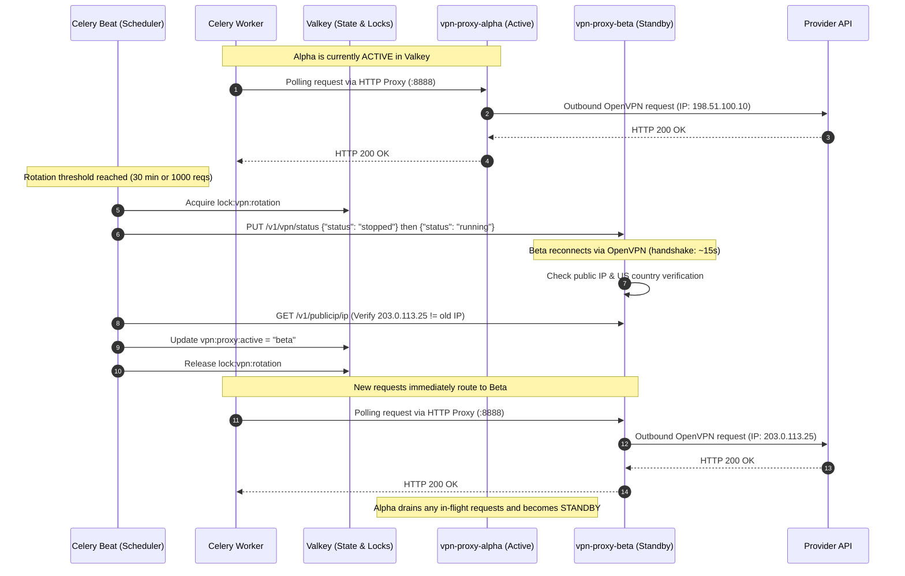

# DESIGN_VPN_ROTATION: Worker VPN & Proxy Rotation Architecture

This document defines the architectural blueprint for routing external campsite provider API requests through a periodically rotating VPN/proxy layer. Its primary objective is to eliminate IP bans, avoid WAF blocks (Cloudflare, AWS WAF, Akamai), and bypass rate-limiting thresholds (HTTP 429) across providers (e.g., Recreation.gov, ReserveCalifornia, UseDirect).

---

## 🎯 Architecture Principles & Defaults

1. **Default Off (Zero Overhead)**: By default, `camply` operates with **no VPN or proxy layer enabled** (`CAMPLY_PROXY_ENABLED=false`). In this default state, provider API requests connect directly to upstream services exactly as they do today, incurring zero latency or infrastructure overhead.
2. **Opt-In Infrastructure via Docker Compose Profiles**: VPN sidecars are configured under Docker Compose `profiles: ["vpn"]`. Standard development commands (`task dev`, `docker compose up`) will not start VPN containers unless explicitly commanded.
3. **OpenVPN Service Credentials**: VPN authentication uses standard OpenVPN service credentials (`OPENVPN_USER` / `OPENVPN_PASSWORD`) supported by NordVPN and nearly all commercial VPN providers.
4. **Zero-Downtime Dual-Proxy Topology**: When enabled, two proxy sidecars (`vpn-proxy-alpha` and `vpn-proxy-beta`) run in parallel. Rotations happen in the background on the standby proxy before swapping active traffic, eliminating request blackout windows.
5. **Strict Kill-Switch by Default (`CAMPLY_VPN_STRICT=true`)**: When proxy routing is active, requests must never silently fall back to the host's cleartext IP address if the VPN drops. Failed proxy connections defer Celery tasks with a retryable exception.

---

## 🏗️ Architectural Topology: The Proxy Sidecar Pattern

### Evaluation of Approaches

| Approach | Reliability | Celery/DB Safety | Zero-Downtime Rotation | Default-Off Simplicity |
| :--- | :--- | :--- | :--- | :--- |
| **A. Network Namespace Sharing** (`network_mode: service:vpn`) | ❌ Low | ❌ Broken (drops Valkey/DB connections) | ❌ No (causes in-flight request resets) | ❌ Complex coupling |
| **B. In-Worker VPN Process** (OpenVPN inside Celery container) | ❌ Fragile | ❌ Risky (messes with container routing table) | ❌ No | ❌ Difficult to maintain |
| **C. Dedicated Dual-Proxy Sidecar Pool (CHOSEN)** | ✅ High | ✅ Completely Isolated (internal traffic untouched) | ✅ Yes (Active/Draining pool) | ✅ Clean toggle via config |

### Chosen Pattern: Decoupled Multi-Proxy Sidecar Pool

Celery workers must **never** route their entire container network stack through a VPN tunnel. Workers must maintain uninterrupted, ultra-reliable connections to:
- **PostgreSQL (`db:5432`)** for transactional state
- **Valkey (`valkey:6379`)** for task queues, locks, and heartbeats
- **Prometheus (`prometheus:9090`)** for scraping metrics
- **Pushover API** for critical user notifications

Instead, we introduce **Gluetun** proxy sidecars. Gluetun acts as an encrypted OpenVPN client that terminates the VPN tunnel and exposes a local, non-leaking **HTTP proxy** (port `8888`) within the Docker internal network.

```mermaid
graph TD
    subgraph Camply Docker Network ["camply-network (Internal Docker Bridge)"]
        subgraph CeleryWorkerPod ["Celery Worker Container"]
            WorkerProcess["Celery Worker Process (concurrency=4)"]
            ProxySelector{"Proxy Enabled?"}
            DirectClient["Direct httpx.AsyncClient (Default)"]
            ProxiedClient["Proxied httpx.AsyncClient"]
        end

        DB[(PostgreSQL)]
        Valkey[(Valkey Cache & Broker)]
        Beat[Celery Beat Scheduler]

        subgraph VPNProxyCluster ["Optional VPN Cluster (Compose Profile: vpn)"]
            ProxyA["gluetun-alpha<br/>(Active Proxy - US East)<br/>HTTP :8888 | Control :8000"]
            ProxyB["gluetun-beta<br/>(Standby / Rotating - US West)<br/>HTTP :8888 | Control :8000"]
        end
    end

    subgraph ExternalInternet ["Public Internet"]
        DirectEgress["Host Public IP (Direct Outbound)"]
        NordVPNEast["NordVPN Server (Atlanta / New York)"]
        NordVPNWest["NordVPN Server (Los Angeles / Seattle)"]
        RecDotGov["Recreation.gov API"]
        ReserveCal["ReserveCalifornia / Tyler API"]
        OtherParks["State Park APIs (FL, VA, etc.)"]
    end

    %% Internal Communication (Always Direct)
    WorkerProcess -->|Direct SQL: port 5432| DB
    WorkerProcess -->|Direct Valkey: port 6379| Valkey
    Beat -->|Enqueue Tasks| Valkey

    %% Default Flow (No VPN)
    WorkerProcess --> ProxySelector
    ProxySelector -->|CAMPLY_PROXY_ENABLED=false (Default)| DirectClient
    DirectClient --> DirectEgress
    DirectEgress --> RecDotGov

    %% Opt-in Flow (VPN Enabled)
    ProxySelector -->|CAMPLY_PROXY_ENABLED=true| ProxiedClient
    ProxiedClient -->|Active: Port 8888| ProxyA
    ProxiedClient -.->|Failover / Rotated: Port 8888| ProxyB

    %% OpenVPN Tunnels
    ProxyA == OpenVPN Tunnel ==x NordVPNEast
    ProxyB == OpenVPN Tunnel ==x NordVPNWest

    %% Proxied Outbound
    NordVPNEast --> RecDotGov
    NordVPNEast --> ReserveCal
    NordVPNWest --> OtherParks
```

---

## 🛡️ VPN Technology & Gluetun Configuration

We standardize on **Gluetun** (`qmcgaw/gluetun`), configured with **OpenVPN service credentials** (`OPENVPN_USER` / `OPENVPN_PASSWORD`).

### OpenVPN Configuration Highlights
1. **Universal Provider Compatibility**: Standard OpenVPN service credentials work out-of-the-box with NordVPN, Surfshark, ProtonVPN, PIA, CyberGhost, etc.
2. **Kill-Switch Guarantee**: Gluetun includes built-in iptables firewall rules preventing any cleartext egress leak if the tunnel drops.
3. **Local HTTP Proxy**: Gluetun embeds an HTTP proxy on port `8888`.
4. **Control REST API**: Exposes a local control endpoint on port `8000` to inspect public IP or command reconnection.
5. **Strict Geographic Targeting**: Provider APIs (Recreation.gov, ReserveCalifornia) frequently reject or block overseas IP addresses. Gluetun locks exit nodes via `SERVER_COUNTRIES=United States`.

### Compose Service Definition (`docker-compose.yaml`)

Both proxy services use `profiles: ["vpn"]`, ensuring they only start when requested via `--profile vpn` or `COMPOSE_PROFILES=vpn`:

```yaml
services:
  vpn-proxy-alpha:
    image: qmcgaw/gluetun:v3
    container_name: camply-vpn-alpha
    profiles: ["vpn"]
    cap_add:
      - NET_ADMIN
    devices:
      - /dev/net/tun:/dev/net/tun
    environment:
      - VPN_SERVICE_PROVIDER=nordvpn
      - VPN_TYPE=openvpn
      - OPENVPN_USER=${NORDVPN_OPENVPN_USER}
      - OPENVPN_PASSWORD=${NORDVPN_OPENVPN_PASSWORD}
      # Region targeting: strictly US to prevent provider geo-blocking
      - SERVER_COUNTRIES=United States
      - SERVER_REGIONS=US East,US Central
      - HTTPPROXY=on
      - HTTPPROXY_LOG=off
      - FIREWALL_OUTBOUND_SUBNETS=172.16.0.0/12,192.168.0.0/16,10.0.0.0/8
    healthcheck:
      test: ["CMD", "/gluetun-entrypoint", "healthcheck"]
      interval: 15s
      timeout: 5s
      retries: 3
    restart: unless-stopped

  vpn-proxy-beta:
    image: qmcgaw/gluetun:v3
    container_name: camply-vpn-beta
    profiles: ["vpn"]
    cap_add:
      - NET_ADMIN
    devices:
      - /dev/net/tun:/dev/net/tun
    environment:
      - VPN_SERVICE_PROVIDER=nordvpn
      - VPN_TYPE=openvpn
      - OPENVPN_USER=${NORDVPN_OPENVPN_USER}
      - OPENVPN_PASSWORD=${NORDVPN_OPENVPN_PASSWORD}
      - SERVER_COUNTRIES=United States
      - SERVER_REGIONS=US West,US Central
      - HTTPPROXY=on
      - HTTPPROXY_LOG=off
      - FIREWALL_OUTBOUND_SUBNETS=172.16.0.0/12,192.168.0.0/16,10.0.0.0/8
    healthcheck:
      test: ["CMD", "/gluetun-entrypoint", "healthcheck"]
      interval: 15s
      timeout: 5s
      retries: 3
    restart: unless-stopped
```

---

## 🔄 Dual-Proxy Zero-Downtime Rotation

OpenVPN connection handshakes take 10–25 seconds. During this reconnection window, an individual proxy container cannot handle traffic. A **dual-proxy pool (`alpha` and `beta`)** completely eliminates this downtime.



### Three Triggers for Rotation

1. **Periodic Time-Based Rotation** (`CAMPLY_VPN_ROTATION_INTERVAL_MINUTES=30`):
   - Managed by Celery Beat scheduler (`camply.vpn.rotate_pool`).
   - Ensures IPs are refreshed even during low-volume periods to prevent long-term tracking.
2. **Volume-Based Rotation** (`CAMPLY_VPN_MAX_REQUESTS_PER_IP=1000`):
   - Prevents traffic volume spikes from raising statistical bot detection flags on provider WAFs.
3. **Reactive / Error-Driven Rotation** (Immediate Failover):
   - If an upstream call returns **HTTP 429 (Too Many Requests)** or **HTTP 403 (Forbidden / WAF Block)**, the worker flags the current IP as `TAINTED` in Valkey, immediately points active traffic to the standby proxy, and retries the request.

---

## 💻 Application Integration Plan

### 1. Configuration Settings (`backend/config.py` & `worker/config.py`)

```python
class WorkerSettings(BaseSettings):
    # Existing settings...
    valkey_url: str = "redis://localhost:6379/0"

    # VPN / Outbound Proxy Settings (Default: OFF)
    camply_proxy_enabled: bool = False
    camply_proxy_urls: list[str] = [
        "http://vpn-proxy-alpha:8888",
        "http://vpn-proxy-beta:8888",
    ]
    camply_proxy_control_urls: list[str] = [
        "http://vpn-proxy-alpha:8000",
        "http://vpn-proxy-beta:8000",
    ]
    camply_vpn_rotation_interval_minutes: int = 30
    camply_vpn_max_requests_per_ip: int = 1000
    camply_vpn_strict: bool = True  # Strict kill-switch: fail if proxy down, never leak cleartext IP
```

### 2. BaseProvider & RetryTransport Dynamic Routing

In `backend/packages/providers/providers/base.py`:
- When `camply_proxy_enabled=false` (the default), `BaseProvider` initializes `httpx.AsyncClient` with direct `httpx.AsyncHTTPTransport`. Zero proxy logic or Valkey lookups occur.
- When `camply_proxy_enabled=true`, `BaseProvider` uses the active proxy from `ProxyManager`.

```python
class RetryTransport(httpx.AsyncHTTPTransport):
    def __init__(
        self,
        retry_strategy: RetryStrategy | None = None,
        circuit_breaker: ProviderCircuitBreaker | None = None,
        proxy_url: str | None = None,
    ) -> None:
        self._retry_strategy = retry_strategy or RetryStrategy()
        self._circuit_breaker = circuit_breaker
        self._proxy_url = proxy_url
        self._inner = httpx.AsyncHTTPTransport(proxy=proxy_url) if proxy_url else httpx.AsyncHTTPTransport()
        super().__init__()
```

### 3. Strict Kill-Switch Handling (`CAMPLY_VPN_STRICT=true`)

When proxy routing is enabled:
- If a connection to the proxy fails (`httpx.ProxyError` / `httpx.ConnectError`), the worker checks `CAMPLY_VPN_STRICT`.
- Because `CAMPLY_VPN_STRICT=true` is the default when VPN is enabled, the worker **refuses to fall back to a direct connection**.
- The task is rejected with `ProxyUnavailableError`, triggering standard Celery task backoff until the proxy recovers, ensuring the host's cleartext WAN IP is never exposed to upstream reservation providers.

---

## 📊 Observability & Admin Operations

### 1. Prometheus Metrics

| Metric Name | Type | Labels | Description |
| :--- | :--- | :--- | :--- |
| `camply_vpn_proxy_requests_total` | Counter | `proxy_host`, `status`, `provider` | Count of requests routed through proxy |
| `camply_vpn_rotations_total` | Counter | `reason`, `proxy_host`, `success` | Rotations categorized by trigger reason |
| `camply_vpn_egress_ip_changes_total` | Counter | `proxy_host` | Verified unique IP changes |
| `camply_vpn_current_ip_info` | Gauge | `proxy_host`, `ip`, `city`, `country` | Current egress IP and geolocation info |

### 2. Admin UI Status & Manual Control

Under `/admin/operations`, when `CAMPLY_PROXY_ENABLED=true`:
- **Active VPN Status**: Card displaying current public IP, ISP/DataCenter, City/State, and connection protocol (OpenVPN).
- **Session Stats**: Number of requests served on current IP, uptime, and last rotation timestamp.
- **Manual "Rotate IP Now" Button**: Triggers `POST /api/admin/operations/vpn/rotate`, allowing operators to manually cycle IPs on demand.
- **Disabled State**: When `CAMPLY_PROXY_ENABLED=false`, the Admin UI shows a clean "Direct (No VPN)" badge.

---

## 🔒 Security, Credentials & Best Practices

1. **OpenVPN Service Credentials**:
   - Commercial VPNs (NordVPN, Surfshark, etc.) issue dedicated **OpenVPN Service Credentials** separate from user account passwords.
   - Always inject via environment variables (`NORDVPN_OPENVPN_USER`, `NORDVPN_OPENVPN_PASSWORD`). Never commit credentials to version control.
2. **DNS Leak Prevention**:
   - Gluetun uses Unbound DNS over TLS inside the VPN tunnel. Provider domain lookups are resolved inside the encrypted VPN tunnel, avoiding DNS poisoning or ISP sniffing.
3. **Provider Geo-Fencing**:
   - Upstream providers reject international or cloud-datacenter IPs. `SERVER_COUNTRIES=United States` is strictly enforced to ensure all acquired IPs are within the US domestic pool.
