# Releases

Releases use the Gitmoji/semantic-release infrastructure from [cookiecutter-python](https://github.com/juftin/cookiecutter-python), with [juftin/actions/semantic-release](https://github.com/juftin/actions/tree/v1.4.0/semantic-release) pinned to v1.4.0. The workflow pins npm 10.9.9 because npm 11 rejects that action's lockfile; its dependency installation and registry signature verification have been verified with npm 10.

## Flow

Every push to `main` starts `.github/workflows/release.yaml`. It calls the entire existing CI workflow, including lint, types, tests, OpenAPI drift, live smoke checks, visual snapshots, and Docker builds. After all checks succeed, `task publish:latest` publishes both images even when no semantic release is needed. The workflow then runs semantic-release. Publication runs only in `juftin/camply-web`; pull requests and manually dispatched CI runs only validate changes.

Release runs are serialized without cancelling an active run. GitHub may replace a pending run with a newer push; semantic-release considers all unreleased commits on `main`.

```mermaid
flowchart LR
    Push[Push to main] --> CI[Complete CI suite]
    CI --> Latest[Publish latest images]
    Latest --> Analyze[Analyze Gitmoji commits]
    Analyze -->|Release needed| Prepare[Stamp application versions]
    Prepare --> Source[Build workspace sdists]
    Source --> Images[Build and push both GHCR images]
    Images --> Release[Create version tag and GitHub release]
    Release --> Major[Advance Git major alias]
```



The preparation hook runs `task release:prepare RELEASE_VERSION=1.2.3`, `task dist`, and `task publish RELEASE_VERSION=1.2.3`. Preparation stamps the backend root and all four workspace packages, updates `backend/uv.lock`, and sets the frontend package version. Those changes exist only in the release runner; development version files remain unchanged in Git. The API's installed package metadata matches the image version. Tags identify the exact source commit.

The GitHub release provides generated release notes and version-stamped Python source distributions: `backend-1.2.3.tar.gz`, `db-1.2.3.tar.gz`, `providers-1.2.3.tar.gz`, and `worker-1.2.3.tar.gz`. `task dist` clears stale build outputs and builds all four installable workspace packages into `dist/`; the virtual workspace root has no distribution. The GitHub plugin attaches `dist/*.tar.gz`. Source builds complete before image publication, so build failures prevent release creation. Packages are not uploaded to PyPI and the legacy CLI is not built. Application hosting, server rollouts, and database migrations remain separate operator tasks.

## Version rules

The default [semantic-release-gitmoji rules](https://github.com/momocow/semantic-release-gitmoji#releaserules) apply to commits since the last release:

| Commit Gitmoji                                      | Version bump             |
| --------------------------------------------------- | ------------------------ |
| 💥 / `:boom:`                                       | Major                    |
| ✨ / `:sparkles:`                                   | Minor                    |
| 🐛 / `:bug:`, 🚑 / `:ambulance:`, 🔒 / `:lock:`     | Patch                    |
| Documentation, tests, CI changes, and other Gitmoji | No release by themselves |

The highest bump wins. Squash-merged PR titles must retain the appropriate Gitmoji. With no existing release tags, the first qualifying release is **1.0.0**, regardless of the development package versions. Subsequent full-version Git tags are `v1.0.1`, `v1.1.0`, etc. After release success, [semantic-release-major-tag](https://github.com/doteric/semantic-release-major-tag), already bundled with the shared action, creates or updates the matching Git alias (`v1`, `v2`, etc.) to the released commit. Only stable releases on `main` are configured; the plugin's default behavior excludes prereleases.

## Images

| Image                            | Tags for version 1.2.3  |
| -------------------------------- | ----------------------- |
| `ghcr.io/juftin/camply-backend`  | `1.2.3`, `v1`, `latest` |
| `ghcr.io/juftin/camply-frontend` | `1.2.3`, `v1`, `latest` |

The backend image also runs Celery workers and beat. Both images include OCI source, source-revision, and version labels and use separate GitHub Actions build caches. Frontend releases use a same-origin `/api` URL, preserving the existing Nginx proxy setup.

`latest` advances on every successful `main` build, including documentation and CI changes. These builds retain development package versions and carry a `sha-<commit>` OCI version label. If the same commit produces a semantic release, its version-stamped images also update `latest`. A moving major tag such as `v1` advances only on stable releases within that major; a `2.0.0` release updates `v2` and leaves `v1` unchanged. Docker Bake maintains the image aliases, while the semantic-release plugin maintains the corresponding Git aliases.

Pin a full version or image digest when selecting an exact deployment version. The existing development Compose configuration builds local images; setting `BACKEND_VERSION`/`FRONTEND_VERSION` alone does not switch it to pulling released images.

## Repository setup

- Enable GitHub Actions and allow the pinned actions used by these workflows.
- Allow the release job's `GITHUB_TOKEN` to write repository contents and packages. It creates release tags and GitHub releases and pushes GHCR images. No personal access token or Docker Hub credentials are needed.
- For existing GHCR packages, grant `camply-web` write access under each package's **Manage Actions access** settings. Choose package visibility separately if anonymous pulls are desired.
- If repository rules restrict version tags, allow the release workflow's token to create full-version tags and create or update moving major aliases. It does not push commits to `main`.
- Keep existing CI checks required for pull requests. `release.yaml` calls the unchanged CI jobs under a `ci` job; inspect the resulting check names after the first push before changing branch rules.

Latest-image publication runs before semantic-release, so commits without a version bump still publish. Versioned and major-alias publication occurs within the semantic-release preparation hook, before tag creation. Neither path depends on a `release: published` workflow event, which would not run when the release is created with `GITHUB_TOKEN`.

## Verification and recovery

Run `task release:test` to exercise version stamping with a fresh uv cache, inspect source archive metadata and required files, rebuild wheels from the sdists, verify the GitHub asset glob, and validate real Docker Bake publication plans in temporary fixtures without pushing images. `task test` includes these checks. They require Node, uv, Task, tar, and Docker Buildx, but no Docker daemon or credentials. Dependency resolution and isolated builds may fetch metadata/build dependencies from the package index. `task dist` builds development-version sdists directly when inspecting the current checkout. Workflow syntax can also be checked with `actionlint`.

To inspect the current checkout's publication plan without building or pushing:

```bash
CI=true RELEASE_VERSION=1.2.3 task publish -- --print
CI=true GITHUB_SHA=$(git rev-parse HEAD) task publish:latest -- --print
```

After merging, inspect the `release` workflow, the GitHub release's four `.tar.gz` assets, both GHCR tags, and the matching Git major alias. Confirm the OCI revision label and major alias match the released full Git tag. Publishing to GitHub and GHCR is exercised only by the hosted workflow; local checks do not create releases.

If CI, source builds, or image publication fail before a Git tag exists, fix the failure and rerun the failed workflow. Image tags are separate registry writes, so a failed run may have published one component; retrying completes publication. `latest` may already have advanced when a later semantic-release step fails. If semantic-release has already pushed the full Git tag but release creation or asset upload failed, complete the release in GitHub using that existing tag and build/upload any missing sdists from the tagged checkout with its release version. If the major-alias success hook fails, correct its tag permissions and move only that major alias to the verified full-version tag. Rerunning semantic-release alone will not repeat hooks for an already tagged release. Do not delete a published full-version tag to force a new release.
