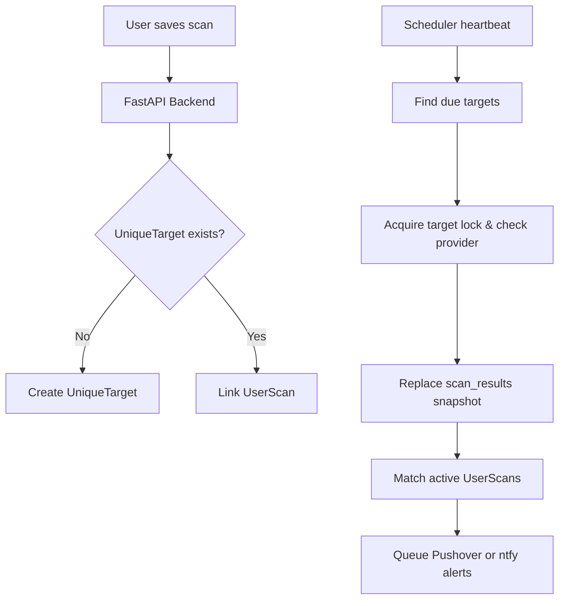

# Polling Engine Architecture

camply separates target polling from user notifications so multiple campers watching the same campground share a single upstream check cycle.

## Package boundaries

The Python codebase ships as one `camply` distribution with strict internal layering (`cli | server | worker -> core -> providers -> db -> __about__`):

- **Base package (`core`, `providers`, `db`, `cli`):** Provides upstream discovery, availability matching, SQLite persistence, and the foreground CLI with no server or broker dependencies.
- **Server (`camply.server`):** FastAPI app, auth, and standalone lifespan runtime (`server` extra).
- **Worker (`camply.worker`):** Shared async polling engine (`camply.worker.engine`) plus Celery/Valkey adapters (`distributed` extra).

## Why de-duplication matters

If ten users watch Yosemite's Lower Pines for the same dates, naive polling makes ten identical upstream requests per cycle and risks IP bans. Instead, camply normalizes each `(provider_id, campground_id, start_date, end_date)` tuple into one shared `UniqueTarget` row and links each `UserScan` subscription to it.

## Target lifecycle and concurrency

A `UniqueTarget` transitions through four states:

1. **Initialized:** Created when the first scan references a campground and date range.
2. **Active:** Eligible for checks while at least one linked `UserScan` is active and enabled.
3. **Cooldown:** After a check updates `last_checked_at`, the target waits until `CAMPLY_TARGET_COOLDOWN` (default `55` seconds) elapses.
4. **Dormant:** Marked inactive when no active scans remain; kept for inspection but skipped during discovery.

In distributed mode, workers acquire a Valkey lock (`lock:target_id`) before calling a provider so concurrent workers never poll the same target simultaneously. In standalone mode, `camply.worker.runtime` runs bounded in-process async loops inside the FastAPI lifespan—avoiding duplicate checks on a single host.

## Fan-out matching and area rounds

- **Blind polling:** The poller asks only what campsites are open for the target's dates, converts responses to `CampsiteDTO`s, and replaces `scan_results` atomically.
- **Per-subscriber filtering:** Each `UserScan` filters the shared snapshot by its own `min_stay_length`, `allowed_weekdays`, `preferred_types`, and `require_electric` preferences without extra provider calls.
- **Recreation-area rounds:** Area scans join one `UserScan` to one `UniqueTarget` per eligible member campground via `scan_targets`. `prepare_rounds()` reconciles membership against the latest `providers.catalog_revision`, recovers stale attempts after `105` seconds, and bounds each round with `round_deadline_at` (`2 * CAMPLY_HEARTBEAT_INTERVAL + 780` seconds) so one slow campground cannot stall other results.
- **Catalog atomicity:** Providers like Recreation.gov parse complete archives in memory before updating `recreation_areas`, `campgrounds`, and `search` in one transaction.

## Foreground CLI execution

`camply.core.search` reuses the same consecutive-night matcher (`camply.db.availability.matching_available_dates`) as saved web scans, but runs sequentially in the foreground using one shared provider client with no database persistence or notification queues.
