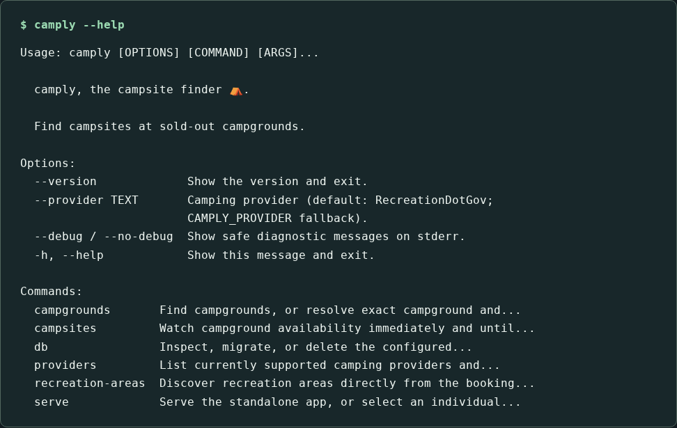
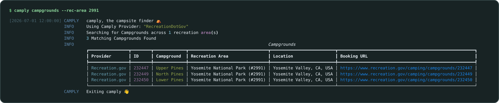
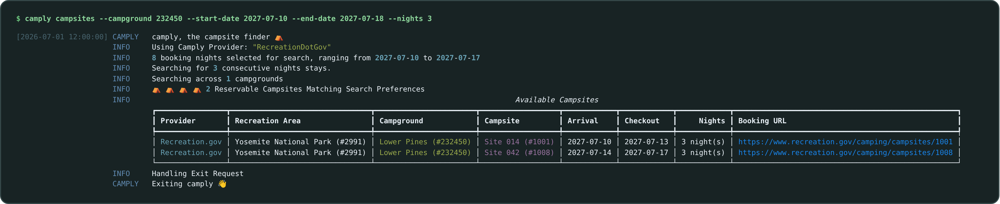

# Command line

Install the base package in an isolated environment to use the `camply` executable:

```bash
uv tool install camply-web
camply --help
```



Legacy `camply` and `camply-web` both install an executable named `camply`. Use
separate environments when keeping both generations. No server extra, account,
database migration or catalog import is needed for these commands. Internet access
to the booking provider is required for discovery and availability.

## Discover locations

```bash
camply providers
camply recreation-areas --search Yosemite --state CA
camply campgrounds --rec-area 2991
camply --provider ReserveCalifornia campgrounds --search redwood
```



`providers` lists the current 13 camping providers. Provider names and registered
class aliases are case-insensitive. The default is `RecreationDotGov`. Set
`CAMPLY_PROVIDER` to change it, or supply `--provider` before or after the discovery
or availability command. A command option overrides a root option, which overrides
the environment. `--debug` and `--no-debug` work at both positions.

Copy native IDs from discovery. IDs belong to the selected provider and may contain
letters, punctuation or leading zeroes. `campgrounds --campground ID` resolves the
exact ID even when it is outside the first discovery page. Multiple `--rec-area`
values combine their campgrounds. Explicit campground IDs take precedence over
area IDs; the command reports ignored areas. Unknown or unbookable selections fail
with an error.

Discovery displays up to 50 results and reports when more exist. Narrow the text,
state or area filter to find more specific locations. Recreation.gov uses its
upstream search relevance; other providers match names and cities. ReserveAmerica
has no separate recreation-area catalog; supply a state to avoid scanning every
state when searching it.

## Watch for a stay

```bash
camply campsites --campground 232450 \
  --start-date 2027-07-10 --end-date 2027-07-18 --nights 3
```



The command checks immediately, prints qualifying stays and booking links, and
continues checking after empty or matching results. Stop it with Ctrl-C. It uses
existing provider request pacing and retry behavior, with an internal one-minute
wait between successful cycles. Provider failures produce an error. Detailed
scheduling and run-mode options remain deferred.

Provide at least one campground or recreation area. Area monitoring resolves every
eligible campground, independently of the discovery display limit. Repeat date
flags to supply multiple windows; starts and ends pair by occurrence order. Arrival
is inclusive and checkout is exclusive. Past starts are clamped to UTC today with
a warning; expired windows are rejected. Overlapping windows and duplicate targets
do not cause duplicate checks.

`--nights` defaults to one and produces exact-length consecutive stays at a single
site. A four-night opening yields two overlapping three-night stays with
`--nights 3`. `--day Friday --day Saturday` restricts eligible nights. `--weekends`
adds Friday and Saturday to explicitly selected days. A requested stay that cannot
fit the selected dates and days fails before checking availability.

Results appear on stdout; warnings, errors and debug diagnostics appear on stderr.
Availability is a live observation and can change before you complete a booking.

## Initial coverage

This delivery supports current-provider discovery and campground-based monitoring
with terminal output. It sends no external notifications and reads no notification
credentials. Existing web Pushover delivery is configured separately.

Site listing, campsite-ID selection, external notifications including Pushover,
missing legacy campground providers/deployments, YAML files, permits, equipment
filtering, TUI, Rich-click, configuration wizard, legacy run-mode switches,
first-try notification controls and offline/persistent history are deferred. Those
commands and flags are rejected. See the [tracked TODOs](specs/026-cli-parity/tasks.md#deferred-todo-registry).

Existing `camply serve` roles/health checks and `camply db` management commands
retain their behavior and dependency requirements. See [running and packaging](operations/RUNNING.md).
