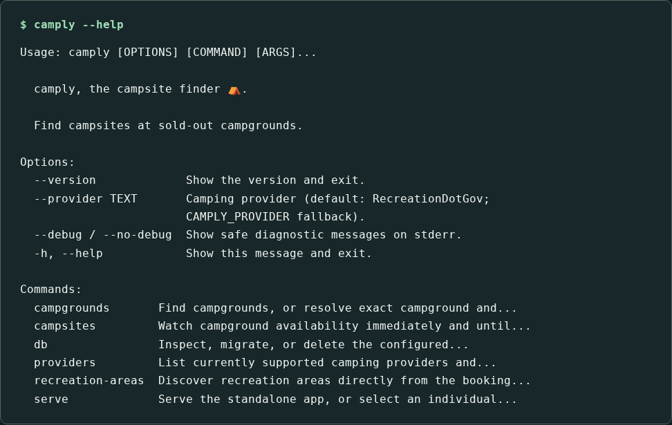

# Command line

The `camply` CLI discovers campgrounds and watches live availability straight from your terminal. It talks directly to booking providers and needs no web account, database, or server setup.

Install it into an isolated environment with [uv](https://docs.astral.sh/uv/), or run commands one-off with `uvx`:

```bash
uv tool install camply-web
camply --help
```



`camply-web` is the pre-release package for **camply v2** and will become `camply` once v2 is stable. Version 2 redesigns the CLI and YAML configuration with breaking changes from v1. If you still have v1 `camply` installed, keep `camply-web` in a separate `uv` tool environment because both provide a `camply` executable.

## Discover locations

List the 26 supported providers (including their site-attribute filter capabilities), search recreation areas, find exact campground IDs, and inspect individual campsites inside a campground:

```bash
camply providers
camply recreation-areas --search Yosemite --state CA
camply campgrounds --rec-area 2991 --limit 100
camply list-campsites --campground 232450 --electric --rv-length 28
camply --provider ReserveCalifornia campgrounds --search redwood
```


`RecreationDotGov` is the default provider. Pass `--provider` (case-insensitive) to choose another. Discovery prints up to 50 matches by default—pass `--limit` (`1`–`500`) to show more, or add `--search`, `--state`, or `--rec-area` to narrow results. `list-campsites` works across all 26 providers and supports `--search`, `--campsite-type`, `--electric`, `--accessible`, `--rv-length`, `--limit`, and `--json`. When searching `ReserveAmerica`, include `--state` so camply does not scan every state.

## Watch for a stay

Pass one or more `--campground` or `--rec-area` IDs from discovery along with paired `--start-date` and `--end-date` flags:

```bash
camply campsites --campground 232450 \
  --start-date 2027-07-10 --end-date 2027-07-18 --nights 3
```


camply checks availability right away, prints matching stays with booking links, and re-checks every `--interval` minutes (default `10`, minimum `5`) until all requested booking dates pass or you press `Ctrl-C`. Transient provider errors during continuous watches are logged and retried on the next interval without resetting alert history.

- **Run modes:** Continuous watching is the default. Pass `--search-once` to run a single check and exit immediately, or `--stop-on-match` to keep watching until the first cycle that finds a qualifying stay and then exit cleanly.
- **Dates:** `--start-date` is check-in (inclusive) and `--end-date` is checkout (exclusive). Repeat both flags in pairs to watch multiple date windows in one command.
- **Stay length:** `--nights` defaults to `1` and matches exact-length consecutive stays at a single site (for example, a 4-night opening yields two 3-night options when `--nights 3`).
- **Targets:** Multiple `--rec-area` flags combine their campgrounds. If you pass `--campground` alongside `--rec-area`, explicit campground IDs win.

## Run multiple searches from a YAML file

Save this minimal configuration in `camply.yaml` to watch May at Lower Pines in Yosemite and February at Furnace Creek in Death Valley. Choose IDs and dates for your trip, and quote IDs to preserve leading zeros. [Lower Pines](https://www.recreation.gov/camping/campgrounds/232450), [Furnace Creek](https://www.recreation.gov/camping/campgrounds/232496).

```yaml
version: 2
searches:
  - name: yosemite
    provider: RecreationDotGov
    campgrounds: ["232450"]
    dates:
      - start_date: "2027-05-01"
        end_date: "2027-06-01"
  - name: death-valley
    provider: RecreationDotGov
    campgrounds: ["232496"]
    dates:
      - start_date: "2027-02-01"
        end_date: "2027-03-01"
```

The required top-level `version: 2` identifies the YAML format. Camply reports unsupported versions before starting any searches.

Run continuously, stop on match, or check once:

```bash
camply campsites --yaml-config camply.yaml
camply campsites --yaml-config camply.yaml --stop-on-match
camply campsites --yaml-config camply.yaml --search-once --json
```

To see every option, [download the full `camply.yaml` example](https://camply.rocks/docs/examples/camply.yaml) or save it with cURL.

```bash
curl --fail --location --output camply.yaml https://camply.rocks/docs/examples/camply.yaml
```

::: details Full configuration example

<<< @/public/examples/camply.yaml

:::

Both examples print results to the terminal. To enable alerts, add any supported channel (`pushover`, `ntfy`, `webhook`, `discord`, `slack`, `telegram`) to `defaults.notifications` or a search's `notifications`, optionally tune `max_notifications` (`1`–`100`, default `5`) or `stop_on_match`, and set the corresponding environment variables before running the command.

Searches inherit settings they omit from `defaults`. A search's list replaces the shared list, so `notifications: []` keeps that search console-only. Use `rv_length: null` to clear an inherited minimum RV length. Names, providers, targets, dates, and state files are set per search. Relative state paths are resolved from the directory containing the YAML file. Channel credentials and destinations come from the environment.

Set `days` and `weekends` in `defaults`, beside `dates` in a search, or inside a date range. Each setting inherits independently. A range overrides its search, and a search overrides `defaults`. `days: []` clears inherited weekdays, and `weekends: false` turns off the inherited weekend filter. With `weekends: true`, Friday and Saturday are included along with any `days` you list. If date ranges overlap, a night qualifies when any range covering it allows it.

With `--search-once --json`, the CLI outputs one ordered array with each search's `name`, `provider`, `status`, and `stays`. A search with no matches returns `ok` and an empty list. A failed search returns `error`, and the command exits with status 1 after the batch finishes. Local validation errors exit with status 2. Diagnostics go to stderr.

Editors that use the YAML Language Server read the schema URL from the full example's first line. For other editors, associate the YAML file with `docs/cli-yaml-config.schema.json` from the repository. See the [configuration field reference](specs/032-cli-yaml-config/spec.md#configuration-fields) for settings and defaults.

To migrate a legacy flat file, set `version: 2` and create one entry under `searches` with a `name` and an explicit `provider`. Convert scalar target and channel values to lists, use `recreation_areas` for recreation-area IDs, and move each start and end date pair into `dates`. Use `interval` for the polling interval and the CLI's `--search-once` when you want a single pass. Replace legacy offline history settings with a per-search `state_file`.

## Filter by site type, equipment, hookups, and specific sites

Narrow availability matches to campsites that fit your setup:

```bash
camply campsites --campground 232450 \
  --start-date 2027-07-10 --end-date 2027-07-18 --nights 2 \
  --campsite-type RV --electric --accessible --rv-length 28 \
  --campsite 014
```

- `--campsite-type`: Repeat to allow `TENT`, `RV`, `CABIN`, or `OTHER` sites.
- `--electric`: Only match sites with electric hookups.
- `--accessible`: Only match ADA-accessible sites.
- `--rv-length`: Require a minimum compatible RV or trailer length in feet (`1`–`200`).
- `--campsite`: Filter by exact campsite ID or case-insensitive site name within your selected `--campground` or `--rec-area` targets.

## Filter by nights of the week

Use `--weekends` (Friday and Saturday nights) or repeat `--day` to watch specific nights across a longer range—such as any summer weekend in one command:

```bash
camply campsites --campground 232450 \
  --start-date 2027-06-01 --end-date 2027-09-01 \
  --weekends --nights 2
```

Weekday filters apply to every occupied night, not the checkout date. A `--weekends --nights 2` search matches Friday and Saturday nights with Sunday checkout. Add `--day Sunday` if you also want Saturday–Monday or Sunday nights.

In the [web app](using-camply.md), the same **Weekends** option under **Nights of the week** applies the same occupied-night rules, while showing full available blocks that meet your minimum stay length instead of fixed-length windows.

## Send notifications

Pass `--notifications` (repeatable) with one or more supported channels—`pushover`, `ntfy`, `webhook`, `discord`, `slack`, or `telegram`—to receive alerts when new qualifying stays open up. Verify your setup first with `camply test-notifications`:

```bash
export PUSHOVER_USER_KEY="your-user-key"
export PUSHOVER_APP_TOKEN="your-app-token"
camply test-notifications --notifications pushover

export NTFY_TOPIC="camply-alerts"
camply test-notifications --notifications ntfy

export DISCORD_WEBHOOK_URL="https://discord.com/api/webhooks/..."
camply test-notifications --notifications discord
```

| Channel    | Environment variables                                                                     |
| ---------- | ----------------------------------------------------------------------------------------- |
| `pushover` | `PUSHOVER_USER_KEY`, `PUSHOVER_APP_TOKEN`                                                 |
| `ntfy`     | `NTFY_TOPIC`, optional `NTFY_SERVER_URL` (default `https://ntfy.sh`), `NTFY_ACCESS_TOKEN` |
| `webhook`  | `WEBHOOK_URL`, optional `WEBHOOK_HEADERS` (JSON object of header names and values)        |
| `discord`  | `DISCORD_WEBHOOK_URL`                                                                     |
| `slack`    | `SLACK_WEBHOOK_URL`                                                                       |
| `telegram` | `TELEGRAM_BOT_TOKEN`, `TELEGRAM_CHAT_ID`                                                  |

All notification settings and webhook URLs are read from environment variables and secret tokens are never logged.

During continuous watching, camply tracks seen openings in memory and only sends alerts for newly opened or reopened stays. To prevent alert floods when many sites open at once, camply caps delivery at `--max-notifications` per channel per cycle (default `5`, range `1`–`100`) and collapses any overflow into one concise summary alert (pass `--max-notifications 1` for a single summary notification per cycle). When running single-pass checks from `cron` or a systemd timer (`--search-once`), pass `--state-file` to persist seen openings across runs:

```bash
export NTFY_TOPIC="camply-alerts"
camply campsites --campground 232450 \
  --start-date 2027-07-10 --end-date 2027-07-14 --nights 2 \
  --notifications ntfy --max-notifications 5 \
  --search-once --state-file ~/.cache/camply-yosemite.json
```

## JSON output for scripting

Pass `--json` to `providers`, `recreation-areas`, `campgrounds`, `list-campsites`, or `campsites --search-once` to emit machine-readable JSON on `stdout` while routing banners and diagnostics to `stderr`:

```bash
camply campgrounds --search Yosemite --state CA --limit 25 --json
camply list-campsites --campground 232450 --electric --json
camply campsites --campground 232450 \
  --start-date 2027-07-10 --end-date 2027-07-12 \
  --search-once --json
```

## Differences from legacy camply

The modern CLI intentionally drops several legacy v1 flags and commands in favor of simpler, safer defaults:

- **No `--continuous` or `--search-forever`:** Continuous watching is the default; use `--search-once` for a single check and `--stop-on-match` to stop once a stay is found.
- **No `--notify-first-try`:** Use `--max-notifications` (default `5`) to control per-cycle alert volume with automatic overflow summaries.
- **No `configure` or `~/.camply`:** Secrets come from explicit environment variables and multi-search setups live in `camply.yaml` (`version: 2`).
- **No `tui` or `rich-click`:** Use `camply serve` for the full interactive web UI.
