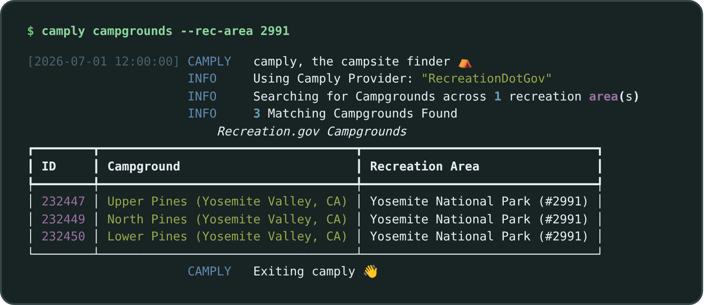
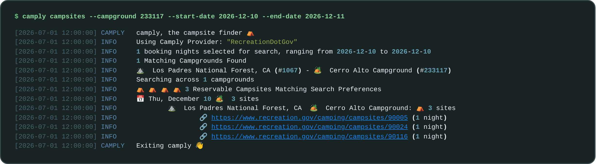

# Command line

The `camply` CLI discovers campgrounds and watches live availability straight from your terminal. It talks directly to booking providers and needs no web account, database, or server setup.

Install it into an isolated environment with [uv](https://docs.astral.sh/uv/), or run commands one-off with `uvx`:

```bash
uv tool install camply-web
camply --help
```


If you also keep legacy `camply` installed, keep `camply-web` in a separate `uv` tool environment because both install a `camply` executable.

## Discover locations

List the 26 supported providers, search recreation areas, and find exact campground IDs:

```bash
camply providers
camply recreation-areas --search Yosemite --state CA
camply campgrounds --rec-area 2991
camply --provider ReserveCalifornia campgrounds --search redwood
```



`RecreationDotGov` is the default provider. Set `CAMPLY_PROVIDER` or pass `--provider` (case-insensitive) to choose another. Discovery prints up to 50 matches—add `--search`, `--state`, or `--rec-area` to narrow results. When searching `ReserveAmerica`, include `--state` so camply does not scan every state.

## Watch for a stay

Pass one or more `--campground` or `--rec-area` IDs from discovery along with paired `--start-date` and `--end-date` flags:

```bash
camply campsites --campground 232450 \
  --start-date 2027-07-10 --end-date 2027-07-18 --nights 3
```



camply checks availability right away, prints matching stays with booking links, and re-checks about once a minute until you press `Ctrl-C`.

- **Dates:** `--start-date` is check-in (inclusive) and `--end-date` is checkout (exclusive). Repeat both flags in pairs to watch multiple date windows in one command.
- **Stay length:** `--nights` defaults to `1` and matches exact-length consecutive stays at a single site (for example, a 4-night opening yields two 3-night options when `--nights 3`).
- **Targets:** Multiple `--rec-area` flags combine their campgrounds. If you pass `--campground` alongside `--rec-area`, explicit campground IDs win.

## Filter by nights of the week

Use `--weekends` (Friday and Saturday nights) or repeat `--day` to watch specific nights across a longer range—such as any summer weekend in one command:

```bash
camply campsites --campground 232450 \
  --start-date 2027-06-01 --end-date 2027-09-01 \
  --weekends --nights 2
```

Weekday filters apply to every occupied night, not the checkout date. A `--weekends --nights 2` search matches Friday and Saturday nights with Sunday checkout. Add `--day Sunday` if you also want Saturday–Monday or Sunday nights.

In the [web app](using-camply.md), the same **Weekends** option under **Nights of the week** applies the same occupied-night rules, while showing full available blocks that meet your minimum stay length instead of fixed-length windows.

## Current CLI scope

The CLI prints live availability to stdout (and diagnostics to stderr when `--debug` is set). It does not send Pushover/ntfy alerts, filter by equipment/permit, or read YAML config files; use the [web app](using-camply.md) when you want persistent scans and background notifications.
