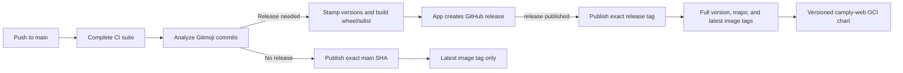

# Releases

Releases use the Gitmoji/semantic-release infrastructure from [cookiecutter-python](https://github.com/juftin/cookiecutter-python), with [juftin/actions/semantic-release](https://github.com/juftin/actions/tree/v1.4.0/semantic-release) pinned to v1.4.0. The workflow pins npm 10.9.9 because npm 11 rejects that action's lockfile; its dependency installation and registry signature verification have been verified with npm 10.

## Flow

Every push to `main` starts `.github/workflows/release.yaml`. It calls the entire existing CI workflow, including lint, types, tests, OpenAPI drift, live smoke checks, snapshot gallery verification, visual snapshots, and Docker builds. After all checks succeed, semantic-release analyzes commits and creates a release when appropriate. Publication runs only in `juftin/camply-web`; pull requests and manually dispatched CI runs only validate changes.

`.github/workflows/publish.yaml` listens for native `release: published` events. It validates the stable full-version tag, checks out that exact tag, stamps the application version, and publishes the shared `camply-web` image followed by the versioned `camply-web` Helm chart. When semantic-release finishes without a release, `release.yaml` calls this same publisher at the successful main SHA to update `latest` only. Release-producing commits build images once, through the release event. The exec success hook writes a runner-local marker used to skip the latest-only fallback.

Release runs are serialized without cancelling an active run. Artifact publication is serialized separately across both entrypoints. GitHub may replace a pending run with a newer push; semantic-release considers all unreleased commits on `main`.



The release preparation hook runs `task release:prepare RELEASE_VERSION=1.2.3` and `task dist`. Preparation stamps the single `camply` backend distribution, updates `uv.lock`, and sets the frontend package version. Those changes exist only in the runner; development version files remain unchanged in Git. The publisher repeats version preparation at the full release tag so installed application metadata matches the image version. Tags identify the exact source commit.

The GitHub release provides generated release notes and one version-stamped
Python wheel/sdist pair: `camply-1.2.3-py3-none-any.whl` and
`camply-1.2.3.tar.gz`. `task dist` clears stale build outputs and builds the
single distribution into `dist/`. The GitHub plugin attaches both artifacts.
Builds complete before release creation; no PyPI upload is configured. The
standalone sdist includes frontend inputs and prepared UI, its README, license,
typing marker, installed Gunicorn configuration, and the full Alembic migration
graph. Its wheel can be rebuilt without JavaScript tooling or repository siblings.
Checkout/release builds require Node 24 and the root package-manager pin; all
artifact-building CI jobs install that toolchain before running the build hook.
Python metadata supports >=3.11; primary development, CI, Docker, and release
fixtures use 3.14, with explicit 3.11 compatibility verification.

### Deployment of the package migration

The imports change to `camply.server`, `camply.db`, `camply.providers`, and
`camply.worker`; custom ASGI/Celery module commands must change with them.
Select `server,distributed,postgres,sentry` for the existing full deployment.
For rollout, stop beat, drain active tasks, back up the database, and replace
the API, worker, and beat together. Celery JSON wire task names and argument
shapes are preserved. Apply the existing database migration chain before
restarting processes; revision identities are retained. Rollback restores the
previous code/images and does not rewrite database history. Application
hosting, rollout, and database migrations remain separate operator tasks.

## Version rules

The default [semantic-release-gitmoji rules](https://github.com/momocow/semantic-release-gitmoji#releaserules) apply to commits since the last release:

| Commit Gitmoji                                      | Version bump             |
| --------------------------------------------------- | ------------------------ |
| 💥 / `:boom:`                                       | Major                    |
| ✨ / `:sparkles:`                                   | Minor                    |
| 🐛 / `:bug:`, 🚑 / `:ambulance:`, 🔒 / `:lock:`     | Patch                    |
| Documentation, tests, CI changes, and other Gitmoji | No release by themselves |

The highest bump wins. Squash-merged PR titles must retain the appropriate Gitmoji. With no existing release tags, the first qualifying release is **1.0.0**, regardless of the development package versions. Subsequent full-version Git tags are `v1.0.1`, `v1.1.0`, etc. After release success, [semantic-release-major-tag](https://github.com/doteric/semantic-release-major-tag), already bundled with the shared action, creates or updates the matching Git alias (`v1`, `v2`, etc.) to the released commit. Only stable releases on `main` are configured; the plugin's default behavior excludes prereleases.

## Images

This repository publishes `ghcr.io/juftin/camply-web`. Reserve `ghcr.io/juftin/camply` for the future migration to `juftin/camply` and its new version series. This image rename retains the current repository's release history and version rules.

| Image                       | Tags for version 1.2.3                                |
| --------------------------- | ----------------------------------------------------- |
| `ghcr.io/juftin/camply-web` | `v1`, `v1.2.3`, `<seven-character-git-sha>`, `latest` |

One image includes Python, Nginx, and every application runtime extra. Compose runs the API, frontend, Celery workers, and beat as separate containers using this same image. The default command is `camply serve backend`; frontend, workers, and beat select `camply serve frontend`, `camply serve worker`, and `camply serve beat`. The frontend launcher renders package-owned Nginx templates at startup and automatically locates and serves the bundled frontend assets, with a same-origin `/api` proxy. The image carries OCI source, source-revision, and version labels and uses one `camply` GitHub Actions build cache.

Each release publishes exactly four tags for that image. The SHA tag is the first seven characters of the checked-out release commit, without a prefix (for example `0123456`). Publication requires `GITHUB_SHA`; the workflow supplies the full checked-out revision and retains it in the OCI revision label.

`latest` advances on every successful `main` build, including documentation and CI changes. Builds without a semantic release retain development package versions and carry a `sha-<commit>` OCI version label. Release-producing builds publish a version-stamped image that also updates `latest`. A moving major tag such as `v1` advances only on stable releases within that major; a `2.0.0` release updates `v2` and leaves `v1` unchanged. Docker Bake maintains the image aliases, while the semantic-release plugin maintains the corresponding Git aliases.

Pin a full version or image digest when selecting an exact deployment version. The existing development Compose configuration builds local images; setting `CAMPLY_VERSION` alone does not switch it to pulling released images.

## Helm chart

Stable releases also publish `oci://ghcr.io/juftin/charts/camply-web`. The chart
version matches the application release without the `v` prefix (`1.2.3`), and its
appVersion selects the corresponding image (`v1.2.3`). The chart name is
`camply-web` for the current repository; `nameOverride: camply` preserves Kubernetes
resource names and selectors. Explicit `image.tag` or `image.digest` values still
override the packaged default.

The publisher installs Helm, authenticates it to GHCR through `--password-stdin`
with the job's runtime `GITHUB_TOKEN`, and runs `task helm:publish` only after the
release image succeeds. The task validates `CI=true` and a stable release version,
then packages and pushes `dist/camply-web-1.2.3.tgz`. Packaging overrides metadata
in the archive without editing chart source files. Latest-only main builds publish
no chart; Helm OCI versions have no `latest` or moving-major alias.

Provision the namespace and database Secret as described in the
[chart guide](../../deploy/helm/README.md), then install a published release:

```sh
helm upgrade --install camply oci://ghcr.io/juftin/charts/camply-web \
  --version 1.2.3 --namespace camply --create-namespace \
  -f my-values.yaml --wait --wait-for-jobs --timeout 15m
```

`task helm:test` verifies archive metadata, pinned images, release-only workflow
ordering, and invalid publication contexts. Tests intercept the registry push;
local verification does not upload artifacts. `task helm:package` produces a
development archive, or accepts `-- --version 1.2.3 --app-version v1.2.3` to inspect
a release package locally. Hosted publication requires package write access to
`juftin/charts/camply-web`; configure its Actions access and visibility separately
from the container image package. If chart publication fails after the image
succeeds, rerun the same **publish** workflow to retry the exact release. Do not
create or delete release tags to retry an upload.

## Repository setup

- Enable GitHub Actions and allow the pinned actions used by these workflows.
- Reuse the GitHub App configured in [juftin/renovate](https://github.com/juftin/renovate/blob/main/.github/workflows/renovate.yaml). Install it on `camply-web` with **Contents: read and write** and **Workflows: read and write**, matching Renovate's documented App setup. Make `APP_ID` and `APP_PRIVATE_KEY` available as Actions secrets in this repository. Secrets stored only in the Renovate repository are not automatically available here. Never copy private keys into source files or logs.
- The release job mints a short-lived installation token scoped to this repository with Contents and Workflows write permissions. Workflows permission allows moving Git major aliases across commits that change workflow files. It uses that token for semantic-release, ensuring GitHub emits the release event. Missing credentials fail explicitly; there is no `GITHUB_TOKEN` fallback that would suppress publishing. No new App or personal access token is needed.
- Allow the publisher's `GITHUB_TOKEN` to write packages. It reads source and pushes GHCR images and Helm charts; it does not need repository write permission or App credentials.
- For existing GHCR packages, grant `camply-web` write access under each package's **Manage Actions access** settings. Choose package visibility separately if anonymous pulls are desired.
- If repository rules restrict version tags, allow the GitHub App to create full-version tags and create or update moving major aliases. It does not push commits to `main`.
- Keep existing CI checks required for pull requests. `release.yaml` calls the unchanged CI jobs under a `ci` job; inspect the resulting check names after the first push before changing branch rules.

The release job uses the App token because releases created with `GITHUB_TOKEN` do not start native `release: published` workflows. The publisher determines its version from the release tag, never a moving major alias or the current main head.

## Verification and recovery

Run `task release:test` to check exact release/main source selection and malformed-tag rejection, exercise version stamping with a fresh uv cache, inspect source archive metadata and required files, rebuild wheels from the sdists, verify the GitHub asset glob, and validate real Docker Bake publication plans in temporary fixtures without pushing images. `task test` includes these checks. They require Node, uv, Task, tar, and Docker Buildx, but no Docker daemon or credentials. Dependency resolution and isolated builds may fetch metadata/build dependencies from the package index. `task dist` builds development-version sdists directly when inspecting the current checkout. Workflow syntax can also be checked with `actionlint`.

To inspect the current checkout's publication plan without building or pushing:

```bash
CI=true RELEASE_VERSION=1.2.3 GITHUB_SHA=$(git rev-parse HEAD) task publish -- --print
CI=true GITHUB_SHA=$(git rev-parse HEAD) task publish:latest -- --print
```

After merging and configuring the App credentials, inspect the `release` and `publish` workflows, the GitHub release's wheel/sdist pair, the GHCR image tags, the matching version at `ghcr.io/juftin/charts/camply-web`, and the matching Git major alias. Confirm the OCI revision label and major alias match the released full Git tag. Publishing to GitHub and GHCR is exercised only by the hosted workflow; local checks do not create releases.

If CI or source builds fail before a Git tag exists, fix the failure and rerun the failed release workflow. If image publication fails, rerun the failed **publish** workflow: it checks out the same full tag and uses the same release version without rerunning semantic-release. Retrying publishes the same image and completes any missing tags. A GitHub release can therefore exist while its image publication is still running or has failed.

If semantic-release has already pushed the full Git tag but release creation or asset upload failed, complete the release in GitHub using that existing tag and build/upload any missing sdists from the tagged checkout with its release version. Publish the release using App or maintainer credentials to emit the native event. If the major-alias success hook fails, correct its tag permissions and move only that major alias to the verified full-version tag. Rerunning semantic-release alone will not repeat hooks for an already tagged release. Do not delete a published full-version tag to force a new release.
