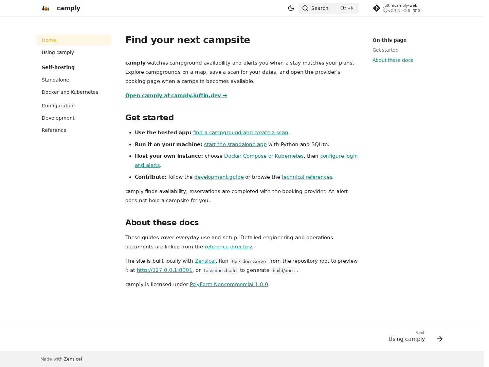
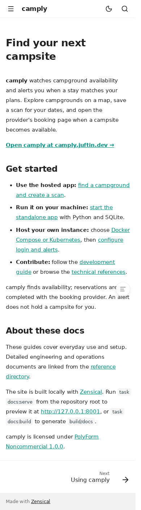

# Documentation tasks

- [x] Audit the README, setup tasks, runtime configuration, and existing reference docs.
- [x] Define scope, implementation plan, and verification strategy.
- [x] Simplify the README and preserve detailed runtime/packaging documentation.
- [x] Add the Zensical site and local uv/Task workflows.
- [x] Verify a strict build, generated links/assets, and local preview.
- [x] Update the global checklist with the completed work and validation.
- [x] Add pull-request documentation checks and CI-gated main-branch Pages publishing using the cookiecutter-python example.
- [x] Verify publishing boundaries and built links/assets; document the Pages setup and site URL.

## Validation

- `task docs:install` and `task docs:build` succeed with only the docs dependency group.
- Generated-page audit verifies all seven pages, internal links and anchors, local assets, repository references, and HTTP preview routes.
- Browser checks verify desktop navigation, light/dark switching, search results, and mobile layout. Local screenshots are saved under ignored `tmp/docs`.
- `uv lock --check`, targeted Oxfmt checks, and `git diff --check` pass.
- `task docs:check` passes both publishing-boundary and rendered-site regression tests; Actionlint validates the modified workflows.
- Full local gates pass with Python 3.14 and Node 24: `task lint`, `task check`, and `task test` (15 release tests, 828 backend tests, 68 packaging tests, 339 frontend tests, and 10 Pages proxy tests; 23 opt-in backend smoke tests skipped).

## Visual evidence

