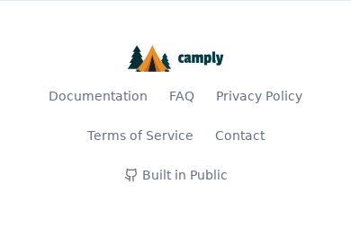

# Documentation tasks

- [x] Audit the README, setup tasks, runtime configuration, and existing reference docs.
- [x] Define scope, implementation plan, and verification strategy.
- [x] Simplify the README and preserve detailed runtime/packaging documentation.
- [x] Add the VitePress site and local Task workflows.
- [x] Verify a strict build, generated links/assets, and local preview.
- [x] Update the global checklist with the completed work and validation.
- [x] Add pull-request documentation checks and CI-gated main-branch Pages publishing using the cookiecutter-python example.
- [x] Verify publishing boundaries and built links/assets; document the Pages setup and site URL.
- [x] Replace user-facing Task setup with a verified GitHub `uv tool install` and `camply serve`; use direct Docker Compose commands and keep Task in contributor guides.
- [x] Bundle VitePress output in the frontend build via Node without separate Python dependencies.
- [x] Preserve complete wheel/sdist builds, archive validation, Docker inputs, and generator-free prepared-archive rebuilds.
- [x] Serve `/docs/` in Python and Nginx, with a footer link and real documentation 404s.
- [x] Verify bundled pages/assets, deployment paths, footer navigation, and runtime dependency isolation.

## Validation

- `task docs:install` and `task docs:build` succeed with only the docs dependency group.
- Generated-page audit verifies all seven pages, internal links and anchors, local assets, repository references, and HTTP preview routes.
- Browser checks verify desktop navigation, light/dark switching, search results, and mobile layout. Local screenshots are saved under ignored `tmp/docs`.
- `uv lock --check`, targeted Oxfmt checks, and `git diff --check` pass.
- `task docs:check` passes both publishing-boundary and rendered-site regression tests; Actionlint validates the modified workflows.
- Full local gates pass with Python 3.14 and Node 24: `task lint`, `task check`, and `task test` (15 release tests, 828 backend tests, 68 packaging tests, 339 frontend tests, and 10 Pages proxy tests; 23 opt-in backend smoke tests skipped).
- User-install follow-up: install from the public Git URL in an isolated uv tool directory with `--with 'camply[server]' --python 3.14`; verify the bundled UI, SQLite migrations, HTTP API, and CLI healthcheck. The updated strict docs build and link/publishing checks pass.
- Bundled-docs follow-up: `task lint`, `task check`, and `task test` pass, including 833 backend tests, 69 packaging tests, the footer component test, and real local Cloudflare Pages serving. A real Nginx process verifies the packaged templates' directory redirects, nested docs, search/assets, and missing-page 404s. Prepared wheels serve docs without Zensical installed; documentation tampering invalidates sdists.
- Cloudflare follow-up: a clean Python environment installs `src/frontend/requirements.txt` and builds the full frontend without uv on PATH. Pages uses its Python renderer directly; the renderer-version regression and strict docs checks pass.

## Visual evidence

