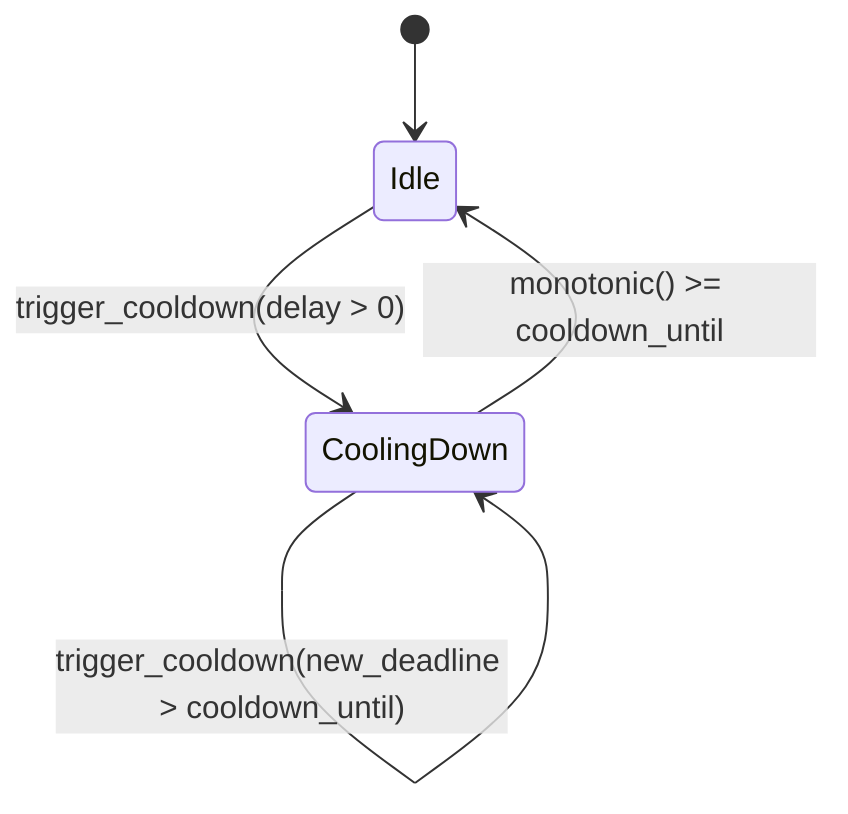
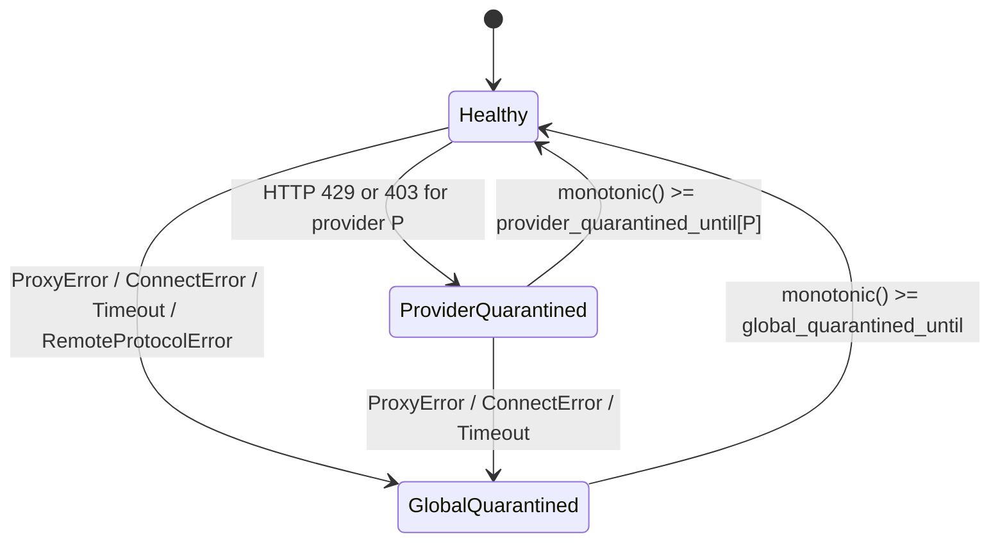

# Data Model: Shared Provider Cooldown, Pacing & Opt-In Proxy Rotation

**Feature**: [037-provider-backoff-proxy-rotation](spec.md) | **Date**: 2026-11-27

No database tables, columns, or Alembic migrations are introduced. All configuration is environment-driven via `pydantic-settings`, and all runtime cooldown, pacing, and proxy quarantine state is ephemeral in-process memory.

## 1. Configuration Model (`ProviderTransportConfig`)

Module: `src/camply/providers/transport_config.py` (new)
Base class: `pydantic_settings.BaseSettings` (`env_prefix="CAMPLY_"`, `case_sensitive=False`)

| Field                           | Environment Variable                   | Type                      | Default  | Constraints & Validation                                                                                                                    |
| ------------------------------- | -------------------------------------- | ------------------------- | -------- | ------------------------------------------------------------------------------------------------------------------------------------------- |
| `provider_max_concurrency`      | `CAMPLY_PROVIDER_MAX_CONCURRENCY`      | `int`                     | `4`      | `ge=0`; `0` disables per-provider concurrency bounding                                                                                      |
| `provider_min_interval_seconds` | `CAMPLY_PROVIDER_MIN_INTERVAL_SECONDS` | `float`                   | `0.0`    | `ge=0.0, le=60.0`; `0.0` disables global per-provider start spacing                                                                         |
| `provider_max_cooldown_seconds` | `CAMPLY_PROVIDER_MAX_COOLDOWN_SECONDS` | `float`                   | `60.0`   | `gt=0.0, le=600.0`; caps `Retry-After` waits and `wait`-policy proxy exhaustion sleeps                                                      |
| `proxy_urls`                    | `CAMPLY_PROXY_URLS`                    | `str` (`repr=False`)      | `""`     | Comma-separated proxy URLs; whitespace trimmed, empty segments skipped, exact duplicates removed in order; empty string disables proxy mode |
| `proxy_quarantine_seconds`      | `CAMPLY_PROXY_QUARANTINE_SECONDS`      | `float`                   | `60.0`   | `gt=0.0, le=3600.0`; default quarantine window for 403, proxy errors, and 429 without positive `Retry-After`                                |
| `proxy_exhausted_policy`        | `CAMPLY_PROXY_EXHAUSTED_POLICY`        | `Literal["wait", "fail"]` | `"wait"` | Case-insensitive normalized lowercase; governs all-proxies-quarantined behavior                                                             |

### Validation Rules for `proxy_urls`

1. Split on `,`, strip leading/trailing whitespace, discard empty entries.
2. Parse each non-empty entry with `urllib.parse.urlsplit`:
   - Scheme MUST be one of `http`, `https`, `socks5`, `socks5h` (normalized lowercase).
   - Hostname MUST be non-empty.
   - Port (when specified) MUST parse as an integer in `1..65535`.
   - If scheme is `socks5` or `socks5h`, `importlib.util.find_spec("socksio")` MUST be non-`None`; otherwise raise `ValueError` referencing only the slot index and redacted URL.
3. Deduplicate exact raw URLs while preserving first-seen order.
4. Any `ValueError` raised during validation MUST NOT include raw username or password segments.

## 2. Value Objects

### `ProxyEndpoint` (frozen dataclass)

Module: `src/camply/providers/transport_config.py` (new)

| Attribute  | Type                 | Notes                                                                                                    |
| ---------- | -------------------- | -------------------------------------------------------------------------------------------------------- |
| `index`    | `int`                | 0-based position in the parsed pool                                                                      |
| `scheme`   | `str`                | Normalized lowercase (`http`, `https`, `socks5`, `socks5h`)                                              |
| `host`     | `str`                | Parsed hostname (bracketed if IPv6 in display label)                                                     |
| `port`     | `int \| None`        | Optional explicit port                                                                                   |
| `label`    | `str`                | Credential-free label: `proxy-{index} ({scheme}://{host}:{port})` or `proxy-{index} ({scheme}://{host})` |
| `_raw_url` | `str` (`repr=False`) | Private connection string passed solely to `httpx2.AsyncHTTPTransport(proxy=...)`                        |

- `raw_url` property returns `_raw_url` for transport creation only.
- `__str__()` and `__repr__()` return `self.label`, guaranteeing zero credential leakage in logs, f-strings, or tracebacks.

### `TransportEvent` (frozen dataclass)

Module: `src/camply/providers/transport_config.py` (new)

| Attribute       | Type                                                                                 | Values / Notes                                                                                                                                            |
| --------------- | ------------------------------------------------------------------------------------ | --------------------------------------------------------------------------------------------------------------------------------------------------------- |
| `kind`          | `Literal["cooldown_wait", "proxy_selected", "proxy_quarantined", "proxy_exhausted"]` | Low-cardinality event discriminator                                                                                                                       |
| `provider`      | `str`                                                                                | Concrete provider class name (e.g., `RecreationGovProvider`)                                                                                              |
| `reason`        | `str`                                                                                | Low-cardinality reason (`429`, `403`, `proxy_error`, `connect_error`, `timeout`, `protocol_error`, `all_quarantined`, `wait_cap_exceeded`, `round_robin`) |
| `proxy_label`   | `str \| None`                                                                        | Safe `ProxyEndpoint.label` (structured logs only; NOT used as a Prometheus label)                                                                         |
| `delay_seconds` | `float`                                                                              | Wait or quarantine duration in seconds (`>= 0.0`)                                                                                                         |

## 3. Runtime State Entities

### `ProviderCooldownGate`

Module: `src/camply/providers/cooldown.py` (new)

Process-wide registry keyed by `provider_name: str` (matching `ProviderCircuitBreaker`).

| State Field            | Type                                                              | Lifetime / Concurrency Semantics                                                                   |
| ---------------------- | ----------------------------------------------------------------- | -------------------------------------------------------------------------------------------------- |
| `provider_name`        | `str`                                                             | Concrete provider class name                                                                       |
| `max_concurrency`      | `int`                                                             | Configured cap (`>= 0`)                                                                            |
| `min_interval_seconds` | `float`                                                           | Configured start spacing (`>= 0.0`)                                                                |
| `max_cooldown_seconds` | `float`                                                           | Maximum single cooldown duration (`> 0.0`)                                                         |
| `_cooldown_until`      | `float`                                                           | `time.monotonic()` deadline; updated monotonically via `max(_cooldown_until, now + clamped_delay)` |
| `_last_request_at`     | `float`                                                           | `time.monotonic()` timestamp of last reserved request start                                        |
| `_semaphores`          | `WeakKeyDictionary[asyncio.AbstractEventLoop, asyncio.Semaphore]` | Loop-scoped concurrency semaphore created lazily when `max_concurrency > 0`                        |
| `_pace_locks`          | `WeakKeyDictionary[asyncio.AbstractEventLoop, asyncio.Lock]`      | Loop-scoped mutex protecting `_last_request_at` reservation (never held across `asyncio.sleep`)    |

#### Cooldown Gate State Transitions

### `ProxyEntry` and `ProxyPool`

Module: `src/camply/providers/proxy.py` (new)

#### `ProxyEntry`

| Field                        | Type               | Notes                                                                                 |
| ---------------------------- | ------------------ | ------------------------------------------------------------------------------------- |
| `endpoint`                   | `ProxyEndpoint`    | Immutable endpoint identity & safe label                                              |
| `global_quarantined_until`   | `float`            | Monotonic deadline for proxy-level transport/network failures (affects all providers) |
| `provider_quarantined_until` | `dict[str, float]` | Per-provider monotonic deadlines for HTTP `429`/`403`                                 |
| `quarantine_count`           | `int`              | Total quarantines recorded in process lifetime                                        |
| `last_reason`                | `str \| None`      | Most recent quarantine reason code                                                    |

Helper logic:

- `quarantine_until(provider_name) = max(global_quarantined_until, provider_quarantined_until.get(provider_name, 0.0))`
- `is_healthy(provider_name, now) = now >= quarantine_until(provider_name)`

#### `ProxyPool`

| Field                | Type                      | Notes                                               |
| -------------------- | ------------------------- | --------------------------------------------------- |
| `entries`            | `tuple[ProxyEntry, ...]`  | Non-empty ordered tuple of configured proxy entries |
| `quarantine_seconds` | `float`                   | Default quarantine window (`> 0.0`)                 |
| `max_wait_seconds`   | `float`                   | Maximum wait under `wait` policy (`> 0.0`)          |
| `exhausted_policy`   | `Literal["wait", "fail"]` | Exhaustion mode                                     |
| `_cursor`            | `int`                     | Next round-robin index in `[0, len(entries) - 1]`   |

#### Proxy Entry State Transitions

## 4. Error Types (`src/camply/providers/errors.py`)

| Exception                             | Base Class      | Attributes                                                           | When Raised                                                                                                                                                |
| ------------------------------------- | --------------- | -------------------------------------------------------------------- | ---------------------------------------------------------------------------------------------------------------------------------------------------------- |
| `ProxyPoolExhaustedError` (new)       | `ProviderError` | `provider_name: str`, `retry_after: float \| None`, `pool_size: int` | All configured proxies are quarantined and either `exhausted_policy == "fail"` or soonest quarantine expiry exceeds `CAMPLY_PROVIDER_MAX_COOLDOWN_SECONDS` |
| `ProviderRateLimitedError` (existing) | `ProviderError` | —                                                                    | HTTP 429 persists after exhausting `RetryStrategy.max_retries`                                                                                             |
| `CircuitBreakerOpenError` (existing)  | `ProviderError` | `provider_name: str`                                                 | Provider circuit breaker is `OPEN` and recovery timeout has not elapsed                                                                                    |
