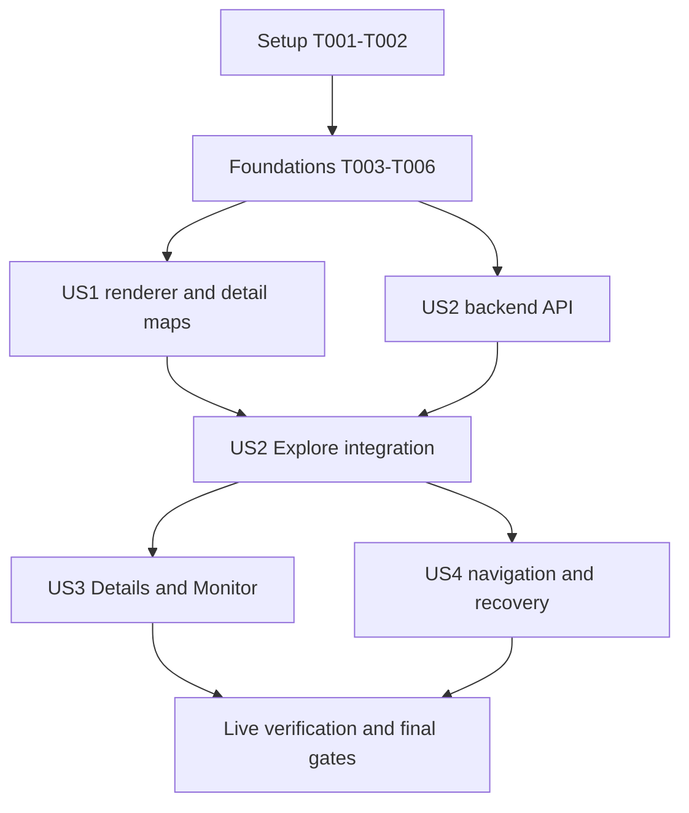

# Tasks: Open-Source Maps & Explore Map View

**Input**: Design documents in `specs/007-open-source-explore-maps/`.

**Prerequisites**: [plan.md](plan.md), [spec.md](spec.md), [research.md](research.md), [data-model.md](data-model.md), [API contract](contracts/search-map-api.md), [UI/configuration contract](contracts/map-ui-and-configuration.md), and [quickstart.md](quickstart.md).

**Renderer update**: T054 supersedes the initial Leaflet selection recorded in the earlier completed tasks; the final renderer is MapLibre GL JS 6.14.0.

**Tests**: Required by the specification and project constitution. Write the behavioral tests for each slice first, observe the intended failures, then implement and rerun. Record actual commands, failures, and results in this feature's `validation.md` during implementation. Implementation and verification are complete; actual results are recorded in [validation.md](validation.md).

**Organization**: Tasks follow the four specification stories, with shared prerequisites and final integration checks. All file paths are relative to the repository root. Use existing Task workflows and repository style; annotate/document new Python functions and tests. No persistent schema change, booking-provider work, tile server, or new clustering service is planned.

## Format: `[ID] [P?] [Story] Description`

- `[P]` identifies work in separate files that may proceed alongside the other indicated tasks after its prerequisites are complete. It does not authorize simultaneous edits to a shared file.
- `[US1]`–`[US4]` map to the prioritized user stories in the specification.
- Check a task only after its change and relevant verification pass. Update the global checklist at the final checkpoint.

## Phase 1: Setup

**Purpose**: Establish a reproducible baseline and add the selected renderer without breaking existing maps.

- [x] T001 Run `task install`, `task lint`, `task check`, `task test`, and `task api:check`; record the baseline and any pre-existing failures in `specs/007-open-source-explore-maps/validation.md`, without changing unrelated application behavior.
- [x] T002 Add Leaflet 1.9.4 and development-only `@types/leaflet` through pnpm in `frontend/package.json` and `frontend/pnpm-lock.yaml`; keep the Google packages until the replacement builds in T014.

## Phase 2: Foundational Prerequisites

**Purpose**: Protect existing matching semantics and establish coordinate handling shared by detail and Explore maps.

- [x] T003 [P] Extend existing matching regressions in `backend/packages/db/tests/test_search_model.py` for blank/compound queries, dialect selection, state normalization, false amenity flags, nonpositive RV length, and partial/positive radius inputs; preserve expected membership and ordering through the upcoming predicate extraction.
- [x] T004 [P] Add failing geometry tests in `frontend/src/lib/maps.test.ts` covering finite/range validation, zero coordinates, longitude 180 normalization, wrapped/full-world viewports, degenerate fitting, nearest world copies, and display-only polar clamping with edge queries reaching ±90°.
- [x] T005 Extract one combined text/attribute predicate builder in `backend/packages/db/db/models/search.py` and use it from `Search.search`, preserving existing ranking and actual-session dialect behavior; run T003 regressions before and after, and retain the flat autocomplete endpoint's empty-query behavior.
- [x] T006 Implement the tested geometry helpers and provider/entity-qualified map-location inputs in `frontend/src/lib/maps.ts`; enforce "Accept zero; reject null, nonfinite, or out-of-range coordinates" for mapping, retain original metadata, and make wrapped viewport normalization and polar-edge query expansion deterministic.

**Checkpoint**: Existing search behavior is unchanged; geometry helpers are typed and tested. US1 can proceed, and US2 database/API work can begin independently of the renderer replacement.

## Phase 3: US1 — Use Existing Maps Without a Proprietary Provider (P1, MVP)

**Goal**: Both existing detail maps work with the keyless default or a configured compatible source.

**Independent Test**: Without proprietary mapping credentials, open a campground and recreation area; verify primary/related locations, useful initial fitting, labels, controls, attribution, and source overrides. Missing primary coordinates must leave the detail page usable.

### Tests First

- [x] T007 [P] [US1] Add failing Leaflet integration unit tests in `frontend/src/components/MapComponent.test.tsx` for initial fitting, single-point zoom 12, primary/related marker identity, no data-update recenter loop, accessible marker names, resize/reveal invalidation, StrictMode remounts, and listener/map cleanup.
- [x] T008 [P] [US1] Extend `frontend/src/lib/maps.test.ts` with failing basemap-configuration cases for the four public settings, keyless OSM defaults, custom attribution requirements, HTTPS/root-relative XYZ templates, invalid schemes/tokens/links, and native zoom "integer 0–19"; keep geometry tests from T004 intact.
- [x] T009 [P] [US1] Add detail-page regressions in `frontend/src/pages/Campground.test.tsx` and `frontend/src/pages/RecreationArea.test.tsx` for valid zero coordinates, primary and related locations, missing/invalid coordinates, correct explicit marker types, and preserved non-map content.

### Implementation

- [x] T010 [US1] Implement public basemap parsing in `frontend/src/lib/maps.ts` and type the four settings in `frontend/src/vite-env.d.ts`: `VITE_MAP_TILE_URL`, `VITE_MAP_ATTRIBUTION_TEXT`, `VITE_MAP_ATTRIBUTION_URL`, and `VITE_MAP_MAX_NATIVE_ZOOM`; use the contract's exact OSM defaults, require custom text/link for a custom source, and surface invalid configuration as a map-specific error.
- [x] T011 [US1] Replace GoogleMapReact in `frontend/src/components/MapComponent.tsx` with a stable Leaflet lifecycle wrapper and import/style Leaflet in `frontend/src/index.css`; fit validated locations with padding/maxZoom 12, allow map zoom through 19, render trusted marker markup and safe linked attribution, set tile `referrerPolicy: "strict-origin"`, preserve native caching, and keep tile transport separate from authenticated Axios.
- [x] T012 [US1] Adapt `frontend/src/pages/Campground.tsx` and `frontend/src/pages/RecreationArea.tsx` to explicit primary/related location identities and the shared coordinate helpers; remove truthiness checks that reject zero, retain original coordinate metadata, and preserve detail content when the primary location cannot be mapped.
- [x] T013 [US1] Wire public map build arguments through `frontend/Dockerfile` and `frontend/docker-compose.yaml`, document defaults/rebuild behavior in `.env.example` and `docs/agents/CONFIGURATION.md`, and verify custom source and attribution forwarding without reading operator secret files.
- [x] T014 [US1] Remove `google-map-react` and `@types/google-map-react` through pnpm in `frontend/package.json` and `frontend/pnpm-lock.yaml`; remove obsolete Google key requirements/references from supported web setup, including `docs/agents/CONFIGURATION.md` and `.env.example` if present, after all call sites use Leaflet.
- [x] T015 [US1] Run the US1 tests with `task frontend:test` and `task frontend:build:static`; inspect both detail maps with intercepted/local fixture tiles and record default/override attribution, valid-zero behavior, cleanup, and absence of Google runtime requests in `specs/007-open-source-explore-maps/validation.md`.

**Checkpoint**: The replacement is independently usable on both detail pages. This is the smallest MVP; Explore discovery is delivered by US2.

## Phase 4: US2 — Discover All Matching Places on Explore's Map (P1)

**Goal**: Every matching mappable catalog place is discoverable independently of list pagination, with bounded responses and individually reachable group members.

**Independent Test**: Search a synthetic catalog covering at least three list pages and multiple regions; discover off-page locations, change filters, traverse >100 co-located places, and confirm page/sort/pan changes do not change global matching membership.

### Tests First

- [x] T016 [P] [US2] Add failing query tests in `backend/packages/db/tests/test_search_maps.py` for all existing filter semantics, global count invariants, missing/invalid/zero/polar coordinates, largest-gap circular bounds with ties, inclusive viewport edges, full-world/wrapped bounds, all zooms, the 512-feature cap, singleton hydration, and complete keyset traversal through >100 co-located/provider-colliding places.
- [x] T017 [P] [US2] Add failing public-route/contract cases in `backend/packages/backend/tests/routers/test_search.py` for all three map endpoints, q overriding query even when empty, no-query catalog discovery, validation errors, empty success versus failure, map/list parity, and cell-plus-captured-viewport member membership; preserve existing route responses.
- [x] T018 [P] [US2] Add failing serialization and query-lifecycle tests in `frontend/src/lib/api.test.ts` and `frontend/src/hooks/useSearch.test.ts` for independent summary/viewport/member calls, filter-only membership keys, no page/sort leakage, cancellation, captured member viewports, and stale/out-of-order response handling.
- [x] T019 [P] [US2] Add failing discovery tests in `frontend/src/pages/SearchPage.test.tsx` and `frontend/src/components/ExploreMap.test.tsx` for map and list always visible in a vertical stack, global versus visible/unmappable counts, off-page matches, filter-driven fitting, no recenter on page/sort/pan, group expansion, paginated View places, and no-matches/no-mappable states.

### Models, Queries, and Endpoints

- [x] T020 [US2] Define typed summary/feature/member DTOs and input validation in `backend/packages/backend/backend/schemas.py` per the API contract: "total = mappable_total + unmappable_total", "bounds is null iff mappable_total is zero", nullable/degenerate summary bounds, finite longitude [-180, 180] and latitude [-90, 90], positive-area request viewports, request zoom 0–19, and the discriminated location/group union with group count >=2.
- [x] T021 [US2] Implement canonical grid and viewport query arithmetic in `backend/packages/db/db/search_maps.py` with typed query results: "Grid levels range 1–20", cell width/height 360 / 2^L, 2^L columns and 2^(L-1) rows, "Cell IDs are `L:x:y` with validated integer ranges", longitude 180 in the first column, latitude 90 in the final row, inclusive viewport edges, and half-open cell ownership; coarsen from min(zoom+2,20) before querying until intersecting cells are at most 512, counting wrapped-column unions once.
- [x] T022 [US2] Implement global summary queries in `backend/packages/db/db/search_maps.py` using T005's predicates, valid-coordinate aggregates, and a distinct-longitude/window-function largest-gap query; return only aggregate counts/bounds to Python, handle no/single/co-located matches and deterministic tied gaps, and retain unmappable matches in global/list totals.
- [x] T023 [US2] Implement viewport aggregation in `backend/packages/db/db/search_maps.py` over all filtered valid rows inside the requested viewport; return "features length <=512", counts summing to represented_total, group centers/member bounds for that viewport, deterministic row/column ordering, and metadata hydration only for singleton cells without arbitrary truncation or full-catalog loading.
- [x] T024 [US2] Implement member queries in `backend/packages/db/db/search_maps.py` using identical filters, exact cell ownership, and the captured viewport; enforce "50 items by default and a maximum of 100", Search.id ascending with id > after_id, cursor "maximum length 128", page_size+1 internal reads, total membership, and nullable next_cursor without parsing IDs or fetching all pages.
- [x] T025 [US2] Add `GET /api/search/map/summary`, `GET /api/search/map`, and `GET /api/search/map/members` to `backend/packages/backend/backend/routers/search.py`; bind T020 DTOs and T021–T024 queries to the actual session dialect, retain q/query semantics and ignored list-presentation parameters, use existing search metrics, return 422 for invalid inputs, and preserve genuine server errors instead of converting them into empty success.
- [x] T026 [US2] Run `task api:generate`, add map aliases in `frontend/src/lib/structs.ts`, and implement typed API calls/shared filter serialization in `frontend/src/lib/api.ts` using `frontend/src/lib/api/generated/schema.ts`; forward AbortSignals, keep application Axios only for backend calls, then run `task api:check`.
- [x] T027 [US2] Implement independent summary/viewport/member hooks in `frontend/src/hooks/useSearch.ts` with canonical filters, viewport/cell/cursor context, page/sort-independent keys, current-context guards, and cancellation; enable map requests only when needed and preserve independently usable list queries.

### Explore Integration

- [x] T028 [US2] Build `frontend/src/components/ExploreMap.tsx` on the shared `frontend/src/components/MapComponent.tsx`, rendering at most 512 location/group features with wrapped-world/polar helpers, a 150ms movement debounce, group zoom and always-available View places, captured viewport membership, explicit Load more, and no futile zoom loop for identical coordinates.
- [x] T029 [US2] Integrate the Explore map in `frontend/src/pages/SearchPage.tsx`: always show map above list without view controls, share existing filters, fit global summary bounds only on initial load or filter changes, label global/visible/unmappable counts separately, preserve extent in parent state, clear obsolete selections, and distinguish successful empty states from loading/updating data.
- [x] T030 [US2] Run the focused database/router/frontend suites and `task api:check`; record complete fixture membership, counts, cursor traversal, capped responses, no-current-page restriction, and filter/page/sort/pan behavior in `specs/007-open-source-explore-maps/validation.md`.

**Checkpoint**: Explore is geographically useful across the whole matching set, with bounded transfer and reachable individual places. Full Details/Monitor actions follow in US3; responsive and recovery acceptance follows in US4.

## Phase 5: US3 — Inspect a Place and Start Monitoring (P2)

**Goal**: Selected map locations and group members open the correct detail destination and existing monitoring flow.

**Independent Test**: Select both entity types, including an off-page campground and reused external IDs across providers. Verify exact destinations and prefilled provider/campground selection, then cancel the form without losing search or extent.

### Tests First

- [x] T031 [P] [US3] Extend `frontend/src/components/ExploreMap.test.tsx` with failing location/member summary cases for names, provider/type/region labels, provider-qualified Details links, campground-only Monitor, external-ID collisions, filtered-out selection clearing, and safe rendering of catalog text.
- [x] T032 [P] [US3] Extend `frontend/src/pages/SearchPage.test.tsx` and `frontend/src/components/ScanForm.test.tsx` with failing card/map conversion parity, nullish handling of zero coordinates, exact off-page campground prefilling, cancellation state preservation, and existing authentication/invitation/scanning-suspension behavior when Monitor is used.

### Implementation

- [x] T033 [US3] Extract the shared SearchResult-to-Campground conversion into `frontend/src/lib/maps.ts` and use it in `frontend/src/pages/SearchPage.tsx` and `frontend/src/components/ExploreMap.tsx`; retain provider/entity/external IDs, use nullish coordinate handling, and never turn a recreation area into a campground scan.
- [x] T034 [US3] Implement React-rendered selected-location and member actions in `frontend/src/components/ExploreMap.tsx`, using ordinary router Details links and the existing `frontend/src/components/ScanForm.tsx` API; show name/provider/type/region, preserve map extent on form open/close, and use current access rules without bypasses or provider text interpolated into Leaflet HTML.
- [x] T035 [US3] Run the US3 map/page/ScanForm tests and record correct provider destinations, all monitored selections, equivalent card actions, access-rule outcomes, and retained state in `specs/007-open-source-explore-maps/validation.md`.

**Checkpoint**: Places discovered outside the current list page are fully actionable, and recreation-area behavior remains distinct from campground monitoring.

## Phase 6: US4 — Mobile Exploration and Map Failure Recovery (P2)

**Goal**: Responsive stacked map/list discovery, keyboard/touch usability, and independently recoverable mapping failures preserve the discovery journey.

**Independent Test**: At 375px and 1440px in both themes, use the stacked map and list, navigate browser history, inspect locations and use Monitor. Simulate initialization, summary/viewport/member, and tile failures; confirm list actions remain usable and retry preserves the current search.

### Tests First

- [x] T036 [P] [US4] Add failing navigation/responsive cases in `frontend/src/pages/SearchPage.test.tsx` for both map and list always present, ignored legacy view values, pagination, shared/reloaded links, back/forward synchronization of the text input and filters, retained extent, and accessible filters.
- [x] T037 [P] [US4] Add failing recovery/focus tests in `frontend/src/components/MapComponent.test.tsx` and `frontend/src/components/ExploreMap.test.tsx` for initialization-boundary isolation, separate tile/summary/viewport/member failures, retry without cache busting or state loss, updating markers for retained results, keyboard panel focus/return, and independent list actions.

### Implementation

- [x] T038 [US4] Implement map above list in a vertical stack at every screen size in `frontend/src/pages/SearchPage.tsx` and `frontend/src/components/ExploreMap.tsx`; retain accessible filters, parent-held extent, correct resize/reveal invalidation, and readable content without horizontal overflow at the required sizes/themes.
- [x] T039 [US4] Finish URL/history handling in `frontend/src/pages/SearchPage.tsx`, retaining existing filter parameter names and pagination-reset behavior, restoring filters/page on reload and history navigation, and synchronizing displayed search input without unnecessary map refits.
- [x] T040 [US4] Implement map-scoped initialization recovery in `frontend/src/components/MapComponent.tsx` and independent query/member/tile status and retry in `frontend/src/components/ExploreMap.tsx`; keep list and scan form outside the failure boundary, avoid interpreting failed data as zero matches, and offer refresh for catalog count changes without claiming cross-request snapshots.
- [x] T041 [US4] Complete keyboard/touch controls and React-panel focus management in `frontend/src/components/ExploreMap.tsx`, `frontend/src/components/MapComponent.tsx`, and `frontend/src/index.css`; supply descriptive marker/group names, non-color identity cues, visible focus, no keyboard traps, and readable light/dark attribution while retaining equivalent list actions.
- [x] T042 [US4] Extend `frontend/scripts/run-snapshots.ts` with path-specific search/map mocks, intercepted deterministic raster tiles registered before navigation, and 375px/1440px light/dark captures of detail maps, Explore groups/summaries, mobile stacking, and map failures; ensure broad existing search interceptors cannot shadow map responses.
- [x] T043 [US4] Run US4 component/page tests and `task snapshot`, review rendered map states and diffs, update intended baselines using `task snapshot:update`, and run `task snapshot:check`; record results and any remaining manual browser checks in `specs/007-open-source-explore-maps/validation.md`.

**Checkpoint**: All four story acceptance flows work with responsive navigation, accessible actions, and map-specific recovery. Live database/browser checks and release gates remain.

## Phase 7: Cross-Cutting Verification and Documentation

**Purpose**: Verify the real renderer/database and deployment configuration, then complete release evidence and documentation.

- [x] T044 [P] Add live PostgreSQL integration coverage in `backend/packages/db/tests/integration/test_search_maps_postgres.py` and a `backend:maps:test-postgres` entrypoint in `backend/Taskfile.yaml`; provision/clean a dedicated disposable database with the existing schema and pg_trgm, inject synthetic credentials at runtime, exercise fuzzy/filter/window/grid/cursor parity, record query plans/timings, and fail explicitly rather than silently skip unavailable Docker/PostgreSQL.
- [x] T045 [P] Add an opt-in isolated application harness in `backend/packages/backend/tests/integration/test_maps_smoke.py`, real-Leaflet interactions in `frontend/scripts/verify-maps.ts`, and the aggregate `maps:verify` task in `Taskfile.yaml`; seed exactly 5,000 matching places plus excluded controls, include >100 co-located members, use real map API requests and intercepted local tiles, clean resources on failure, and include T044's PostgreSQL entrypoint once available.
- [x] T046 Wire `task maps:verify` into `.github/workflows/ci.yaml` with the required frontend/backend/browser/Docker setup and retained verification artifacts; ensure opt-in live tests do not accidentally run against developer databases during ordinary `task test`.
- [x] T047 Run `task maps:verify` and record the complete 5,000-place discovery proof, <=512 viewport features, <=100 member responses, PostgreSQL query plans, browser/OS/hardware/fixture details, and timings under `frontend/tmp/` with a summary in `specs/007-open-source-explore-maps/validation.md`; enforce "within 3 seconds after search completion" for the initial usable map and "within 500 milliseconds" for location selection/group expansion, optimizing and remeasuring only if those targets fail.
- [x] T048 Extend `frontend/scripts/verify-maps.ts` to verify public source/attribution/native-zoom overrides, invalid configuration fallback, no Google requests, no application authorization/CSRF headers or private scan fields in tile requests, and static repository-subpath Details/Monitor navigation; run `task frontend:build:static` and `task frontend:docker` to verify public build-argument forwarding, using local fixture sources rather than public tile traffic.
- [x] T049 Update `README.md`, `docs/agents/CONFIGURATION.md`, `docs/agents/DEVELOPER_GUIDE.md`, `docs/agents/DESIGN_API.md`, and `docs/agents/DESIGN_FRONTEND.md` for Leaflet, all three endpoints, independent list/map behavior, public build-time settings/rebuilds, attribution, external tile request privacy, source licensing/service limits, and alternative/self-hosted raster setup.
- [x] T050 Execute the final gates from `specs/007-open-source-explore-maps/quickstart.md`: `task fix`, `task lint`, `task check`, `task test`, `task api:check`, `task maps:verify`, `task snapshot:check`, and `task pre-commit -- --all-files`; inspect formatter/hook changes and record actual results and remaining limitations in `specs/007-open-source-explore-maps/validation.md` without marking failed or unrun gates complete.
- [x] T051 Reconcile all story acceptance scenarios and FR/SC mappings against `specs/007-open-source-explore-maps/validation.md`, mark only verified implementation items in this `specs/007-open-source-explore-maps/tasks.md`, and update T3.3 implementation/verification progress in `docs/agents/CHECKLIST.md` before proposing the completed feature.

- [x] T052 Apply the 2026-10-14 layout clarification: remove List/Map selection, always stack the map above the list, preserve filters/pagination/history, and verify desktop/mobile layout through unit, live-browser, and visual regression checks; align the spec and documentation.

- [x] T053 Add accessible Show map/Hide map controls with the map expanded by default, keep the list usable while collapsed, preserve the camera on reopening and respect changed filters; verify unit, live-browser, and expanded/collapsed visual states and align the feature documentation.

- [x] T054 Replace Leaflet with the user-selected MapLibre GL JS renderer and built-in types; preserve keyless raster settings, safe attribution/requests, geometry, accessible markers, lifecycle/retry, collapsible stacked Explore, and all discovery actions. Update unit/browser/visual checks and documentation, then verify the migration.

## Dependencies & Execution Order

### Phase Dependencies

1. T001 establishes the baseline; T002 installs the selected renderer. T003/T004 can run concurrently afterward; T005 depends on T003 and T006 depends on T004. Complete both foundational branches before story integration.
2. US1 tests T007–T009 can be written concurrently. T010/T011 follow their tests, T012 integrates the detail pages, T013 wires deployments, and T014 removes Google only after its call sites are replaced. T015 verifies the MVP.
3. US2 tests T016–T019 can be written concurrently after foundations. Backend tasks T020–T025 may proceed while US1 is implemented; serialize T021–T024 because they share the query file. T026 follows endpoint schemas/routes, T027 follows typed API calls, T028 needs the US1 renderer and US2 hooks, and T029/T030 finish integration and verification.
4. US3 depends on US2 discovery/member data and the existing scan form. T031/T032 are independent test edits; T033 precedes T034, followed by T035 verification.
5. US4 builds on US2 view/query state and US1 lifecycle. T036/T037 test edits can overlap; serialize implementation edits to shared map/page files. Its complete Details/Monitor acceptance checks require US3.
6. T044/T045 can run concurrently after story integration because they write separate test/Task files. T046 follows both; T047 runs the assembled harness. T048 adds deployment cases, T049 updates final docs, and T050/T051 close the feature only after all required checks pass.

### Parallel Execution Examples

| Story | Safe parallel work after prerequisites                                              | Shared-file constraint                                                                              |
| ----- | ----------------------------------------------------------------------------------- | --------------------------------------------------------------------------------------------------- |
| US1   | T007 MapComponent tests, T008 basemap config tests, T009 detail-page tests          | Finish test edits before corresponding implementation; T008 extends the already-completed T004 file |
| US2   | T016 database tests, T017 router tests, T018 client/hook tests, T019 page/map tests | T021–T024 all edit db/search_maps.py and run sequentially; US1 renderer must land before T028       |
| US3   | T031 map summary/action tests and T032 page/scan-form tests                         | T033/T034 share ExploreMap.tsx and run sequentially                                                 |
| US4   | T036 navigation/page tests and T037 component recovery/focus tests                  | Serialize subsequent SearchPage/MapComponent/ExploreMap edits; do not concurrently edit US3 files   |

Independent backend work may proceed alongside US1 frontend work. US3 and US4 are separately testable outcomes but share frontend files; the default execution order is sequential. These examples identify scheduling opportunities, not a requirement to spawn agents.

## Requirement and Outcome Traceability

| Requirements                                  | Main tasks                                         |
| --------------------------------------------- | -------------------------------------------------- |
| FR-001 proprietary replacement                | T002, T011–T015, T048                              |
| FR-002 source configuration and setup         | T008, T010, T013, T048–T049                        |
| FR-003 linked attribution                     | T007–T011, T041–T043, T048                         |
| FR-004 detail locations and fitting           | T004, T006–T007, T009, T011–T012, T015             |
| FR-005 stacked map/list layout                | T019, T029, T036, T038–T039, T042–T043             |
| FR-006 all-results discovery                  | T016–T017, T021–T030, T045–T047                    |
| FR-007 matching parity                        | T003, T005, T016–T019, T022–T030, T044             |
| FR-008 bounded map data                       | T016–T017, T020–T028, T044–T047                    |
| FR-009 preserved extent and list independence | T019, T027–T029, T032, T034–T041                   |
| FR-010 shareable URL/history                  | T029, T036, T039, T043, T048                       |
| FR-011 correct Details/Monitor                | T031–T035, T041, T045, T048                        |
| FR-012 provider/entity identity               | T006–T007, T012, T016–T017, T024, T028, T031–T035  |
| FR-013 valid/zero coordinates and counts      | T004, T006, T009, T012, T016–T017, T020–T024, T029 |
| FR-014 loading/races/failure recovery         | T018–T019, T025, T027, T036–T037, T040, T042–T045  |
| FR-015 responsive accessible interactions     | T007, T011, T036–T038, T041–T045                   |
| FR-016 public catalog and tile transport      | T011, T025, T032–T035, T048–T049                   |
| SC-001 all three keyless surfaces             | T015, T030, T043, T048                             |
| SC-002 complete multi-page discovery          | T016, T024, T028, T030, T045–T047                  |
| SC-003 filter/page/sort/pan parity            | T003, T016–T019, T030, T044–T047                   |
| SC-004 one-action correct Monitor             | T031–T035, T045, T048                              |
| SC-005 mobile/desktop/themes/keyboard         | T036–T043, T045                                    |
| SC-006 usable list during map outages         | T037, T040, T043, T045                             |
| SC-007 measured 5,000-place performance       | T044–T047                                          |
| SC-008 shared-link/history restoration        | T036, T039, T043, T045, T048                       |

## Implementation Strategy

Deliver US1 first as the independently demonstrable mapping-replacement MVP. Add US2 for the complete geographic-discovery slice, then US3 for the monitoring journey, and US4 for full navigation/recovery acceptance. Validate each checkpoint while retaining previously passing behavior; do not treat the MVP as completion of the requested feature.

Use the final real-database/browser checks to confirm the design's bounds and performance rather than infer them from mocked unit tests. Do not add indexes, caches, persistent geometry, or additional infrastructure unless measurement demonstrates the need and the plan is updated accordingly. Updating task status records implementation evidence; this document's creation records only readiness to implement.

- [x] T055 Integrate current main live Explore search and indexed PostgreSQL matching; share transaction-local fuzzy threshold setup across list and map queries, preserve explicit false amenity filters, debounce/cancellation, history and pagination behavior, then rerun verification.
