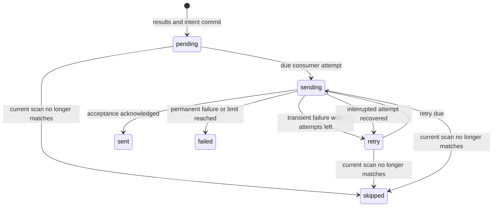

# Data model: optional standalone runtime

Keep existing users/scans/targets/results/catalog/audit models shared. Add one portable SQLAlchemy entity; local runtime/history are in memory.

## NotificationOutbox

Only standalone consumes/writes this table in this feature.

| Field             | Constraint / meaning                                                                           |
| ----------------- | ---------------------------------------------------------------------------------------------- |
| `id`              | Required UUID primary key; stable delivery/job identity across retries.                        |
| `detection_id`    | Required UUID for one successful result-change transaction.                                    |
| `user_id`         | Nullable UUID FK to users, `ON DELETE SET NULL`; missing user causes skip.                     |
| `scan_id`         | Nullable UUID FK to user_scans, `ON DELETE SET NULL`; missing scan causes skip.                |
| `target_id`       | Nullable UUID FK to unique_targets, `ON DELETE SET NULL`; missing/relinked target causes skip. |
| `campsite_id`     | Required string, maximum 128 characters.                                                       |
| `payload`         | Required JSON `NotificationDTO`; contains no credentials.                                      |
| `status`          | Required enum: `pending`, `sending`, `retry`, `sent`, `skipped`, `failed`.                     |
| `attempt_count`   | Required integer >= 0, default 0; at most four sends (initial plus three retries).             |
| `next_attempt_at` | Required UTC datetime for pending/retry eligibility.                                           |
| `created_at`      | Required UTC datetime.                                                                         |
| `finished_at`     | Nullable UTC datetime; required for terminal states.                                           |
| `error_category`  | Nullable allowlisted string, maximum 64 characters; no raw exceptions or credentials.          |

Unique constraint: `(detection_id, scan_id, campsite_id)` for nondeleted scans. Each matched campsite/subscription receives one intent per detection. Retries reuse its UUID; closing/reopening gets a new detection identity. Index `(status, next_attempt_at)` and terminal `finished_at`.

Before sending, resolve current references and verify ownership, scanning permission, invitations, active status, unchanged target, unexpired dates, current filters, and token. Missing references/nonmatches end as skipped. Load current credentials rather than storing them.

Commit attempt increment before network I/O, then acknowledge afterward. Recover `sending` on startup; four consumed attempts become explicit terminal failure, including interrupted delivery. Retry transient failures after 120 seconds. Preserve classified failure results when providers return failure rather than raise. Prune terminal records after 24 hours; never silently prune pending alerts. Transactions cannot span HTTP calls or retry sleeps.

## Existing targets/results

Successful checks replace results, set `last_checked_at`, and insert matching intents in one short transaction. Provider failure changes neither results nor success time. Process-local in-flight target UUIDs prevent overlapping checks. JSON/list/UUID/date fields must round-trip under both database dialects; retain existing UTC API normalization for SQLite naive values. Test FK enforcement for ingestion/deletion.

## RuntimeState / JobAttempt

Lifespan-owned memory, not SQL tables. RuntimeState tracks scheduler health, last discovery, running/pending work, and one coalesced catalog job. JobAttempt uses existing allowlisted telemetry fields: stable job ID, distinct event ID, one-based attempt, timing/outcome, and provider/target context.

Retain at most 1,000 completed attempts from the last 24 hours; prune by count/age and clear on restart. Reconstruct pending alerts from the outbox; rediscover targets and recreate catalog schedules. No credentials, raw alert payloads, or full exception strings appear in history.

## Delivery acceptance and date cutoff

Standalone validates both application and current user notification credentials before sending. Missing credentials are skipped; malformed payloads and permanent upstream rejections are failed. Timeouts, transport errors, HTTP 429, and HTTP 5xx retry within the existing budget. Only an explicit accepted upstream response records sent; a silent/no-op adapter return is never proof of delivery.

Use the current UTC calendar date as the initial expiry cutoff. Before dispatch, remove nights before today and outside the current target start-inclusive/end-exclusive range, then reapply all filters including consecutive minimum stay. Keep today and future nights; an empty or insufficient remaining stay is skipped. Update the delivered dates to the retained nights. This is an explicit UTC policy, not provider-local timezone support.
