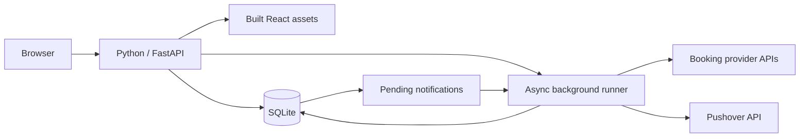

# Implementation plan: optional standalone runtime

**Branch**: `rare-mole` | **Date**: 2026-10-13 | **Status**: Ready for implementation review
**Spec**: [spec.md](spec.md) | **Research**: [research.md](research.md)
**Data**: [data-model.md](data-model.md) | **Contracts**: [contracts/](contracts/)
**Validation**: [quickstart.md](quickstart.md) | **Tasks**: [tasks.md](tasks.md)

Add `CAMPLY_RUNTIME_MODE=standalone` alongside the default `distributed` mode.
Standalone runs one Uvicorn process with SQLite, a lifespan-managed asyncio
runner, and the compiled frontend. Both modes use the existing application,
providers, authentication, and scan engine.

## Technical context

- **Languages**: Python 3.12 development environment and existing TypeScript/React.
  Preserve current package Python metadata; this feature does not raise minimums.
- **Dependencies**: FastAPI/Starlette, Uvicorn, SQLAlchemy/Alembic, aiosqlite,
  Pydantic, httpx, structlog; Vite/pnpm only for asset builds. Infrastructure extras
  remain available for distributed deployment.
- **Storage/platform**: File-backed SQLite on local disk; one application instance.
  PostgreSQL remains supported for the distributed stack.
- **Tests**: pytest, synthetic/VCR provider responses, Vitest, Playwright, generated
  OpenAPI contract checks, and clean minimal-install smoke verification.
- **Performance goals**: Under SC-004's controlled no-backlog fixture, start delivery
  within 60 seconds of detection and respond to health within 2 seconds while
  catalog/provider work is held pending. No broad production throughput claim.
- **Scope**: Optional personal/small shared deployment; no replacement monitoring
  database, generic queue, cross-database migration, or multi-replica support.

## Constitution check before and after design

| Principle                 | Design evidence                                                                                             | Gate                                       |
| ------------------------- | ----------------------------------------------------------------------------------------------------------- | ------------------------------------------ |
| Reliability and precision | Shared provider checks; preserved results on failure; atomic pending delivery; SC-004 timing target.        | Pass at design level; verify in T015–T026. |
| Type safety               | Typed engine results, Pydantic response contracts, regenerated client, mypy/native TypeScript gates.        | Pass at design level; verify T029/T035.    |
| Workflow automation       | Dedicated Task workflows and uv-managed extras; existing Docker remains supported.                          | Pass at design level; verify T012/T034.    |
| Monorepo boundaries       | Reuse worker/db/providers/backend packages; frontend stays in frontend.                                     | Pass; no new workspace package.            |
| Automated verification    | Test tasks precede behavior changes; migration, browser, restart, and distributed regressions are required. | Pass at design level; verify T034/T035.    |

No constitution exception or amendment is needed. Design gate completion is not
an assertion that unimplemented behavior has passed tests.

## Planned project structure

```text
specs/007-standalone-runtime/
  spec.md, plan.md, research.md, data-model.md, quickstart.md, tasks.md
  contracts/runtime.md, contracts/admin-api.md
  checklists/requirements.md, checklists/runtime.md
backend/packages/worker/worker/
  engine/{discovery,scanner,catalog,notifications}.py  # extracted async logic
  runtime.py                                      # local runner/state
  outbox.py                                       # local delivery/recovery
  tasks/{heartbeat,scanner,ingestion,notifications}.py # Celery adapters
backend/packages/backend/backend/
  standalone.py, static.py                        # launch and frontend serving
  static/                                        # staged build assets, not sources
  app.py, config.py, schemas.py
  services/{operations,local_operations,trends}.py
backend/packages/db/
  db/config.py, db/models/notification_outbox.py
  migrations/versions/<generated>_notification_outbox.py
frontend/
  vite.config.ts, src/pages/admin/AdminOperations.tsx
  src/components/admin/, src/lib/api.ts, src/lib/api/generated/schema.ts
Taskfile.yaml, backend/Taskfile.yaml, frontend/Taskfile.yaml
.github/workflows/ci.yaml
```

New paths identify intended responsibilities; implementation should prefer an
existing helper when it already fits rather than add layers or duplicate code.



## Research: what the repository already supports

| Area            | Evidence                                                                                                                                    | Consequence                                                                     |
| --------------- | ------------------------------------------------------------------------------------------------------------------------------------------- | ------------------------------------------------------------------------------- |
| SQLite          | `backend/packages/db/db/config.py` already defaults to `sqlite+aiosqlite`; `db` declares aiosqlite                                          | Extend existing database support rather than replace persistence.               |
| Portable models | Scan/search fields use SQLite JSON variants; search has separate SQLite and PostgreSQL ranking paths                                        | Reuse SQLite search; trigram typo tolerance remains PostgreSQL-specific.        |
| Migrations      | Existing revisions include SQLite variants and guard `pg_trgm` creation by dialect                                                          | Verify the entire revision chain; do not infer support from `create_all` tests. |
| Scan engine     | `worker/tasks/heartbeat.py`, `scanner.py`, and `notifications.py` combine async logic with Celery dispatch/retry, Valkey locks, and metrics | Extract async functions before adding a second runner.                          |
| Metadata        | `worker/tasks/ingestion.py` schedules provider catalogs daily at midnight UTC; `providers/cli.py` already supports `--provider-id all`      | Keep daily cadence and support manual initial ingestion.                        |
| Application     | `backend/app.py` eagerly imports Prometheus metrics and has no lifespan or static mount                                                     | Add lifecycle management and conditional metrics setup.                         |
| Admin           | `backend/services/operations.py` eagerly imports Redis/Celery; trends queries Prometheus                                                    | Make service imports conditional and introduce mode-aware responses.            |
| Frontend        | API client defaults to `/api`; Vite base changes when `GITHUB_REPOSITORY` is set                                                            | Same-origin requests already fit; standalone builds must force root base.       |
| Launch/install  | Gunicorn defaults to multiple workers; backend sync installs all workspace packages; infrastructure libraries are direct dependencies       | Add a dedicated single-process launcher and a genuinely minimal install path.   |

These are source-review findings, not completed migration or runtime tests.

## Design decisions

### 1. Configuration and dependency boundaries

- Add a typed runtime enum and validate standalone requires file-backed SQLite.
  Keep auth configuration independent and defaults compatible with distributed.
- Keep the `worker` package. Extract common async logic into `worker/engine/`
  modules, with no Celery, Redis, or Prometheus imports or signal registration.
  Existing task modules become adapters around these functions.
- Move infrastructure libraries into distributed extras for backend and worker;
  move psycopg into a PostgreSQL extra for db. Declare direct internal package
  dependencies rather than relying on incidental workspace installation.
- Make the root distributed extra select those extras, and explicitly enable it
  in existing full-stack install workflows. Standalone sync selects only the
  backend's core dependency graph and bypasses `sync --all-packages`.
- Guard imports in application startup, admin services, worker configuration,
  metrics, and package initializers. Missing extras in distributed mode should
  produce an actionable error, not silently select a different runtime.
- Use `uv add` / `uv remove` to update dependencies and the lockfile during
  implementation. Test a separate minimal environment, not the full dev venv.

**Verify**: standalone API import, schema export, and launch succeed with excluded
libraries absent. Existing Task and Compose workflows install distributed extras.

### 2. SQLite persistence and upgrades

- Use the existing configured data location and accept an explicit absolute file
  path. Make SQLite URL construction unambiguous; test default and custom paths.
- Reuse one application-scoped async engine/session factory; each concurrent task
  gets its own session. Close resources during shutdown.
  This lifecycle applies to standalone. Celery adapters using `asyncio.run` must
  keep engine resources within their invocation's event loop rather than sharing
  a cached async engine across loops.
- Enable foreign keys and a bounded busy timeout on each SQLite connection; enable
  WAL for file-backed standalone storage. Keep transactions short and avoid
  holding database transactions across provider HTTP calls or retry sleeps.
- Run Alembic before starting the server through the standalone launcher. Do not
  use `Base.metadata.create_all` or automatic schema stamping in production.
- Exercise fresh upgrades and upgrades of populated databases. Use Alembic batch
  operations only for revisions that actually need SQLite table reconstruction;
  preserve the PostgreSQL path and test any necessary changes to older revisions.
- Verify enabled foreign keys against catalog ingestion and deletion as well as
  schema creation. Normalize SQLite's naive timestamps at existing UTC boundaries.
- Document local-disk storage and SQLite's online backup API or a stopped-process
  backup; copying just the database file while WAL writes continue is insufficient.

**Verify**: migrations through head, provider seeds, representative CRUD/search,
foreign-key enforcement, contention, persistence, and backup/restore on SQLite;
retain PostgreSQL migration verification.

### 3. Common engine and standalone runner

- Extract target discovery, eligibility checks, provider lookup/checks, result
  diffing, filter matching, catalog ingestion, and notification delivery into
  typed async functions. Surface results and failures to each runner; keep Celery
  retry calls, distributed locks, and metric recording in distributed adapters.
- Pass only the small hooks needed for notification dispatch and execution
  reporting. Avoid a generic queue framework, scheduler dependency, or plugin API.
- Start and supervise standalone tasks in FastAPI's lifespan. Discover due targets
  immediately, then use existing heartbeat/cooldown settings. Maintain an in-flight
  target set so a slow check cannot be scheduled twice.
- Start with one scan consumer, one catalog consumer, and one notification
  consumer. Page due work instead of creating one task per target. A provider's
  slow request cannot block HTTP handling or notification delivery.
- Retry failed target checks with bounded exponential backoff held in memory,
  while preserving provider transport retry/pacing. Failed checks do not overwrite
  results or mark the target successfully checked. Re-discover due work on restart.
  Use at most three retries per check, with 60/120/240-second delays; after exhaustion,
  wait at least a heartbeat interval before a new check cycle. Keep provider-level
  retry behavior distinct from this target-level policy.
- Run catalog sync daily at midnight UTC and through the existing admin trigger.
  Coalesce repeated sync requests while a refresh is active; return a job ID
  promptly. On a fresh catalog, show the existing sync action with a useful empty
  state. Do not block server startup on large catalog downloads.
- Audit synchronous catalog parsing/archive processing; offload blocking work
  from the event loop and chunk writes without splitting provider atomic updates.
- On shutdown, stop discovery, allow a bounded drain, then cancel remaining work,
  roll back open transactions, and close clients and the engine. A stopped or
  unexpectedly failed runner must appear unhealthy rather than silently disappear.
- The supported launcher runs one worker without production reload. Reject
  conflicting worker settings; document that a second instance using the same
  database is unsupported. Process-local guards are not distributed locks.

**Verify**: synthetic clock tests cover cadence, cooldown, deduplication, retry,
pause/suspend/delete during queued work, repeated sync, HTTP responsiveness, and
startup/shutdown. Existing Celery adapters pass the same engine behavior tests.

### 4. Pending notification recovery

- Add a small `notification_outbox` model and migration with UUID, user/scan/target
  references, a serialized `NotificationDTO`, creation/next-attempt timestamps,
  attempt count, delivery status, and a bounded error category. Store no credentials
  in the payload; load current notification settings when delivering.
- In standalone, record matching notification intents in the same transaction as
  replacing scan results and updating `last_checked_at`. A failed commit leaves
  neither partial results nor orphaned dispatch intentions.
- The single notification consumer reads due records, rechecks user/scan ownership
  and eligibility, and sends directly through the existing Pushover adapter.
  Deleted or inactive scans, suspended users, and missing tokens become skipped.
  Recheck invitations, edited target association, expired dates, and current filters
  against the payload as detailed in the data model. Interrupted attempts consume
  the finite retry budget and cannot stay pending forever at exhaustion.
- Retry transient failures with existing notification retry limits/delays. Retain
  terminal outcomes for 24 hours and prune them periodically. Pending retries
  survive restarts; in-progress work becomes eligible again on restart.
- Give each detection event a stable identity for internal retry deduplication;
  a site that closes and later reopens is a new event. Do not claim exactly-once
  external delivery: acceptance followed by a crash before acknowledgment can
  produce a duplicate alert.
- Distributed mode keeps its existing Celery dispatch semantics in this feature;
  adopting the outbox there is a separate change. Use a small dispatch boundary
  so scan/filter logic is shared without changing that deployment's behavior.

**Verify**: crash before/after commit, restart with pending records, transient
failure/retry, terminal failure, reopening, and eligibility changes before send.

### 5. Frontend serving and packaging

- Build the existing frontend for `/` with relative `/api` requests, explicitly
  overriding the GitHub repository base for standalone. Retain current behavior
  for other build targets.
- Copy built assets into the backend package for standalone artifacts and allow a
  configured build directory for checkout workflows. Test the installed artifact
  from outside the repository so asset discovery cannot depend on the current
  working directory. A wheel with built assets needs no Node process at runtime.
- Mount static files after API routes. Serve `index.html` for client navigation
  requests, including deep links, but exclude `/api`, `/metrics`, and asset paths
  from SPA fallback. Validate paths stay inside the asset directory.
- Cache fingerprinted assets long-term and make `index.html` revalidate. Serve
  only frontend assets, never the repository or SQLite directory. Preserve HEAD,
  content types, and genuine 404/405 behavior.
- Keep existing cookies/CSRF and origin checks; trust the explicitly configured
  same-origin frontend for session login. Document secure-cookie settings for
  local HTTP and retain secure defaults for HTTPS.

**Verify**: root/deep links, missing assets/API routes, path traversal, cache headers,
installed asset resolution, and real same-origin login/CSRF in Chromium.

### 6. Admin capabilities without external monitoring

- Extend the existing operations response with runtime/capability information,
  including historical trends and broker availability. Make broker-specific fields
  nullable where they are not applicable; distributed responses retain real values.
  Exact fields, health/readiness status, and disabled-trends response behavior are
  defined in [the admin contract](contracts/admin-api.md).
- Return standalone scheduler status, last discovery, running/pending work, and
  recent attempt records from application state. Bound records to 1,000 and 24
  hours; tell users that this history clears on restart. Database-backed admin
  counts, user management, audit events, and scan/target views continue to work.
- Dispatch provider sync through the selected runtime. Preserve admin authorization
  and CSRF checks; task IDs identify local jobs in standalone.
- Hide Celery/broker controls and skip trend fetching when disabled. A direct
  trends call returns the existing unavailable response shape with an intentional
  disabled explanation, without contacting Prometheus. `/metrics` returns 404 in
  standalone; exclude it from SPA fallback.
- Preserve unavailable versus zero semantics and report runner failures distinctly
  from unsupported monitoring. Regenerate OpenAPI types and contract tests.

**Verify**: admin interactions in both modes, no infrastructure imports or requests
in standalone, honest disabled/error states, and unchanged distributed smoke tests.

## Delivery sequence and workflows

1. Extract the common engine and isolate extras → verify shared behavior and both
   installation paths before adding a runner.
2. Harden SQLite and add the outbox → verify migrations and transactional recovery.
3. Implement lifespan runner and runtime-aware admin services → verify background
   work, failures, shutdown, and monitoring behavior.
4. Serve/package frontend and add Task commands → verify real browser flows using
   one Python server and a clean standalone installation.
5. Document both modes and add CI coverage → verify all quality gates plus existing
   distributed admin smoke coverage.

Proposed new root tasks (not implemented yet):

| Task                      | Purpose                                                                        |
| ------------------------- | ------------------------------------------------------------------------------ |
| `task standalone:install` | Install backend core plus frontend build tools, without infrastructure extras. |
| `task standalone:build`   | Build root assets, stage them in Python, and build core workspace wheels.      |
| `task standalone:run`     | Apply SQLite migrations, validate assets, and start one Python server.         |
| `task standalone:test`    | Exercise minimal installation and service-free browser smoke verification.     |

Release artifacts include compiled assets; their Python launch path skips frontend
installation/build entirely. Task/uv automate checkout development rather than
becoming additional server processes. Existing `task dev`, Compose, and worker
tasks continue to select distributed behavior.

## Verification and governance

Use synthetic provider responses and notification transports. Add meaningful
regressions alongside implementation and a service-free browser smoke test that
uses real application HTTP routes and SQLite, without intercepting browser APIs.
Keep the existing Docker-based admin smoke test for distributed mode. Run
`task fix`, `task lint`, `task check`, `task test`, `task api:check`, and applicable
pre-commit/snapshot checks before completing implementation.

Constitution check: retain typed Pydantic/SQLAlchemy boundaries, async I/O,
monorepo packages, Task workflows, and automated verification. Docker remains
supported; the optional host runtime adds a deployment choice. Reusing the worker
package avoids another package or duplicated scanner. The outbox is justified by
alert recovery after process shutdown, not general-purpose job scheduling.

Update configuration, developer guide, roadmap, poller/data/notification/API
blueprints, README, and the global checklist when implementation lands. This
planning change records future work and does not mark functionality complete.

Technical references supporting the design:

- [FastAPI lifespan](https://fastapi.tiangolo.com/advanced/events/) describes the
  startup/shutdown boundary used to manage runner resources.
- [SQLite WAL](https://www.sqlite.org/wal.html) explains reader/writer concurrency,
  the single-writer limit, and local shared-memory constraints.
- [Alembic batch migrations](https://alembic.sqlalchemy.org/en/latest/batch.html)
  documents table reconstruction for SQLite schema changes.
