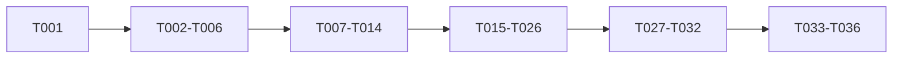

# Tasks: Optional standalone runtime

**Input**: [spec.md](spec.md), [plan.md](plan.md), [research.md](research.md), [data-model.md](data-model.md), [contracts/](contracts/), [quickstart.md](quickstart.md).
**Status**: All 42 tasks complete and verified against current main. See [review](review.md) and [current verification](quickstart.md#verification-evidence-2026-10-28).
**Tests**: Required by FR-015 and the constitution. Add behavior tests before implementation and observe intended failures.
**Format**: `- [ ] Tnnn [P?] [USn?] description with exact paths`. [P] means separate files with prerequisites already satisfied.

## Phase 1: Setup

- [x] T001 Add runtime/config validation regressions to `backend/packages/backend/tests/test_standalone_config.py` for independent auth/environment, default distributed, invalid runtime, non-file SQLite, assets/storage errors, and conflicting worker settings (FR-001/012).

## Phase 2: Foundational

- [x] T002 Add shared discovery/check/filter/catalog/delivery behavior regressions and Celery adapter parity in `backend/packages/worker/tests/test_engine.py` and existing worker tests; preserve successful outputs and failure-result classification (FR-004/015).
- [x] T003 Extract typed async functions into `backend/packages/worker/worker/engine/discovery.py`, `scanner.py`, `catalog.py`, and `notifications.py`; adapt existing `worker/tasks/` wrappers while keeping locks/retries/metrics outside common engine (FR-004).
- [x] T004 Move infrastructure dependencies into extras using uv in `backend/pyproject.toml`, `backend/packages/{backend,worker,db}/pyproject.toml`, and `backend/uv.lock`; declare core internal dependencies and update full-stack selection in `backend/Taskfile.yaml` and the existing Docker/CI dependency installation without changing distributed launch behavior (FR-007).
- [x] T005 Add full-chain fresh/populated SQLite upgrade, FK ingestion/deletion, JSON/list/UUID/UTC, contention, and backup/restore tests in `backend/packages/db/tests/test_standalone_database.py`; retain PostgreSQL migration verification (FR-003/013/015).
- [x] T006 Harden SQLite URL/resources/WAL/FKs/busy timeout and session reuse in `backend/packages/db/db/config.py` and `backend/packages/db/migrations/env.py`; modify only incompatible migration operations proven by T005 while keeping PostgreSQL paths intact (FR-003/013).

**Checkpoint**: Shared engine, portable storage, and explicit dependency graphs are ready.

## Phase 3: US1 - Start without services (Priority: P1)

**Goal**: One Python server hosts built assets/API with persistent storage.
**Independent test**: Launch a clean core install, load root/deep links, save/reload state, restart, and exercise actionable startup errors.

- [x] T007 [P] [US1] Add launcher and minimal-import/OpenAPI regressions in `backend/packages/backend/tests/test_standalone_launcher.py`, with infrastructure packages absent and migrations before serving (FR-001/003/007/010/012).
- [x] T008 [P] [US1] Add asset/deep-link/API/metrics/HEAD/405/cache/traversal tests in `backend/packages/backend/tests/test_static.py`, including source-checkout-independent resolution (FR-002/014).
- [x] T009 [US1] Add typed runtime/frontend configuration and conditional metrics/infrastructure imports in `backend/packages/backend/backend/config.py`, `app.py`, and `services/operations.py`; make common package initializers safe in core-only installs (FR-001/007/012).
- [x] T010 [US1] Implement guarded static serving and installed asset discovery in `backend/packages/backend/backend/static.py` and `app.py`, retaining API errors and distributed hosting (FR-002/014).
- [x] T011 [US1] Add `backend/packages/backend/backend/standalone.py` to validate assets/storage, apply Alembic, and launch one loopback-bound Uvicorn worker without production reload or conflicting worker settings (FR-001/003/010/012).
- [x] T012 [US1] Add standalone install/build/run Task workflows in `Taskfile.yaml`, `backend/Taskfile.yaml`, `frontend/Taskfile.yaml`, and root-base asset builds in `frontend/vite.config.ts`; configure packaged frontend assets and complete Alembic resources in `backend/packages/backend/pyproject.toml` and `backend/packages/db/pyproject.toml` and stage ignored assets/wheels without Docker or all-workspace sync (FR-002/007/010).
- [x] T013 [US1] Add installed-artifact verification outside the checkout in `backend/packages/backend/tests/integration/test_standalone_smoke.py`; inspect installed dependencies, bundled assets, migrations, and saved-state persistence (FR-003/007/010/015, SC-001/002/007).
- [x] T014 [US1] Run the US1 scenarios in `specs/007-standalone-runtime/quickstart.md` and T001/T005/T007/T008/T013 checks; record implementation evidence in the PR (SC-002/007).

**Checkpoint**: Standalone website/API/storage are independently usable; background detection is completed by US2.

## Phase 4: US2 - Discover and monitor (Priority: P1)

**Goal**: Poll targets and refresh catalogs without worker services, recovering pending alerts.
**Independent test**: Real API plus synthetic upstreams proves catalog → shared scan → filtered alert, failure isolation, shutdown, and restart recovery.

- [x] T015 [P] [US2] Add deterministic scheduling/deduplication/cooldown/retry/coalesced-sync/failure-isolation/shutdown tests in `backend/packages/worker/tests/test_runtime.py` before local runner implementation (FR-004/005/011/013).
- [x] T016 [P] [US2] Add outbox transaction/crash/retry/reopening and current owner/target/filters/invitation/date/credential checks in `backend/packages/worker/tests/test_outbox.py`, including terminal failure at four consumed attempts and 24-hour terminal pruning (FR-006/008/015).
- [x] T017 [US2] Add `backend/packages/db/db/models/notification_outbox.py` and export it from `db/models/__init__.py`: `id` is a "Required UUID primary key"; `detection_id` is a "Required UUID"; user/scan/target references are "Nullable UUID FK" with "ON DELETE SET NULL"; `delivery_key` is a "Required string, maximum 128 characters: summary marker or campsite ID"; `payload` is "Required JSON NotificationDTO; contains no credentials"; `status` is "Required enum: pending, sending, retry, sent, skipped, failed"; `attempt_count` is "Required integer >= 0, default 0; at most four sends"; `next_attempt_at`/`created_at` are "Required UTC datetime"; `finished_at` is "Nullable UTC datetime; required for terminal states"; `error_category` is "Nullable allowlisted string, maximum 64 characters". Add unique detection/scan/delivery key and due/cleanup indexes per `data-model.md` (FR-006).
- [x] T018 [US2] Generate the outbox Alembic revision under `backend/packages/db/migrations/versions/` using `task backend:migration`; extend T005 tests for fresh/populated SQLite and PostgreSQL upgrades and FK-safe deletion (FR-003/006).
- [x] T019 [US2] Commit standalone delivery intents with result replacement/success timestamp in `backend/packages/worker/worker/engine/scanner.py`; keep the existing distributed dispatch adapter and new-detection identity across closing/reopening (FR-004/006).
- [x] T020 [US2] Implement due delivery, current-scan validation, 120-second transient retry, three retries/four sends, interrupted-attempt recovery, explicit upstream acceptance, classified failure/no-op outcomes, UTC date clipping with minimum-stay recheck, credential-free error categories, and terminal pruning in `backend/packages/worker/worker/outbox.py` (FR-006/008).
- [x] T021 [US2] Implement supervised bounded discovery/scan/catalog/delivery tasks in `backend/packages/worker/worker/runtime.py`, with in-flight target guards, immediate discovery, existing heartbeat/cooldown, 60/120/240-second target retry delays, and graceful draining/cancellation (FR-005/013).
- [x] T022 [US2] Wire daily midnight-UTC and manual/coalesced provider sync in `worker/runtime.py`, `backend/packages/backend/backend/services/local_operations.py`, and `routers/admin.py`; return a local job ID promptly and continue after individual provider failures (FR-011).
- [x] T023 [US2] Offload blocking archive/catalog parsing and chunk writes only where needed in `backend/packages/providers/providers/recreation_gov/provider.py` and existing provider helpers, preserving existing provider commit boundaries and short DB transactions (FR-013).
- [x] T024 [US2] Add runner resource startup/shutdown and unhealthy readiness to `backend/packages/backend/backend/app.py` and `routers/health.py`; ensure API import/schema generation does not start work (FR-005/012/013).
- [x] T025 [US2] Add real-HTTP timing/fault/eligibility/restart integration coverage in `backend/packages/backend/tests/integration/test_standalone_smoke.py`, with successful synthetic upstreams, no backlog, "delivery begins within 60 seconds" and "health responds within 2 seconds" criteria (FR-008/013/015, SC-003/004/005).
- [x] T026 [US2] Run US2 scenarios in `specs/007-standalone-runtime/quickstart.md` and worker/integration checks, verifying one check for two subscribers and no lost committed pending intents (SC-001/003/004/005).

**Checkpoint**: Standalone monitoring and alert recovery work end to end.

## Phase 5: US3 - Operate either mode (Priority: P2)

**Goal**: Honest local monitoring and unchanged distributed administration.
**Independent test**: Admin UI/API in each mode shows supported status and correct disabled/outage states.

- [x] T027 [P] [US3] Add runtime/capability/nullable-workload/trends/auth and sync-dispatch contract tests in `backend/packages/backend/tests/test_standalone_admin.py` (FR-008/009/011).
- [x] T028 [P] [US3] Add local/distributed history-retention/restart/disabled-chart/unhealthy interaction cases in `frontend/src/pages/admin/AdminOperations.test.tsx` and `AdminPages.test.tsx` (FR-009).
- [x] T029 [US3] Extend `backend/packages/backend/backend/schemas.py` and local runtime/history mapping in `services/local_operations.py`; implement 1,000-record/24-hour history and unknown-versus-zero semantics per `contracts/admin-api.md` (FR-009).
- [x] T030 [US3] Dispatch operation/history/sync/trends reads by selected runtime in `backend/packages/backend/backend/services/operations.py`, `services/trends.py`, and `routers/admin.py`; avoid infrastructure imports/queries locally and retain distributed responses (FR-007/008/009/011).
- [x] T031 [US3] Adapt `frontend/src/pages/admin/AdminOperations.tsx`, `frontend/src/pages/admin/AdminOverview.tsx` to capabilities; hide broker/trend panels, explain retention, preserve sync/admin controls, and show genuine failures (FR-008/009).
- [x] T032 [US3] Run `task api:generate` for `frontend/src/lib/api/generated/schema.ts`, update affected typed fixtures, and verify `task api:check` plus local/distributed admin tests (FR-009/015, SC-006).

**Checkpoint**: Administrators can operate both runtimes with accurate status.

## Phase 6: Cross-cutting verification and documentation

- [x] T033 Update `README.md`, `docs/agents/CONFIGURATION.md`, `DEVELOPER_GUIDE.md`, `PLAN.md`, `ARCHITECTURE_DEEP_DIVE.md`, and data/notification/API blueprints for both modes, installation/artifacts, process limits, auth, and SQLite backup/restore (FR-003/010).
- [x] T034 Add `standalone:test` to `Taskfile.yaml`, core-only CI to `.github/workflows/ci.yaml`, and real server/SQLite/Chromium smoke coverage in `backend/packages/backend/tests/integration/test_standalone_smoke.py`; use synthetic upstreams rather than browser API interception and retain distributed smoke (FR-007/015, SC-001/006/007).
- [x] T035 Run `task fix`, `task lint`, `task check`, `task test`, `task api:check`, applicable pre-commit/snapshots, standalone smoke, and distributed `task admin:smoke`; record results against `specs/007-standalone-runtime/quickstart.md` (FR-015, SC-008).
- [x] T036 Complete remaining quickstart acceptance scenarios and update `docs/agents/CHECKLIST.md` and this `tasks.md` only for actually completed implementation and checks (FR-010/015).

## Dependencies and execution order

- T003 follows T002; T004 follows extraction. T006 follows T005.
- US1 depends on the foundation; T009 follows T001/T007, T010 follows T008, T011 follows storage/config, T012 follows serving/launcher, and T013/T014 verify artifacts.
- US2 integrates with US1 lifecycle/storage; T017–T020 follow T016, T021 follows T015, T022/T024 follow T021, and T025/T026 verify the integration. T019 also depends on T018; T020 depends on T019.
- US3 uses the working runner; backend and frontend tests precede schema/services/UI, and codegen follows response changes. T034 follows all stories; T035 follows CI/smoke changes.
- [P] pairs T007/T008, T015/T016, and T027/T028 touch separate tests and can be prepared concurrently after their shared prerequisites. No parallel edits to shared production files are implied.

## Parallel examples by story

- US1: launcher/minimal-import tests (T007) alongside static-routing tests (T008).
- US2: runner tests (T015) alongside outbox fault/recovery tests (T016).
- US3: backend contract tests (T027) alongside frontend interactions (T028).

## Implementation strategy

Deliver foundation → US1 → US2 → US3 → final verification. US1 is the deployable website/API/storage increment; campsite monitoring is added by US2. Each story has a separate acceptance checkpoint, though integrated stories depend on the preceding runtime foundation.

Implementation was authorized with `/speckit.implement` and the subsequent requirements-review approval. Installed-artifact and real-HTTP runtime scenarios share `test_standalone_smoke.py` so the same clean environment verifies both stories. Catalog writes preserve the existing provider transaction boundaries; archive parsing is offloaded without redesigning ingestion.

## Rebase and review against current main (2026-10-28)

- [x] T037 Review upstream changes and rebase onto `7da9ea8`, preserving search/maps, richer results, compression, dependency upgrades, CI, and release workflows.
- [x] T038 Use `db.availability` for shared filtering and qualifying stays; preserve current summary/direct behavior and site details in `worker/engine/scanner.py` and `alerts.py`.
- [x] T039 Keep original migration history and add merge revision `4d64e0e4ae18`; verify upgrades from current main and the earlier PR schema preserve saved/pending state, and exercise explicit search-index downgrade/upgrade boundaries across merged history.
- [x] T040 Revalidate each site in durable summaries, retry busy acknowledgments without resending, fail readiness on other storage errors, and use distinct polling-cycle job IDs with stable retries.
- [x] T041 Default standalone summary links to the configured listener, preserve explicit public URLs, clear stale build wheels, and expand installed-artifact tests to maps/results/compressed worker assets.
- [x] T042 Complete current full-suite/type/lint/API/pre-commit/visual/runtime/release verification, update operational documentation and PR, and push the reviewed branch.
